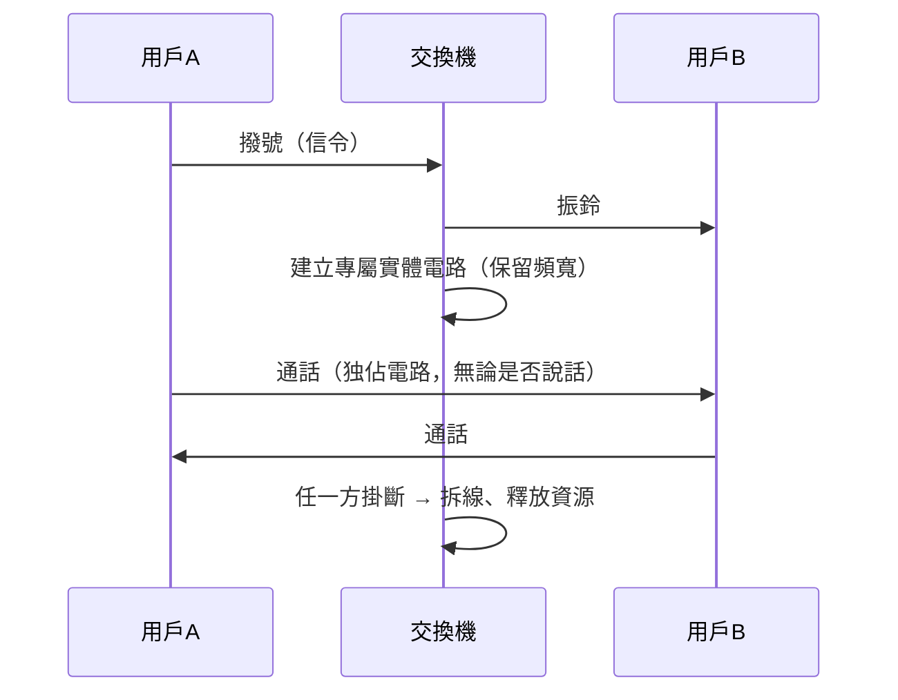

# 1.2 傳統電話網與電路交換（Circuit Switching）：為每一對通話者建立專屬實體線路的低效機制

## 從電報到電話：語音的挑戰

電報傳遞的是離散符號，而電話要傳遞的是連續的聲波。1876 年，亞歷山大·格拉漢姆·貝爾（Alexander Graham Bell）取得電話專利——這個專利後來被稱為「史上最有價值的專利」。貝爾的洞察是：聲音的震動可以轉換成電流的連續變化（類比調變），在導線中傳遞後再還原為聲音。

## 電路交換的誕生：接線生與步進交換機

最早的電話必須**一對一拉專線**：n 個用戶互連需要 $n(n-1)/2$ 條線路，用戶一多便不可行。於是「交換」的概念誕生——用戶只需連到交換局，由**人工接線生**在配線盤上用跳線把兩個用戶的線路實體接通，通話結束後拆線。

1891 年，堪薩斯城的殯葬業者阿爾蒙·斯特羅格（Almon Strowger）因懷疑接線生（競爭對手的親友）故意把生意轉走，發明了**步進制自動交換機**（Strowger switch）。用戶撥號脈衝直接驅動機械式選擇器，自動接通線路——自動化的動機竟然是一樁商業糾紛，這是技術史上著名的插曲。

## 電路交換的本質：專屬資源的建立—使用—拆除

電路交換（Circuit Switching）有三個根本特徵：

1. **資源預先保留**：通話期間，即使雙方沉默不語，電路頻寬也專屬佔用。
2. **固定延遲**：資料沿同一實體路徑依序傳遞，延遲低且穩定——這正是語音最需要的品質。
3. **建立成本高**：撥號建立電路可能需要數秒，不適合突發性的短訊息傳輸。

## 經濟學視角：話務理論與「供不應求」的藝術

丹麥數學家愛爾蘭（Agner Erlang）為哥本哈根電話公司研究話務擁塞，建立排隊論（Queuing Theory）的基礎。電話公司以「中繼線數 × 呼損率」來計算投資：不可能讓所有人同時通話，只需以統計複用（statistical multiplexing）的角度規劃幹線數量即可。

但請注意這個關鍵矛盾：**電路交換在幹線上仍不複用——它只在「撥號需求」上做統計，不在「頻寬使用」上做統計**。人說話時實際只有約 40% 的時間在發聲，其餘時間電路空轉。這個低效，正是半世紀後 Paul Baran 設計封包交換時攻擊的要害。

## 電路交換的深遠影響

- ** reliability 的典範**：電話網提供「五個九」可用性，其 48V 直流饋電、信令系統（後來的 SS7）甚至能在市電中斷時讓家用電話繼續工作。
- **壟斷的溫床**：交換機與幹線的鉅額固定成本，天然傾向規模經濟與壟斷——這直接塑造了 AT&T 帝國（下一節）。
- **數位化的起點**：1962 年貝爾實驗室推出 T1 載波系統，將語音以 8-bit PCM 數位化（每路 64 kbps），24 路複用成一條 1.544 Mbps 幹線——數位傳輸從此進入電信主幹，也為日後電信網與資料網的交會埋下伏筆。

## 小結

電路交換以「為每對通話者建立專屬實體路徑」的方式，提供了近乎完美的語音品質，但也付出了頻寬嚴重浪費、建立緩慢、靈活性低的三重代價。當電腦的突發性資料流量出現時，這個百年範式將遭遇真正的挑戰。
