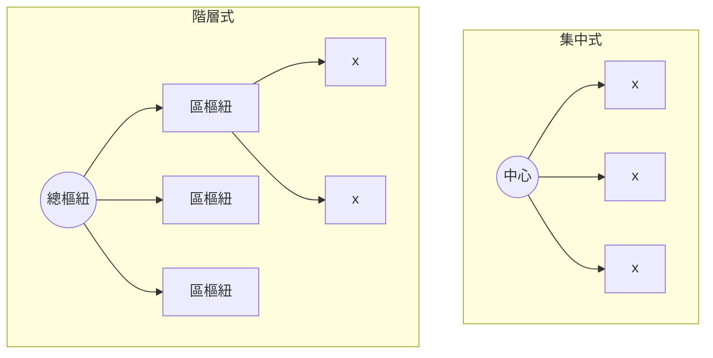

# 2.1 蘭德公司（RAND）的冷戰課題：如何建立一個在核打擊後依然能運作的指揮網路？

## 核陰影下的通訊困境

1957 年 10 月 4 日，蘇聯發射史普尼克一號（Sputnik），那劃過夜空的嗶嗶聲對美國造成巨大的心理衝擊：**敵人的火箭已經能夠飛越海洋**。艾森豪總統在 1958 年成立 NASA 與**國防部高級研究計劃局（ARPA，DARPA 的前身）**，期望以科技奪回主動權。

而在更早的 1950 年代中期，美國戰略思想家們已經面對一個冰冷的問題：如果蘇聯發動核突襲，美軍的指揮通訊系統能否倖存？

## SAGE 系統：半自動地面防空網

美國的第一個回答是 **SAGE（Semi-Automatic Ground Environment）**——用巨型電腦 AN/FSQ-7（每台重 250 噸、耗電 3 MW）彙整雷達資料、指揮攔截機。SAGE 有兩項劃時代的意義：

1. 它是人類第一個**大型即時電腦網路**的原型（雷達站—數據機—中央電腦的即時資料鏈），上一章提到的 Bell 101 數據機正是為它而生。
2. 它培養了一整代「電腦與防空」的人才——後來封包交換的構想，正是在這個圈子裡孕育。

但 SAGE 有致命弱點：它是**階層式星狀架構**，中央節點被毀則全網癱瘓。而當時蘇聯的氫彈威力已足以摧毀任何單一指揮中心。

## RAND 的研究傳統

蘭德公司（RAND Corporation）原是道格拉斯飛機公司 1945 年與陸軍航空隊合作的計畫，1948 年改組為獨立非營利智庫，長期接受空軍資助。RAND 的風格是：**不問「應該如何」，先問「系統的物理與數學極限在哪裡」**。賽局理論、系統分析、馮紐曼的核戰模型，都出自這裡。

1959 年前後，空軍向 RAND 提出一個委託課題，大意是：**能否設計一個通訊系統，讓美國在遭受核打擊後仍有能力下令發動報復？**

## 舊答案的破產

當時所有通訊設計都繼承電報與電話的兩大傳統：

- **集中式（centralized）**：所有線路匯入中心交換局——炸掉中心即全滅。
- **階層式（hierarchical/decentralized）**：地區樞紐再匯入中央——炸掉高層樞紐，整個子樹癱瘓。

數學家們很快算出：上述兩種拓撲在核打擊下的倖存機率都低到不可接受。答案是第三種：**分散式（distributed）**——像漁網或神經網一樣，每個節點與多個鄰居相連，沒有中心，沒有上級，任何節點被摧毀，流量自動繞道。

## 一個更激進的推論

倖存拓撲只是問題的一半。另一半更顛覆：如果節點與線路隨時可能消失，那麼「先建立固定電路再通話」的電路交換就完全不可行——你無法預知哪條路徑會在通話中途消失。通訊必須被拆成能**各自獨立找路**的小單元。

這個推論，交給了 RAND 裡一位正在研究「核戰後通訊」的數學家——**保羅·巴蘭**。他的構想與其英國同行的獨立發明，將徹底改變世界。下一節詳述。
