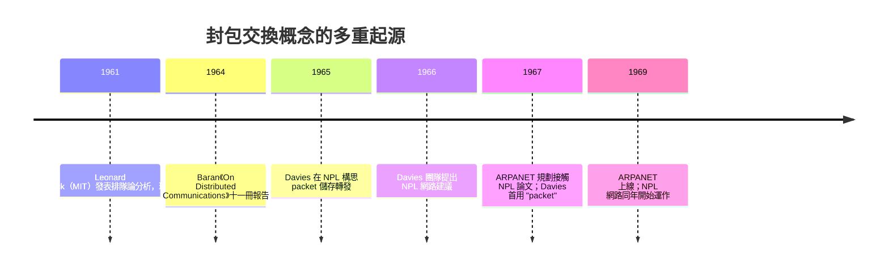

# 2.2 保羅·巴蘭（Paul Baran）與唐納德·戴維斯（Donald Davies）：分散式網路與「封包（Packet）」的概念誕生

## 巴蘭：RAND 地下室裡的異端

保羅·巴蘭（Paul Baran, 1926–2011）生於波蘭，幼年隨家人移民美國。他白天在蘭德公司研究核戰通訊，晚上啃排隊論與通訊理論。1960 年代初，他在 RAND 的報告中構思出一個驚人的方案，並於 **1964 年以十一冊《論分散式通訊》（On Distributed Communications）系列報告**公開發表。

### 巴蘭的三個核心概念

1. **分散式拓撲**：每個節點連接多個鄰居（他建議平均 3–4 條連線），無中心、無階層，最低連通度設計使網路在任意多節點損毀下仍大概率保持連通。
2. **訊息區塊化（message blocks）**：把任何訊息切成固定大小的小塊，每塊帶上目的地位址，像寄明信片一樣個別投遞。節點像「熱馬鈴薯」（hot-potato routing）一樣盡快把塊往某個可行方向丟出。
3. **儲存轉發（store-and-forward）**：中繼節點先收到整塊、檢查、再轉發——每個節點都是一台小型電腦（他稱之為「分散式通訊電腦」）。

巴蘭選用的詞是 "message block"（訊息塊），他也曾自嘲式地想過用「明信片」這個比喻。**「封包（packet）」這個名字其實來自英國**。

## 戴維斯：NPL 的獨立發明

在大西洋彼岸，英國國家物理實驗室（NPL）的**唐納德·戴維斯（Donald Davies, 1924–2000）**——戰時曾在倫敦帝國學院聽過圖靈的課、並參與過 ACE 電腦計畫——於 1965 年前後為解決**分時電腦網路互連**的問題，獨立想出了同樣的構想：把資料切成小塊、在節點間儲存轉發。

戴維斯給這個小塊取了名字：**packet（封包）**。他的同事 Roger Scantlebury 在 1967 年的 ACM 論文中首次公開了 NPL 的設計，而恰好在場的 ARPANET 規劃者把這份論文帶回了美國。歷史在此交會：

## 三位奠基者的分工

| 人物 | 貢獻 | 性格與處境 |
|---|---|---|
| **Leonard Kleinrock**（MIT/UCLA） | 以排隊論證明封包交換的數學可分析性；日後主導第一個節點測量 | 理論家，提供學術正當性 |
| **Paul Baran** | 冷戰倖存動機、分散式拓撲、區塊化通訊的完整工程設計 | 智庫工程師，最初動機是核戰 |
| **Donald Davies** | 命名 "packet"、NPL 網路實作、用數據證明小封包效率 | 國家實驗室科學家，動機是分時電腦互連 |

三個獨立起源、三種動機（核戰、理論、電腦科學），指向同一個結論——這是典範轉移的經典劇本：**時機成熟，想法必然湧現**。

## 為什麼封包交換優於電路交換？（工程視角）

- **統計複用**：突發流量互相填補彼此的空隙，同樣的幹線頻寬可承載數倍話務。巴蘭估計：傳統方案需要大量備援電路，封包網路可以少用一半以上的線路。
- **抗毀性**：無固定路徑，節點/線路損毀時封包自動改道。
- **錯誤恢復**：單塊損壞只需重傳該塊，而非整條通話。
- **成本曲線**：1960 年代數位積體電路價格暴跌，使「每個節點都放一台小電腦」從天方夜譚變成合理投資——**摩爾定律是封包交換的經濟基礎**。

## 為什麼封包交換不適合語音？（當時的合理疑慮）

儲存轉發會引入**可變排隊延遲**（jitter），對 1960 年代的語音品質而言近乎災難；加上早期節點電腦記憶體極小、轉發速度有限，電信工程師的懷疑並非愚昧，而是專業。這場「電信 vs 電腦」文化的衝突，下一節將展開。

## 小結

封包交換誕生於冷戰的恐懼、分時電腦的需求與排隊論的數學三者交會處。它不是某一個天才的靈光，而是三個人在三個國家、三種動機下的殊途同歸。1969 年，這個構想將被 ARPA 付諸實現。
