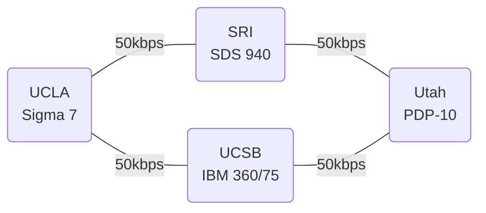

# 3.1 美國國防部高級研究計劃局（DARPA）的野心：連接 UCLA 與史丹佛研究中心的主機

## 從 Sputnik 恐慌到 ARPA

1958 年 ARPA 成立之初，肩負太空與飛彈重任，但 NASA 於同年成立後拿走了太空任務，ARPA 一度陷入「無所事事」的尷尬。它的救贖來自一位怪傑式的局長心態：**資助高風險、高報酬、無短期軍事用途的基礎研究**。

1962 年，心理學家**約瑟夫·利克萊德（J. C. R. Licklider）**接掌 ARPA 的「指揮控制研究」（CC）部門。這位前 MIT 教授寫過一篇改變歷史的論文：**《人機共生》（Man-Computer Symbiosis, 1960）**，並提出了「**星際網路（Intergalactic Computer Network）**」的願景——把全國所有研究電腦連成一體，人人可即時存取彼此的資料與程式。

Licklider 的三項遺產：

1. **願景**：網路的目的是「人的溝通」，不是機器效率。
2. **資金模式**：ARPA 以合約資助大學實驗室，不干涉細節、只押注聰明人——後世稱之為「ARPA 模式」。
3. **人才網**：他資助的 MIT Project MAC、史丹佛 SRI、UCLA、猶他大學等實驗室，日後成為 ARPANET 的第一批節點。

## IPTO 與「Resource Sharing」的正當性

Licklider 之後，IPTO（資訊處理技術處）歷任主管持續推動連網。1966 年接掌 IPTO 的**勞倫斯·羅伯茨（Larry Roberts）**——MIT 林肯實驗室出身、做過分時實驗——把目標具體化為「**資源共享（resource sharing）**」：

> 各大學用 ARPA 經費買了互不相容的昂貴電腦，每台利用率只有幾個百分點。與其每校各買一台，不如用網路共享——這在預算聽證會上是完美的理由。

**政治經濟學**在此起了關鍵作用：封包交換網路不是以「未來的網際網路」的名義獲得資金，而是以「省錢共享電腦」的名義。1970 年代國會聽證會上，羅伯茨靠這套論述一次次擋下預算刪減。

## 1967 年：計畫定案

1967 年 10 月，在密西根州蓋洛德的 ACM 研討會上，羅伯茨公開 ARPANET 設計方案。會議上的兩個關鍵輸入：

1. **NPL 團隊（Davies/Scantlebury）**指出 ARPANET 原設計主機直接互連的問題，並介紹了 packet 與儲存轉發——促成了「主機不直接承擔網路功能」的架構修正。
2. **Wesley Clark** 建議：在每台主機與網路之間放一台專用小型電腦處理通訊——這就是 **IMP（Interface Message Processor）**的由來（下一節詳述）。

## 第一批節點的選定

1968 年底 ARPA 發出 IMP 招標，由 BBN（Bolt Beranek and Newman，劍橋的一家聲學研究公司，卻養了一群頂尖電腦人才）得標。首批四個站點的選擇兼顧了學術實力與硬體相容性：

| 節點 | 機構 | 主機 | 意義 |
|---|---|---|---|
| 1 | **UCLA**（加州大學洛杉磯分校） | SDS Sigma 7 | Kleinrock 的網路測量中心 |
| 2 | **SRI**（史丹福國際研究所，門洛公園） | SDS 940 | Engelbart 的「增智研究中心」，NLS 系統 |
| 3 | UCSB（加州大學聖塔芭芭拉） | IBM 360/75 | Culler-Harr 互動數學系統 |
| 4 | University of Utah（猶他大學） | DEC PDP-10 | 圖形學重鎮（衍伸出 Evans & Sutherland） |

注意：**「史丹福研究中心」即 SRI International**，當時位於門洛公園，並非史丹福大學本身。四個節點分散在加州與猶他，用 50 kbps 專線相連——速度不到今日家寬的百分之一。

## 小結

ARPANET 的誕生是**軍事需求（冷戰）、官僚智慧（資源共享論述）、學術理想（Licklider 的人機共生）與工程天才（Roberts 的整合）**四股力量的交會。1969 年夏天，第一台 IMP 將抵達 UCLA，歷史上第一個封包交換網路即將點火。
