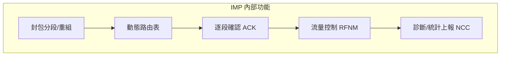

# 3.3 介面訊息處理機（IMP）：世界上第一代路由器（Router）與節點硬體的誕生

## Wesley Clark 的關鍵建議

1967 年 ARPANET 方案討論時，華盛頓大學的**Wesley Clark**（LINC 電腦的發明者）提出了一個決定性的架構洞見：

> **不要讓每台研究主機自己處理網路通訊。** 在主機與網路之間放一台專用小型電腦，所有通訊任務（分段、繞路、重傳、確認）都交給它。

理由極為務實：

1. 全國十幾台異質大型主機（Sigma 7、IBM 360、PDP-10、GE 645……），不可能逐一改寫其作業系統來跑通訊。
2. 通訊需要**即時**回應（封包到達就要處理），而分時大型主機忙於研究任務，根本不可靠。
3. 把「網路」與「主機」解耦，網路才能獨立演進——這正是**分層思想**在硬體上的第一次具體化。

ARPANET 由此定下千年架構：

```
[主機 Host] ←→ [IMP] ←通訊線路→ [IMP] ←→ [主機 Host]
```

**Host-to-IMP 的分工**，實質上就是今日 TCP/IP 分層中「應用/傳輸」與「網路層」的物理投影；IMP 就是**路由器（Router）**的直系祖先。

## BBN 得標：一家聲學公司怎麼贏的

1968 年底 ARPA 招標。出人意料，得標的是 **BBN（Bolt Beranek and Newman）**——一家以聲學與心理學研究聞名的劍橋顧問公司。但它藏著一群被 Licklider（他本人後來任職 BBN）吸引來的電腦天才，如 Frank Heart、Bob Kahn、Severo Ornstein、Will Crowther。

BBN 提案勝出的關鍵：

- **務實的硬體選擇**：選用 Honeywell DDP-516 軍規小型電腦（16-bit、24 KB 記憶體），堅固、便宜、即時性佳。
- **詳盡的軟體設計**：以組合語言寫成、嚴格即時排程、每個細節都有數據支撐。
- **承諾營運**：BBN 不只交機，還在劍橋設立 **NCC（網路控制中心）**，24 小時監看整個網路——這是世界第一個網路營運中心（NOC）。

## IMP 的工程設計

一台 IMP 約一個冰箱大小（Honeywell DDP-516），功能包括：

- **封包轉發**：以「最短路徑估計」動態繞路，路徑表由各 IMP 互相交換延遲資訊更新（距離向量路由的祖先）。
- **儲存轉發與確認**：相鄰 IMP 之間逐段確認（hop-by-hop ACK），壞包自動重傳。
- **流量控制**：封包緩衝區有限，目的地 IMP 拒收時上游暫停發送（RFNM 機制），防止目的端被灌爆——這是擁塞控制的最早實作。
- **心跳與自我診斷**：定時交換存活訊號，故障 IMP 自動被繞開。

BBN 的工程鐵律是「**永不當機**」：他們宣稱 IMP 的可用性目標是「比電話網更可靠」。事實上，整個 ARPANET 歷史上 IMP 硬體的意外宕機極為罕見，多數故障來自線路與軟體。



## 從 IMP 到 PSN 到路由器

ARPANET 的 IMP 演化樹，幾乎就是路由器的族譜：

1. **1970 年代**：BBN 為電信業與國際客戶改造 IMP 為商用分封交換機（後來的 X.25 服務基礎）。
2. **1980 年代**：TCP/IP 時代，思科（1984 年創立）以「在史丹福校園把兩個不同協定的網路接起來」的多協定路由器起家——但核心概念仍是 IMP 的「專用機器幫主機轉發封包」。
3. **今天**：從 1G 核心路由器到資料中心白盒交換機，控制平面與轉發平面分離、動態路由、逐段確認、擁塞控制——**全是 IMP 在 1969 年定下的骨架**。

## 意外的遺產：IMP 組裝的「開源精神」

BBN 工程師 Will Crowther 在做 IMP 軟體之餘，寫了一個文字探險遊戲 **Colossal Cave Adventure（1976）**——史上第一個冒險遊戲，隨 ARPANET 傳播，催生了整個 MUD 與電玩冒險類型。網路不僅傳遞資料，它**必然**承載文化——這個規律從第一天就成立。

## 小結

IMP 證明了「把網路做成一台專用機器」的可行性，也留下了現代路由器與網路營運的全部範式。但 IMP 之間說的是 ARPANET 專屬的語言；當更多網路出現時，網路與網路如何互連？這個問題，將由 Bob Kahn 與 Vint Cerf 以 TCP/IP 回答——下一章。
