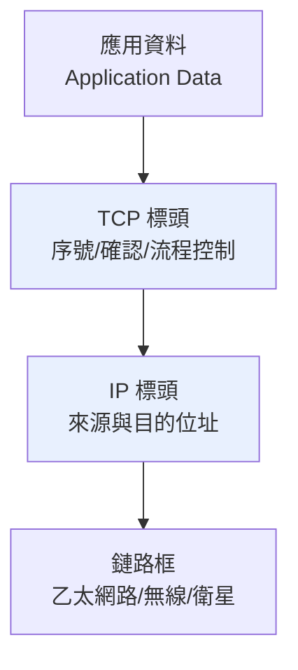

# 4.2 1974 年劃時代論文：TCP/IP（傳輸控制協定 / 網際協定）的分層封裝哲學

## 1974 年 5 月：〈A Protocol for Packet Network Intercommunication〉

1974 年 5 月，**Vinton Cerf 與 Robert Kahn** 在 IEEE Transactions on Communications 發表論文《A Protocol for Packet Network Intercommunication》。這篇不到二十頁的論文，描繪了日後覆蓋全球的網際網路藍圖。

### 論文的三個革命性主張

1. **閘道器（Gateway）特殊化**：網路之間用「閘道器」相連。閘道器只做一件事——**重新封裝（encapsulate）**：把 A 網路的封包拆開，套上 B 網路的格式再送出。閘道器不需要理解應用內容，因此任何網路都能接。
2. **端到端的共同協定**：兩端主機跑一個共同協定（最初叫 **TCP**），對全路徑的可靠性、排序、流量控制負責。中間網路只須「盡力而為」。
3. **統一命名**：每台主機有**全網唯一的識別名**（後來成為 IP 位址），讓封包能跨網路被路由。

## 分層封裝：從一個想法到一座大教堂

論文核心的「封裝」思想，可用今日的分層模型表述：

每一層只跟對方的**同層**說話：

- **鏈路層**：管「這一跳」的物理傳輸（乙太網、無線、衛星各不相同）。
- **網路層（IP）**：管「跨網路」的路由與定址——**唯一被規定要全球統一的層**。
- **傳輸層（TCP/UDP）**：管「端到端」的可靠傳輸、排序與擁塞控制。
- **應用層**：各應用自訂（郵件、檔案、登入……）。

### 分層的四個好處

1. **解耦**：光纖、Wi-Fi、衛星任憑更換，IP 之上應用不變；應用推陳出新，底層不必重寫。
2. **可組合**：新應用只要遵守 TCP/IP 即可上網，無須改動網路本身——這就是「許可自由（permissionless innovation）」的制度根源。
3. **可演進**：各層獨立升級。五十年間 IP 從 v4 到 v6、鏈路從 50 kbps 專線到 400G 光纖、應用從 Email 到短影音——**分層是網際網路能活五十年而未重寫的根本原因**。
4. **政治可談判**：國際標準組織只需在各層各自協商，避免「一次性解決所有問題」的談判崩潰。

## 1978 年：TCP 與 IP 分家

原始設計把「網際功能」與「可靠傳輸」合在同一個 TCP 裡。1975–1977 年的三個網路（ARPANET、SATNET、PRNET）互連實驗暴露出問題：

- 某些網路（衛星、無線）需要**不同的確認與超時策略**，若都塞在 TCP 中，協定會無限膨脹。
- Danny Cohen 等人提出：**語音這類即時應用不需要可靠重傳**（包丟了就丟了，重傳反而更糟），需要一個「不可靠但快」的選項。

於是 1978 年版本將架構拆為：**IP（網際協定）**與 **TCP（傳輸控制協定）**，並增加 **UDP**（用戶資料報協定）。這次「分家」是協定史上最漂亮的工程判斷——**它為即時多媒體預留了生存空間**，三十年後的 VoIP、視訊、串流全部受益。

## OS 模型 vs TCP/IP：兩種世界的對照

1984 年 ISO 公布 **OSI 七層參考模型**，作為官方法定標準；TCP/IP 則是工程社群的「事實標準」：

| | OSI（法定標準） | TCP/IP（事實標準） |
|---|---|---|
| 誕生方式 | 政府間委員會先定模型再定協定 | 先有能跑的程式碼再歸納模型 |
| 層數 | 7 層 | 4 層（鏈路/網路/傳輸/應用） |
| 推動者 | ISO、各國電信當局 | ARPA、大學、工程師社群 |
| 結局 | 協定本身式微，模型成為教學語言 | 統治全球 |

1980 年代後期，各國政府（含美國聯邦 GOSIP、英國、日本）曾立法要求採用 OSI，一場「法定標準 vs 事實標準」的戰爭打了近十年。**1990 年代，TCP/IP 以「能跑、免費、開放」完勝**——這是「粗共識、可運作程式碼」文化對官僚標準體系的又一次勝利。

## 小結

1974 論文真正的發明，不是「封包」也不是「路由」，而是**一個可持續演進的治理結構**：分層使任何創新只需替換一層；端到端使網路不需中央許可；閘道器使任何網路都能加入。這三件事共同構成了「網際網路」與「眾多專有網路」的分水嶺。
