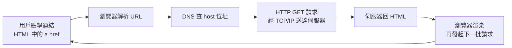

# 5.1 CERN 歐洲核子研究組織的超文本（Hypertext）需求：HTTP、HTML 與 URL 的三重發明

## 從 Gopher 到 CERN：為什麼是 1989 年的日內瓦？

1980 年代末，網際網路（TCP/IP 層）已經穩定運作，但「上網」對普通人仍然近乎玄學：要會用 FTP 抓檔案、Telnet 登入、Archie 搜尋、讀 Newsgroup。同時出現過幾個「更好的介面」嘗試：

- **WAIS**（Thinking Machines，全文檢索），
- **Gopher**（明尼蘇達大學，1991，選單式文件導航）——Gopher 一度是最有希望勝出的「平民網路介面」。

歷史的轉折發生在日內瓦的 **CERN（歐洲核子研究組織）**，原因是三個獨特條件的交會：

1. **規模**：CERN 是全球最大物理實驗室，數千名來自幾十國的物理學家輪轉進出，資訊格式混亂、文件遺失極嚴重——「找資料」是每天的真實痛點。
2. **硬體**：CERN 是 NeXT 電腦的重要用戶（NeXTstep 內建物件導向環境與 Objective-C，開發效率極高）。
3. **人**：一位來自英國、在牛津做過「以超文本連結隨機聯想」研究的軟體工程師——**Tim Berners-Lee**。

## 1989 年 3 月：一份被主管寫上「模糊但振奮」的備忘錄

**1989 年 3 月**，Berners-Lee 向 CERN 提交提案《Information Management: A Proposal》，提出用「超文字（hypertext）」連結全實驗室的文件與人員。他的主管 Mike Sendall 在封面上寫下管理史上最著名的批註：

> **「Vague, but exciting.」（模糊，但令人振奮。）**

這句話本身就是 ARPA 模式的縮影——**不要求提案完美，只要求方向有趣**。

## 三重發明：URL、HTTP、HTML

1989–1991 年間，Berners-Lee 與比利時同僚 **Robert Cailliau** 推動專案，一次發明三件互相咬合的東西：

### 1. URL／URI（統一資源定位符）

`http://host/path` 形式的**全域定址方案**。這是三發明中最深刻的一個：它讓「任何文件」在概念上獲得了一個**全球唯一且可引用的位址**——學術引用、書籤、超連結全部建立在它之上。網頁之所以能「互相連結」，是因為每一頁都有名字。

### 2. HTTP（超文字傳輸協定）

一個**極簡的應用層協定**（第一版只有幾行文法）：客戶端發 `GET /path`，伺服器回文件。設計哲學：

- **無狀態（stateless）**：每次請求獨立，伺服器不記憶前一次——簡單、易擴展、易做負載均衡。
- **文本協議**：人類可直接用 Telnet 除錯——降低了採用門檻。
- **跑在 TCP 80 埠**：直接借用現成網際網路基礎設施，不需要鋪任何新線路。

### 3. HTML（超文字標記語言）

以 **SGML** 為基礎的極簡標記語言，核心標籤只有十幾個（`<title>`、`<h1>`、`
`、`<a href=...>`……）。其偉大之處在於**寬容**：標籤打錯也盡量顯示——這讓完全不懂電腦的科學家也能寫網頁，是「粗共識、寬容解析」原則在應用層的勝利。

## 1991 年 8 月：alt.hypertext 上的公開信

1990 年底，第一個瀏覽器/編輯器（WorldWideWeb，跑在 NeXT 上）與第一個伺服器（httpd）在 CERN 運作；第一個網站 `info.cern.ch` 上線。**1991 年 8 月 6 日**，Berners-Lee 在 Usenet 討論群 `alt.hypertext` 發帖，向全世界宣告：

> "The WorldWideWeb (WWW) project aims to allow links to be made to any information anywhere... **Try it**: `http://info.cern.ch/`"

這則 Usenet 貼文，是萬維網向人類的正式自我介紹。

## 小結

萬維網的誕生不是單一發明，而是 **URL + HTTP + HTML 的三位一體**：URL 給文件名字，HTML 給文件身體，HTTP 給它們之間跑的路。下一節我們將看到：Berners-Lee 做出的另一個選擇——**放棄專利**——如何讓這三件發明真正成為全人類的資產。
