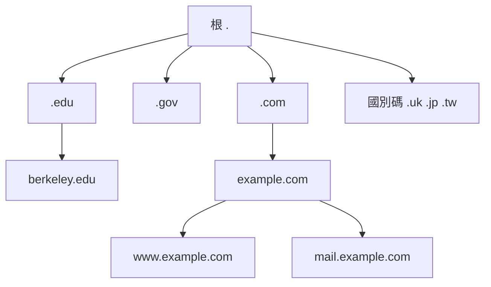

# 6.1 從 HOSTS.TXT 到 DNS 樹狀域名：保羅·莫卡派特里斯（Paul Mockapetris）如何解決記憶 IP 的痛苦？

## 手工時代：HOSTS.TXT 的末日

1970–80 年代初，讓電腦「知道別人的名字」的方式極其原始：史丹福研究院（SRI-NIC）維護一個純文字檔 **HOSTS.TXT**，記錄全網所有主機的名字與 IP 位址。每台電腦定期抓取整份檔案。

這個方案有三個致命傷：

1. **單點**：全世界只有 SRI 一台主機是權威。
2. **線性**：主機從幾十台漲到數百台、數千台，檔案越來越大，且**每次改名都要等 SRI 更新、全網同步**。
3. **政治**：名字衝突、搶註、維護者過勞——1980 年代中期，HOSTS.TXT 已明顯瀕臨極限。TCP/IP 大轉向（1983）帶來的主機爆發，讓它一夜崩潰。

## 1983：Mockapetris 的樹

1983 年，南加州大學資訊科學研究所（USC ISI）的 **Paul Mockapetris** 設計出**域名系統（Domain Name System, DNS）**，並寫下 RFC 882/883（後由 RFC 1034/1035 取代）。核心思想：**以樹狀層級 + 分散式資料庫 + 委派機制**，取代單一文字檔。

### 五個天才設計

1. **層級命名**：`www.example.com.` 從右往左逐級縮小範圍——名字本身攜帶了「該問誰」的路線圖。
2. **委派（delegation）**：根伺服器不管 `example.com` 的細節，只告訴你「問 `.com` 的伺服器去」；`.com` 再指向該域的權威伺服器。**管理權隨著命名權層層下放**——這是把聯邦制寫進協定。
3. **快取與 TTL**：查詢結果在沿途快取一段時間（Time To Live），根伺服器因此不必承載全網流量。
4. **多種紀錄類型**：A（位址）、MX（郵件主機）、NS（域名伺服器）……DNS 從一開始就不只是「名字→IP」，而是一個通用的分散式資料庫。
5. **UDP 之上的簡單查詢**：單次查詢用 UDP，快而輕；必要時降級用 TCP。

1984–85 年，DNS 實作上線（JEEVES、後來的 BIND），`*.com` 等頂級域名開始註冊——第一個 `.com` 註冊者是 1985 年 3 月的 **symbolics.com**（Symbolics 電腦公司），至今仍在。

## 治理的演化：從一個人到 ICANN

DNS 技術解決了「名字衝突」，但「**誰有權分配頂級域名與根伺服器**」成為新的政治問題：

- **1980–90 年代**：IANA 由 **Jon Postel** 一人（USC ISI）近乎「一人治理」地維護——包括根區檔案與埠號分配。學術圈的信任取代了法律合約。
- **1990 年代末商業化壓力**：Network Solutions 獨家壟斷 `.com` 註冊（每域名 35 美元），利益衝突爆發；同時多國政府對「美國一家機構管全球根」高度不滿。
- **1998 年**：美國商務部主導成立 **ICANN**（網際網路名稱與數字分配機構），以非營利多利益方組織接管 IANA 功能與域名政策。
- **2016 年**：美國正式將 IANA 職能移交國際多方社群——「美國單一管理」時代結束。

## DNS 的後續演化

- **DNSSEC**（1997 起標準化、2010 年代根區簽署）：以數位簽章防堵 DNS 汙染與劫持——對「查詢結果可信」的補課。
- **新型頂級域名**（2013 年起，.shop、.app、.xyz 等上千個）：域名資源商品化。
- **DNS over HTTPS/TLS（DoH/DoT）**：查詢本身加密，對抗中間監看——也引發「加密 DNS 讓誰看見流量」的新治理爭議。

## 小結

DNS 用「樹 + 委派 + 快取」三件套，把一台主機的負擔變成全世界的自願協作。它同時是工程奇蹟與政治妥協：技術上無中心，治理上卻始終繞不開根伺服器與頂級域名的主權之爭。下一節，我們看 IP 位址本身的枯竭危機，以及 ICANN 時代的定址政治。
