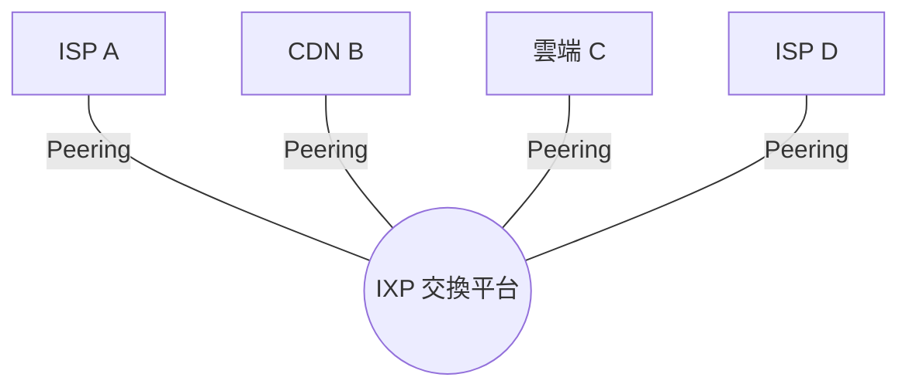

# 6.3 跨國海底光纖（Subsea Fiber Cables）與網路交換節點（IXP）：全球數據流量的物理動脈

## 「雲」的真相：它在海底

雲端運算的行銷意象飄在天上，事實卻沉在海底：**全球約 95% 以上的洲際數據流量，走的是海底光纖電纜**——衛星（包括 Starlink）目前只承擔極小部分。截至 2020 年代中期，全球約有 500 條以上現役海纜，總長超過百萬公里，足以繞地球數十圈。

## 技術史：從銅纜到單波 100G

| 年代 | 技術 | 容量 |
|---|---|---|
| 1866–1956 | 同軸/電纜電報 | 每秒數十~數百字元 |
| 1956 | TAT-1（跨大西洋**電話**同軸電纜） | 36 路語音 |
| 1988 | **TAT-8**：第一條跨大西洋**光纖**海纜 | 約 280 Mbps（4 萬路語音） |
| 1990s | EDFA 光纖放大器 + WDM 分波多工 | Gbps 級 |
| 2000s– | 相干光通訊、100G/400G 單波 | 每對光纖數百 Tbps |

兩個關鍵發明值得銘記：

1. **摻鉺光纖放大器（EDFA, 1987）**：光訊號不再需要「光→電→光」轉換即可在海中放大——深海中繼器因此簡化到近乎無源，海纜壽命長達 25 年。
2. **WDM（波分複用）**：一根光纖同時跑數十~上百個不同顏色的光波長，每個波長都是獨立通道——**頻率複用思想在光域的重演**。

## 經濟與政治：誰鋪海纜，誰就擁有流量

- **1990 年代**：海纜由電信聯盟（consortium）共同出資，dot-com 泡沫期狂鋪（如 360networks、Global Crossing），泡沫破裂後頻寬價格暴跌——這是上一章說過的「過度建設遺產」。
- **2010 年代起**：**內容巨頭親自下海**。Google、Microsoft/Meta、Amazon 出資或獨資鋪纜（Google 自 2008 年起投資數十條，如 Curie、Dunant；Meta 的 2Africa 為史上最長海纜之一）——**雲端廠商把「骨幹」垂直整合進自己的版圖**，海纜從公共運輸變成戰略資產。
- **地緣政治**：海纜登陸站（cable landing station）所在國握有「剪線」的最終權力；台灣、關島、馬爾他、吉布地等節點成為戰略要地。2018 年起，美國以國安審查（FCC Team Telecom）否決多條連接香港的海纜路線——**海底電纜已重演十九世紀帝國電報網的政治學**。

## IXP：網路的「路口」

光有骨幹不夠——流量在**哪裡**交換，決定了延遲與成本。**網際網路交換中心（Internet Exchange Point, IXP）**是讓數百家 ISP/CDN/雲端在同一機房用一台以太網交換機**免費對等互連（peering）**的物理場所。

- **没有 IXP 的世界**：A 的用戶連 B 的伺服器要繞經第三國的轉接商（transit），又貴又慢。
- **有 IXP 的世界**：本地流量本地交換，延遲從數百毫秒降到個位數毫秒。

歷史關鍵案例：

- **AMS-IX / LINX / DE-CIX**（阿姆斯特丹、倫敦、法蘭克福）：1990 年代歐洲 IXP 三傑，使歐洲不再依賴美國轉接，歐洲網際網路成本大降。
- **IXP 作為發展工具**：肯亞 2009 年首條海纜登陸 + 本地 IXP，國際頻寬成本暴跌、本地延遲從 800ms 降到 10ms 級——**一個 IXP 的經濟效果勝過千言萬語的援助**。
- **CDN 的崛起**：Akamai（1998）、Cloudflare 等以「把內容搬近用戶」為業，本質上是對「光速有限」的商業回應。

## 脆弱性：人類最脆弱的基礎設施

海纜只有花園水管粗細，卻承載全球經濟：

- **錨與漁船**是頭號殺手（每年上百起故障），鯊魚咬纜、地震（如 2006 年台灣恆春地震切斷多條亞洲海纜，東亞網路癱瘓數週）次之；
- **單一登陸站依賴**：某些島國只有一條海纜，一次船錨事故即全國斷網；
- **間諜與破壞**：冷戰時美軍曾打撈蘇聯海纜竊聽（Operation Ivy Bells）；今日海底「灰色行動」已成公開擔憂。

## 小結

海底光纖是數位時代的跨洋鐵路，IXP 是它的十字路口。它們提醒我們：**網際網路不是虛擬的，它建立在極少數物理瓶頸之上**——這既是工程成就，也是系統性風險。下一篇，無線電波將把網路從桌面上解放出來。
