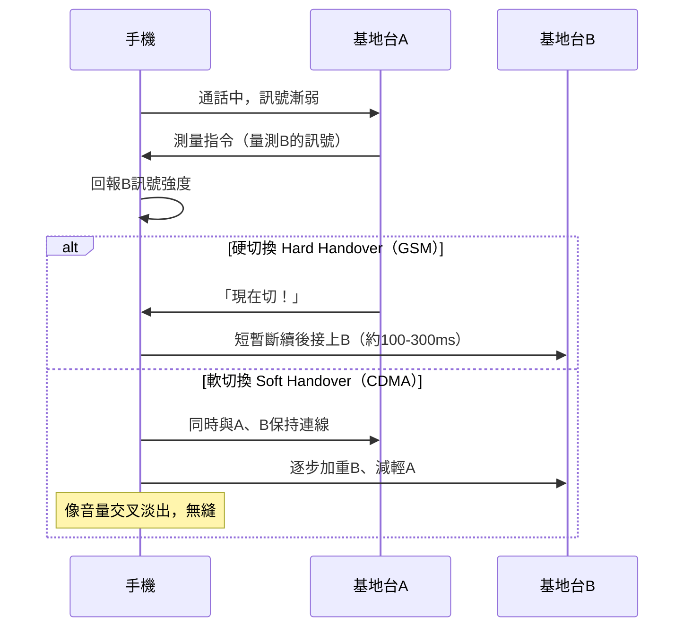

# 7.3 移動路由與基地台手遞手（Handover）技術：高鐵上如何保持網路連線不中斷？

## 問題的本質：節點在動，網路不動

有線網路的世界裡，每台機器的位置是固定的，路由表可以慢慢收斂。但手機（或高鐵上的你）以每秒數十~上百公尺移動，每幾秒就越過一個基地台的涵蓋邊界。網路必須回答兩個問題：

1. **切換（Handover/Handoff）**：通話或傳輸進行中，如何從基地台 A 無縫轉到基地台 B？
2. **移動管理（Mobility Management）**：跨城市、跨國移動時，別人怎麼「找到」你、封包怎麼「跟著」你走？

## 切換的兩大流派：硬切與軟切

- **硬切換（Hard Handover）**：先斷後接（break-before-make）。GSM 採用，實作簡單但會有一瞬中斷——通話時那一聲「咔」就是它。
- **軟切換（Soft Handover）**：先接後斷（make-before-break）。CDMA 家族（3G）採用，手機同時連多個基地台，像 DJ 交叉淡出——代價是資源開銷大。
- **4G LTE**：回到「硬切換為主」，但以**快速量測回報 + 隨機存取前置 + 資料前轉（data forwarding）**把中斷壓到數十毫秒以下——配合 VoLTE，通話幾乎無感。

### 切換決策的工程學

何時切、切去哪，是「調度藝術」：

- **滯後（hysteresis）**：鄰站訊號要**超出**當前站一定 dB 才切，避免在邊界來回震盪（乒乓效應 ping-pong）。
- **速度感知**：高鐵（300 km/h）需要提前、大幅的切換閾值調整；2G/3G 時代鐵路沿線曾為此專門優化網路參數。
- **負載平衡**：5G 引入讓「擁擠的小站」與「空曠的大站」協同的切換策略，兼顧訊號與負載。

## 移動管理的分層答案

切換只解決「這一秒」，跟著你跨城市走的是另一套機制，且分層演進：

1. **2G/3G：電信自己解**——HLR/VLR（歸屬/拜訪位置暫存器）資料庫記錄你人在哪個位置區（Location Area），來話時「尋呼（paging）」全區找你。**這是「跟人找路」的電話網思維**。
2. **4G：MME + 跟蹤區**——同思路的 IP 化版本；同時通訊協定層新增 **PMIP/GTP** 隧道，讓你的 IP 位址在移動中保持不變（錨定在 home gateway）。
3. **網際網路層：Mobile IP** 與 **HIP**——IETF 的答案：家鄉代理（home agent）轉發、隧道封裝。學理優雅，商業上則大多被電信方案與應用層取代。

## 應用層的自救：斷線重連與內建冗餘

實務上，高鐵體驗的品質一半靠無線層、一半靠**應用設計**：

- TCP 在快速移動中頻繁換路徑，擁塞控制容易誤判而降速——**MPTCP（多路 TCP）、QUIC 的連線遷移（connection migration，以連線 ID 取代四元組）**應運而生：IP 變了，會話不斷。
- 串流 App 以「緩衝 + 自適應碼率（HLS/DASH）」吸收切換瞬間的抖動。
- 這再次印證**端到端哲學**：網路做不到的，端點聰明地補上。

## 高鐵上的額外物理難題

移動網路在高鐵上還有三重物理加成難度：

1. **都普勒頻移**：300 km/h 時 2 GHz 訊號偏移可達數百 Hz，接收機必須動態校正頻率。
2. **快速穿過小區**：市區基地台密、小區小，列車每數秒過一個站——切換頻率是步行的百倍。
3. **車廂屏蔽**：金屬車體 + 鍍膜玻璃像法拉第籠，訊號衰減 20–30 dB。因此 5G 時代出現「車載中繼/直放站」與鐵路專用頻譜（如 GSM-R 的演進 FRMCS）。

## 小結

Handover 是「移動」這件事送給網路工程的終極考題：物理層的無縫接力、移動管理的位址追蹤、應用層的容錯重連，三層合奏才有「在 300 公里時速下看 4K 影片」的日常奇蹟。下一篇，我們轉向資料中心——當伺服器不再在地面上移動，網路的革命換了一個戰場。
