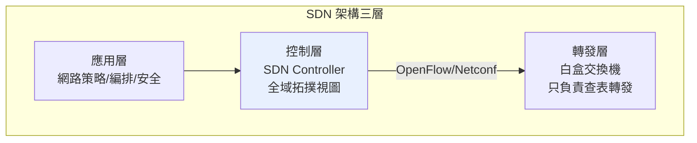

# 8.2 OpenFlow 與軟體定義網路（SDN）：將控制平面（Control Plane）與數據平面（Data Plane）徹底分離

## 概念革命：網路的「腦」搬出盒子

傳統路由器/交換機是「**身心合一**」的盒子：

- **控制平面（Control Plane）**：思考——跑路由協定（OSPF/BGP）、算路徑、建轉發表；
- **數據平面（Data Plane）**：行動——高速查表、轉發封包（ASIC 硬體加速）。

兩者被專有韌體**焊死在同一台盒子裡**。SDN（軟體定義網路）的核心主張只有一句話：

> **把控制平面從每台設備中抽出，集中到一台（或一組）可程式化的控制器；設備退化為只管快速轉發的「白盒」，靠開放協定（OpenFlow 等）聽從控制器的指令。**

三個關鍵詞：

1. **集中控制（Centralized Control）**：控制器握有全網拓撲與流量視圖——「以全知換取最優決策」。
2. **可程式化（Programmability）**：網路行為由軟體定義，配置可版本控制、可測試、可自動化——網路工程終於可以 DevOps。
3. **開放介面（Southbound：OpenFlow；Northbound：REST API）**：硬體與控制軟體解耦，打破供應商鎖定。

## OpenFlow：一個簡單到近乎大膽的協定

2008 年，史丹福 **Nick McKeown**、**Martin Casado** 等人發表論文《OpenFlow: Enabling Innovation in Campus Networks》。設計極簡：

- 交換機維護**流表（flow table）**，每條規則是「匹配欄位（二/三/四層任意組合）→ 動作（轉發到某埠／丟棄／送控制器）」；
- 首包不匹配時送控制器，控制器下發規則；
- 規則老化與逾時由控制器管理。

**「比傳統路由協定簡單一百倍」正是它的殺傷力**：硬體廠商只需在既有 ASIC 上加一個「流表 + 到控制器的通道」，就能支援——低實作門檻讓生態快速起飛。OpenFlow 由 **ONF（Open Networking Foundation，2011，Google/微軟/雅虎/德意志電信等共組）**託管標準化。

## Google B4：SDN 的成年禮

理念要靠實績背書，最有力的一擊是 **Google B4 廣域網（2013 年 SIGCOMM 論文公開）**：

- 連接全球資料中心的私有骨幹，以 OpenFlow 白盒交換機＋自研控制器（Paxos 分散式控制）構建；
- 成果：鏈路利用率從傳統網路的 30–40% 提高到**接近 100%**，等效於「省下三分之二的線路投資」；
- Google 隨後把資料中心內部網路 Jupiter 也 SDN 化——**雲端巨頭用行動宣判了傳統盒子的死刑**。

B4 的意義遠超省錢：它證明**集中式流量工程（traffic engineering）**可以做到分散式協定永遠做不到的事——因為控制器「知道全圖」，可以像下棋一樣調度每一條流。

## 生態的兩條演化路線

1. **學院派（OpenFlow 純種）**：理想是「通用流表 + 中央大腦」。現實中 OpenFlow 1.x 的複雜性、控制器規模化難題使其在 2010 年代後期退潮。
2. **工程務實派**：保留「集中控制 + 開放 API」的靈魂，改用更工程化的工具——
   - **P4（Programming Protocol-independent Packet Processors，2014）**：直接**程式化定義交換機的解析與轉發行為**，比 OpenFlow 更徹底的可程式化；
   - **SONiC**（微軟開源的交換機作業系統，2016）、Cumulus、FRRouting：白盒上的開源 NOS；
   - **BGP/Netconf + 自動化**（Ansible、Intent-based networking）：很多「SDN」其實是傳統協定 + 自動化編排的混合體。

**OpenFlow 作為協定式微了，但 SDN 的思想完勝**——今日所有大型雲端網路都是「集中控制、軟體定義」的，只是控制器與硬體的介面各不相同。

## 業界的連鎖反應

- **思科的轉型**：被迫推出 ACI（SDN 產品線）、收購 SDN 公司（如 2012 年 12 億美元收購 Meraki、2013 年收購 Insieme 相關資產）；網路產業整體毛利被白盒壓縮。
- **網路工程師的職業變遷**：CCIE 式 CLI 大師讓位給「會寫 Python 的網路工程師」（NetDevOps）——**網路工程軟體化**是不可逆的職業結構變遷。
- **與 NFV 合流**：SDN 分離控制與轉發，NFV（網路功能虛擬化，2012 年 ETSI 白皮書）把防火牆、負載均衡、NAT 從專用盒子搬進 x86 虛擬機/容器——兩者合體，構成今天 5G 核心網與公有雲的網路軟體棧。

## 小結

SDN 證明了一件事：**網路也可以像作業系統一樣被重寫**。當「控制」成為軟體，創新周期從「硬體五年」縮短到「軟體兩週」。下一節，我們走進資料中心內部，看 Spine-Leaf 拓撲如何用以太網扛住超算級的東西向流量。
