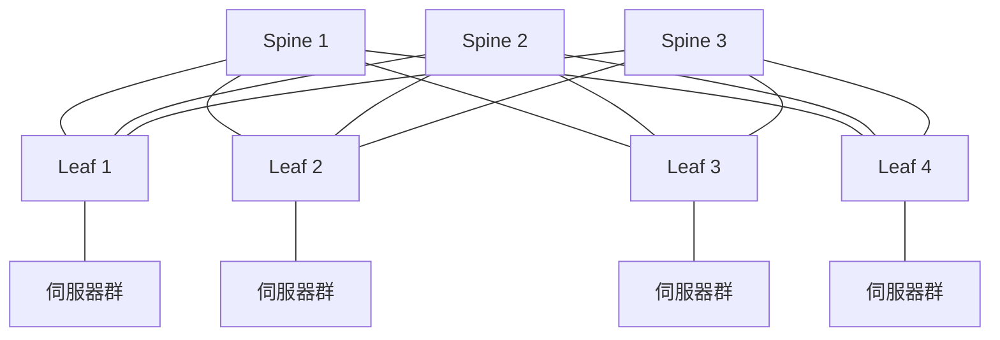

# 8.3 資料中心內部網路（Spine-Leaf 架構）：超大型雲端廠商（AWS/GCP）的超高頻寬網路重構

## 流量方向的革命：南北向 → 東西向

傳統企業網的設計假設是「**南北向**」：客戶端在網外、伺服器在網內，流量主要在「進出」方向。因此經典設計是三層樹狀拓撲：

```
          核心層（Core）
        ／            ＼
   匯聚層（Aggregation）
    ／      |       ＼
 接入層（Access）── 伺服器
```

但虛擬化與雲端把這個假設徹底顛覆：一台實體伺服器跑數十個虛擬機/容器，分散式儲存、分散式運算（MapReduce/Spark）、微服務之間**瘋狂互喊**——流量爆量發生在**伺服器與伺服器之間**，即「**東西向（east-west）**」。研究顯示，現代資料中心內部流量可達對外流量的**數百倍**。

## 樹狀拓撲的死刑：超額訂閱與 Spanning Tree

三層樹有兩個致命傷：

1. **頻寬瓶頸在上游**：樹往上收窄，數百台伺服器的東西向流量都要擠過上游少數鏈路——超額訂閱（oversubscription）比率動輒 10:1 以上，跨機架通信被上游卡死。
2. **生成樹協定（STP）浪費一半鏈路**：為防迴圈，STP 把冗餘鏈路**邏輯上斷開**——買了冗餘卻不能用，且拓撲收斂以秒計。
3. （額外）**路徑長度不均**：同排機架很近，跨排要繞很多跳，延遲不均打擊分散式運算的長尾。

## Spine-Leaf：把網路壓成兩層織物

雲端巨頭與廠商（Cisco Nexus、Arista、Facebook Fabric）匯流出的答案是 **Clos 織物**，實作為 **Spine-Leaf（脊葉）架構**：



規則簡單到近乎優雅：

- **每一台 Leaf 都連接每一台 Spine**（full mesh），Leaf 只連伺服器，Spine 只連 Leaf；
- 任意兩台伺服器之間**恆為兩跳**（Leaf→Spine→Leaf），延遲可預測；
- **無單點、無樹根**：任何 Spine 或 Leaf 故障，流量繞道，冗餘鏈路**全部可用**；
- **橫向擴容（scale-out）**：頻寬不夠就加一台 Spine——樹是「向上長」必然卡瓶頸，織物是「向外編」永遠對稱。

數學上，這是 1950 年代貝爾實驗室 **Charles Clos** 為電話交換系統設計的 Clos 網路的復活——**電話交換的多級交換理論，六十年後在資料中心光纖上重生**。

## 配套的三件工程

1. **ECMP（等價多路徑）**：流量在多條等價路徑上按流雜湊分攤，吃滿所有鏈路——取代 STP 的「禁用冗餘」。
2. **BGP 進資料中心**：大型織物內用 **BGP（eBGP unnumbered）**取代 OSPF/STP——因為 BGP 規則簡單、路由策略可控、故障收斂可調。**治理路由表的 BGP 從骨幹走進了機櫃**。
3. **無損與擁塞控制**：RoCEv2（RDMA over Converged Ethernet）、PFC、ECN 讓乙太網承載**極低丟包**的儲存與 AI 訓練流量——AI 時代的 GPU 叢集（如萬卡訓練）把 Spine-Leaf 頻寬推向每 GPU 數百 Gbps。

## 雲端的規模與經濟

- **AWS** 自 2006 年起以自研交換機構建織物（早期用思科，後大規模自研＋白盒）；**Google Jupiter**（SDN 化織物）單叢集頻寬達 Pbps 級；**Microsoft SONiC** 成為開源資料中心 NOS 事實標準；**Meta** 以 OCP 公開其 Fabric 設計。
- 經濟學：白盒交換機 + 開源軟體讓每端口成本下降一個數量級；**「網路作為雲端核心競爭力」**意味著亞馬遜不再需要思科——這是供應商權力結構的歷史性逆轉。

## 小結

Spine-Leaf 用「對稱、扁平、可程式化」的織物，解決了東西向時代的頻寬、延遲與擴展三重難題。它是 Clos 理論、開源硬體與 SDN 集中控制的三重勝利。下一篇，網路將離開地面——進入近地軌道的星鏈天網。
