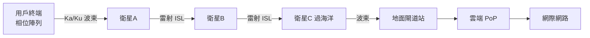

# 9.2 馬斯克的星鏈（Starlink）計畫：數萬顆近地軌道（LEO）衛星的相位陣列天線與雷射星間鏈結（ISL）

## 一張宏偉的藍圖

2015 年，馬斯克在西雅圖宣布 SpaceX 衛星網路計畫（後定名 **Starlink**）；2019 年 5 月，首批 60 顆衛星升空。計畫規模不斷上修：首代星座約 12,000 顆（已獲 ITU/美國 FCC 檔案），後續申請擴展至 30,000–42,000 顆——**超過人類歷史發射衛星總和**。

### 三代技術疊代

| 參數 | V1（2019–） | V1.5（2021–） | V2 mini（2023–）/ V3 |
|---|---|---|---|
| 高度 | ~550 km | ~550 km | ~525–535 km |
| 雷射星間鏈結 | 無 | **有（ISL）** | 有，大幅強化 |
| 單星頻寬 | ~17–20 Gbps | ~20 Gbps | ~100 Gbps 級（V3 目標） |
| 質量 | ~260 kg | ~300 kg | ~800 kg（V2 mini）；V3 更大 |

## 兩個讓天網「活」起來的發明

### 1. 相位陣列天線（Phased Array）：波束自動追星

星鏈的難題：衛星以每秒約 7.5 公里掠過天頂，用戶天線必須**毫秒級精準追蹤**。星鏈用戶終端（俗稱「UFO on a stick」）內建**電子掃描相位陣列天線**：

- 以數百個天線陣元合成波束，**電控相移**即可讓波束瞬間轉向，**沒有任何機械轉動**；
- 波束同時追蹤多顆衛星，實現「衛星過頂前預先切換」——**天上的 handover**（上一章的地面技術在天上重演）；
- 相位陣列技術源自軍用雷達（如宙斯盾系統），星鏈把它做成消費電子——**軍工技術的消費化降價**是本時代重複出現的模式。

### 2. 雷射星間鏈結（ISL）：太空中的光纖

2021 年起搭載的 **Optical Inter-Satellite Links**：衛星之間以雷射直接通訊（單鏈 100 Gbps 級、距離數千公里）。意義巨大：

- **覆蓋海洋與極地**：不必每顆衛星都看得到地面站，流量可以沿著「衛星鏈」跨越無人區；
- **路徑比地面更短**：光在真空比在玻璃光纖快約 47%。紐約→倫敦的數據經 LEO 星座中繼，理論延遲可低於海底光纖——**星鏈的第一個高級客戶市場，其實是高頻交易與骨幹替代**；
- **抗毀性**：星座是分散式網路，單星失效自動繞行——巴蘭 1964 年的核戰倖存網路構想，在 2020 年代的軌道上實現。

## 工程的狠勁

- **量產火箭×量產衛星**的垂直整合：單次發射 60 顆以上、月均多次發射，2020 年代中期在軌數量突破 **7,000–8,000 顆**，占全球活躍衛星過半；
- **自帶推進的離軌**：每顆衛星裝霍爾效應離子推進器，壽命終了主動再入燒毀——回應太空碎片責任；
- **自動化營運**：星座以軟體自治運轉，人工干預極少——**天網本身就是一個超大型 SDN**（控制平面在地面，數據平面在 550 公里高空）。

## 商業與社會的實績

- 用戶自 2021 年公測（beta）後爆發式成長，2020 年代中期突破 **400–500 萬戶**，覆蓋 100+ 國；
- 定價從 beta 的 99 美元/月起步，下探至 Roam 移動方案；烏克蘭戰爭（2022）中星鏈成為軍民通訊命脈，首次證明**天基網路的戰略價值**；
- 對傳統產業的衝擊：偏遠地區衛星寬頻（原被 GEO 壟斷）、航空 Wi-Fi（多家航空公司轉投星鏈）、海運、軍事通訊全部重寫規則；
- 競爭者跟進：Amazon **Kuiper**、中國 **GW 星網**（Guowang）與 **千帆星座（Qianfan/G60）**、歐洲的 Eutelsat OneWeb（先發卻轉型 B2B）——**低軌星座成為大國標配**。

## 值得記住的限制

- 天氣敏感：暴雨（Ku 頻段雨衰）會降速甚至斷線；
- 城市密度差：單波束用戶容量有限，人口稠密區不如光纖；
- 供電與法律：終端依賴地面電力；各國落地許可（如印度、非洲多國）仍是談判場。

## 小結

星鏈的偉大不在單項技術（相位陣列、雷射鏈結、火箭回收各有先例），而在**系統級整合與成本革命**——把 1990 年代破產的三個構想，用 2020 年代的製造與發射經濟學重新做成。它也把最難的問題帶上了天：誰有權治理軌道？下一節。
