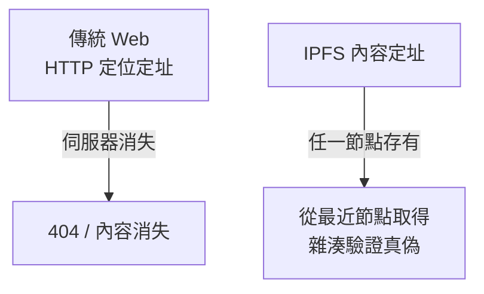

# 10.1 從中心化伺服器走向點對點（P2P）與區塊鏈網路：IPFS（星際檔案系統）與去中心化架構

## 中心化的宿命：為什麼 Web 變成了「大平台」

萬維網的設計是去中心的（任何人可以架站、任何頁面可以連結），但 2000 年代後期起，實際格局劇烈中心化：

- **規模經濟**：自架伺服器在成本、安全、CDN、可用性上全面輸給雲端巨頭；
- **網路效應**：社交與市集平台以用戶鎖定用戶，Facebook、YouTube、Amazon 成為實質上的「新網關」；
- **搜尋與應用商店**：Google 與 App Store/Play 決定了「誰被看見」。

結果是「**平台資本主義**」的三重矛盾：資料主權（用戶資料屬於平台）、言論治理（私有平台執行準司法權力）、單點審查（一次下架，內容即消失）。這些矛盾催生了新一波**去中心化網路**運動。

## P2P 的兩次浪潮

### 第一次（1999–2005）：Napster、GnuTella、BitTorrent

- **Napster**（1999）：中央索引 + 節點直傳，顛覆音樂產業，2001 年被法院關閉——**中心化索引是法律弱點**。
- **Gnutella、Kazaa、BitTorrent**（2001 起）：完全無中心的**分散式雜湊表（DHT）**——把檔案切成塊、以內容雜湊定址、節點互相下載（swarm）。BitTorrent 在巔峰期承載了全球約三成的網路流量。
- **意義與限制**：P2P 證明了「無中心的檔案分發」技術可行且成本低；但版權戰爭（RIAA/MPAA 的訴訟、關閉 eDonkey/ES2 等）與「搭便車」（只下不上傳）使其退居地下。

### 第二次（2014– ）：內容定址與區塊鏈

**IPFS（InterPlanetary File System）**由 Protocol Labs 的 **Juan Benet** 於 2014–2015 年提出，是這波浪潮的核心架構：

1. **內容定址（Content Addressing）**：檔案的位址是它自己的**密碼學雜湊**（CID），例如 `ipfs://QmXoypiz...`。**問的是「內容是什麼」，不是「內容在哪裡」**——這是與 HTTP 定位定址的根本決裂。
2. **去重與不可變**：相同內容全網只存一份；雜湊保證內容一經發布無法偷偷篡改——**定址即驗證**。
3. **DHT + BitSwap**：以 DHT 找「誰有這個 CID」，以類 BitTorrent 的以物易物協議交換資料塊。
4. **Filecoin（2020 上線）**：以區塊鏈激勵儲存節點——「提供儲存空間賺取代幣」，把去中心儲存變成可持續的市場。

## 區塊鏈網路：信任的去中心化

比特幣（2008 年中本聰白皮書、2009 上線）與以太坊（2015）把 P2P 網路推向「**去中心化的狀態機**」：

- **網路層**：全節點對全節點的 gossip 廣播，無中心伺服器；
- **共識層**：以工作量證明（PoW）/權益證明（PoS）讓互不相識的節點對「唯一真相」達成一致——**拜占庭容錯在開放網路中的工程化**；
- **應用層**：以太坊的智慧合約使「去中心化應用（DApp）」成為可能；ENS（以太坊域名服務）直接對標 DNS 的去中心化重寫。

**Web3** 一詞（以太坊共同創辦人 Gavin Wood 2014 提出）總結了這個願景：以**密碼學驗證取代平台信任**，用戶持有金鑰與資料，網路服務由開放協議而非公司提供。

## 冷峻的現實：去中心化的三難

1. **可擴展性三難**：去中心、安全、吞吐量三者難以兼得（以太坊主網 TPS 僅數十，靠 Layer-2 rollup 補足）。
2. **治理悖論**：程式碼即法律仍需人為升級（以太坊 The DAO 分叉事件 2016、去中心化應用的前端常仍架在中心化雲上）——**「去中心化」常常只是把權力移到看不見的地方**。
3. **司法與監管**：各國對加密資產的監管（SEC 訴訟、中國全面禁止交易、歐盟 MiCA）證明：**協議可以去中心，資本與司法仍然中心**。

## 值得記住的反例與平衡

去中心化不是萬靈藥：中心化 CDN 提供了去中心網路至今做不到的低延遲與防濫用；維基百科以中心化架構實現了最成功的知識公地。**架構選擇本質上是治理選擇**——「誰有權改變規則」比「節點有多少」更能定義一個網路的去中心程度。

## 小結

從 Napster 到 IPFS 再到 Web3，去中心化運動的反覆興起，映照的是平台權力週期性的過度膨脹。技術在進步（內容定址、密碼學共識），社會在學習（監管、治理），勝負未定。下一節，我們轉向所有這些網路的共同敵人——攻擊與防禦的軍備競賽。
