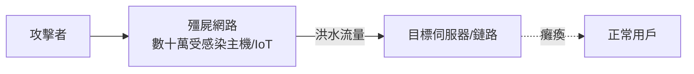

# 10.2 分散式阻斷服務攻擊（DDoS）與加密傳輸（HTTPS/TLS/QUIC）：網路安全與隱私防線的演進

## 明文的黃金年代（1990s）：為什麼 Web 一開始是裸奔的

HTTP 誕生於學術環境，設計哲學是「簡單、無狀態」——**安全完全不在需求清單上**。1990 年代的網路上，密碼、郵件、聊天全部明文傳輸；任何人坐在同一個區網（或骨幹路由器旁）就能窺視一切。

改變的契機是**電子商務**：1994 年 Netscape 發明 **SSL 2.0**（Taher Elgamal 主導），1999 年 IETF 標準化為 **TLS 1.0**。技術核心有三：

1. **非對稱金鑰交換**（RSA / 後來的 ECDHE）：在公開通道上協商只有雙方知道的對稱金鑰——數學上依賴「大數分解／離散對數難題」；
2. **對稱加密**（AES 等）：高效加密全部應用資料；
3. **憑證與信任鏈（PKI）**：由憑證授權機構（CA）簽章，證明「這把公鑰確實屬於這個域名」。

## 從「銀行專用」到「預設加密」的三級跳

| 階段 | 約時間 | 關鍵事件 |
|---|---|---|
| 銀行專用 | 1995–2010 | 只有結帳頁面用 HTTPS；瀏覽器鎖頭圖示 |
| ** Snowden 事件（2013）** | 2013–2015 | 史諾登揭露大規模被動監聽（含骨幹抓包、PRISM），證明「明文=全民裸奔」 |
| **HTTPS Everywhere** | 2015–2018 | EFF 的 HTTPS Everywhere 外掛、**Let's Encrypt（2015）免費自動發證**、Google Chrome 將 HTTP 標記「不安全」、Firefox 預設 HTTPS-Only |

**Let's Encrypt** 值得特書：非營利的 ISRG 以 ACME 協定實現證書**全自動化簽發與續期**，把「TLS 的營運成本」降到近零——**經濟摩擦的消除使加密普及率從不到一半躍升至九成以上**。制度 + 工具創新的又一次勝利。

TLS 自身也在攻防中進化：POODLE、Heartbleed（2014，OpenSSL 庫的漏洞而非協定）、BEAST 等事件不斷淘汰舊版本；TLS 1.3（2018）砍掉所有已知不安全選項，交握只需 1-RTT（0-RTT 恢復），**安全與速度第一次不再互斥**。

## QUIC 與 HTTP/3：傳輸層的重生

TCP 建立連線需要三次交握，TLS 再要 1–2 次往返——行動網路上「連線建立」本身吞噬大量時間。Google 自 2012 年起實驗 **QUIC（Quick UDP Internet Connections）**：

- **跑在 UDP 之上、內建 TLS 1.3**：加密與傳輸交握合一，首次連線 1-RTT、重連 0-RTT；
- **連線 ID 取代「IP+埠」四元組**：手機從 Wi-Fi 切到 5G，IP 變了，**連線不斷**（連線遷移）——直接回應上一章的移動性難題；
- **使用者空間實作**：協定升級隨應用發布，不必等作業系統十年；
- **每個 stream 獨立**：單一資料流丟包不再阻塞其他流（解決 TCP 隊頭阻塞）。

2022 年，IETF 將 **QUIC（RFC 9000）與 HTTP/3（RFC 9114）**標準化；Google、Meta 的多數流量、Cloudflare 的過半請求已走 HTTP/3。**傳輸協定三十年的最大重寫，由一家公司的內部實驗開始**——這也是「先有可運作碼、再有標準」模式的又一次勝利。

## DDoS：用網路自己的規模攻擊網路

DDoS（分散式阻斷服務攻擊）的哲學是「**用別人的電腦淹死你的目標**」：

里程碑事件：

- **2000 年**：15 歲的 Mafiaboy 攻擊 Yahoo!、CNN、Amazon——DDoS 首次成為主流新聞；
- **2013 Spamhaus 攻擊**：DNS 反射放大攻擊（以 74 字節請求換 3,500 字節回應，放大 50 倍以上）衝出 300 Gbps，一度擠壓歐洲骨幹；
- **2016 Mirai 殭屍網路**：感染數十萬台**弱密碼物聯網設備**（攝影機、路由器），10 月攻擊 DNS 供應商 **Dyn**，Twitter、Netflix、Reddit 大面積癱瘓——**IoT 安全債務的總清算**；
- **規模競賽**：2020 年代攻擊峰值突破 Tbps 級（Cloudflare 記錄 2020 年代中期超過 5.6 Tbps）。

### 防禦的軍備競賽

1. **分散吸收（anycast + 全球邊緣網路）**：Cloudflare、Akamai 把攻擊流量**分散到全球數百個節點**——用攻擊者沒有的規模對抗攻擊；
2. **協定級補課**：BCP38（源位址過濾，防 IP 欺騙）、DNSSEC、RPKI（防 BGP 劫持）——**1990 年代欠下的信任債，分期償還三十年**；
3. **資源代價的轉嫁**：TLS 讓攻擊必須完成加密交握（成本更高），而 QUIC 的 0-RTT 反成新的放大攻擊面——**防禦是無終點的紅皇后競賽**。

## 小結

這三十年是「信任基礎設施」的重建史：密碼學從銀行的奢侈品變成全球預設，傳輸協定在安全與效能的和解中重生，而攻擊者始終在規模與創意上進化。最後一節，我們看零信任架構如何把「邊界」這個最後的舊地圖撕掉。
