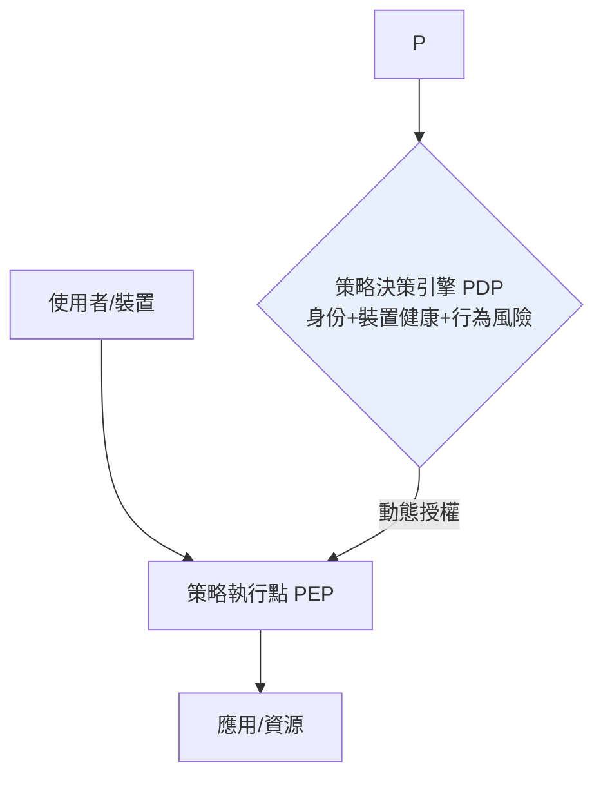

# 10.3 零信任網路架構（Zero Trust Architecture）：當傳統網路邊界消失，如何重新建立信任？

## 城牆模式的崩塌

傳統企業安全的世界觀是「**城堡與護城河**」：

```
[外部:不可信] ══防火牆══ [內部:可信]
        VPN 隧道 = 給可信者開的城門
```

進入內網＝獲得信任；內部橫向移動（lateral movement）幾乎不受限。這個模型在三股力量下徹底崩塌：

1. **雲端化**：資料不在自家機房，「內部」失去地理意義；
2. **BYOD 與遠距**：員工的筆電、居家網路、手機 App 全在城牆外；疫情（2020）把整個白領階級移出城牆；
3. **供應鏈攻擊**：SolarWinds 事件（2020，駭客經由 IT 供應商的軟體更新進入美國政府與企業內網數月）證明：**攻擊者不需要翻牆，只要混進補給車隊**。

## 零信任的哲學：「永不信任，始終驗證」

零信任（Zero Trust）不是一個產品，而是一套設計原則，最早由 Forrester 分析師 **John Kindervag** 於 2010 年系統提出；Google 的內部實作 **BeyondCorp**（2011–2017 年系列論文，起因於 2009 年 Operation Aurora 供應鏈攻擊）是最著名的工程示範。美國 NIST 於 2020 年發布 **SP 800-207**〈零信任架構〉，使之成為官方參考模型；2021 年美國拜登總統以行政命令要求聯邦政府零信任化——**從學術概念到國家政策**只用了十年。

### 核心原則

1. **以身份為邊界**：不再問「你從哪個網路來」，改問「**你是誰、你的裝置健康嗎、你要做什麼**」——每一次請求都重新認證與授權（continuous verification）。
2. **最小權限（Least Privilege）**：預設拒絕，僅授予完成當前任務所需的最小存取範圍，且授權有時效。
3. **假設已遭入侵（Assume Breach）**：設計的前提是攻擊者已在網內——微分段（micro-segmentation）把網路切成最小單元，橫向移動寸步難行。
4. **端到端加密 + 全面可觀測**：內部流量同樣加密；所有存取被記錄、分析、異常即時反應。



（PEP/PDP 分離：執行與決策分離——這與 SDN 的「控制平面/數據平面分離」同構，**零信任是安全版的 SDN**。）

## 技術支柱的歷史拼圖

零信任不是一夕發明，而是把數十年技術收攏成體系：

- **PKI 與單一登入**（1990s–2000s）：身份的數位化；
- **多因素驗證（MFA）**：YubiKey（2007–）與 FIDO/WebAuthn（2019 W3C 標準）以硬體金鑰／生物特徵對抗釣魚——**金鑰在手，密碼退場**（passkeys 時代）；
- **裝置健康證明**：TPM 晶片、MDM 行動裝置管理，讓「這台機器可信」變成可驗證命題；
- **服務網格（Service Mesh，Istio/Envoy，2017–）**：把零信任原則推到**微服務之間**——服務對服務的每一次呼叫都要相互認證（mTLS）與細粒度授權；
- **SASE/雲端邊緣（2019 Gartner 術語）**：安全功能（SWG、ZTNA、CASB）雲端化，跟上應用的雲端化。

## 治理與文化的深水區

技術之外，零信任的真正難點是**組織轉型**：

- 「內網可信」的假設寫進了無數舊系統、舊協定（SMB、LDAP、資料庫連線），改造成本巨大；
- 安全團隊從「守門人」變成「策略工程師」，運維從「網路位置」思維轉向「身份與政策」思維；
- 隱私與監控的張力：持續驗證意味持續記錄使用者行為——**安全與隱私的邊界需要制度性劃線**。

## 小結

零信任承認了一個殘酷的事實：**網路從來就不是一個可信的地方**。它把信任從「拓撲位置」抽離，重建在「密碼學身份 + 持續驗證」之上——這是巴蘭「假設網路隨時會故障」思想的邏輯延伸：**假設網路隨時會被滲透**。至此，全書的線索在此匯流：從電路交換到封包交換，從城牆到零信任，網路的每一次革命，都是對「不完美世界」的更誠實回應。
