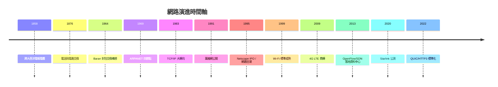

# 《網路的故事：從冷戰防空洞、TCP/IP 協定、全球光纖到星鏈與 Web3》

> 一本寫給網際網路架構師、網路工程師、資訊安全專家與數位文明研習者的專題史。
> 網路從來不只是電纜、光纖與無線電波的物理連接——它是人類將孤立資訊節點串聯成全球大腦的壯麗史詩。

## 前言：將地球連成神經系統——網路如何重構人類社會的資訊時空

本書以**歷史演進與通訊協定／架構範式轉移**為主軸，記錄人類如何從二戰密碼戰與冷戰核陰影下的電報電路，走過 ARPANET 的封包交換革命、TCP/IP 與網際網路（Internet）的統一，經歷萬維網（World Wide Web）爆發、行動網際網路（3G/4G/5G）降臨，直到當代的雲端軟體定義網路（SDN）、星鏈衛星網際網路與去中心化 Web3。

---

## 目錄

### 第一篇：前網際網路時代與封包交換的破曉（1950 年代 – 1960 年代）

* 第1章-電報、電路交換與電信巨頭的壟斷
    * [1.1-摩斯電碼與跨大西洋海底電纜](01.1-摩斯電碼與跨大西洋海底電纜.md)
    * [1.2-傳統電話網與電路交換](01.2-傳統電話網與電路交換.md)
    * [1.3-AT&T 的電信帝國與早期數據傳輸](01.3-AT&T的電信帝國與早期數據傳輸.md)

* 第2章-冷戰陰影與 Paul Baran 的封包交換狂想
    * [2.1-蘭德公司的冷戰課題](02.1-蘭德公司的冷戰課題.md)
    * [2.2-巴蘭與戴維斯：封包概念的誕生](02.2-巴蘭與戴維斯：封包概念的誕生.md)
    * [2.3-電信巨頭的嘲弄：封包交換絕對無法傳輸語音](02.3-電信巨頭的嘲弄.md)

### 第二篇：ARPANET 登場與 TCP/IP 協定大一統（1960 年代末 – 1980 年代）

* 第3章-1969 年 ARPANET：世界上第一個封包交換網路
    * [3.1-DARPA 的野心：連接 UCLA 與 SRI 的主機](03.1-DARPA的野心.md)
    * [3.2-人類網際網路的第一個訊息「LO」](03.2-第一個訊息LO.md)
    * [3.3-介面訊息處理機（IMP）：第一代路由器](03.3-IMP第一代路由器.md)

* 第4章-溫頓·瑟夫與羅伯特·卡恩：TCP/IP 協定與全球網際網路的誕生
    * [4.1-異質網路連線的巴別塔困境](04.1-異質網路連線的巴別塔困境.md)
    * [4.2-1974 年劃時代論文：TCP/IP 的分層封裝哲學](04.2-TCP_IP的分層封裝哲學.md)
    * [4.3-1983 年 1 月 1 日「大轉向」](04.3-1983年大轉向.md)

### 第三篇：萬維網爆發、域名系統與網際網路狂潮（1980 年代末 – 1990 年代）

* 第5章-蒂姆·伯納斯-李與萬維網：讓全人類都能閱讀網頁
    * [5.1-CERN 的超文本需求：HTTP、HTML 與 URL 三重發明](05.1-CERN的超文本需求.md)
    * [5.2-伯納斯-李的無私承諾：將萬維網贈予全人類](05.2-將萬維網贈予全人類.md)
    * [5.3-Netscape 與 dot-com 泡沫狂潮](05.3-Netscape與dot-com泡沫狂潮.md)

* 第6章-域名系統（DNS）、IP 位址分配與網路骨幹基礎建設
    * [6.1-從 HOSTS.TXT 到 DNS 樹狀域名](06.1-從HOSTS.TXT到DNS樹狀域名.md)
    * [6.2-ICANN、IPv4 枯竭與 IPv6 拉鋸戰](06.2-IPv4枯竭與IPv6拉鋸戰.md)
    * [6.3-海底光纖與網路交換節點（IXP）：全球數據的物理動脈](06.3-海底光纖與IXP.md)

### 第四篇：無線網路、行動網際網路與雲端資料中心架構（2000 年代 – 2010 年代）

* 第7章-無線通訊革命：從 Wi-Fi 到 3G/4G/5G 行動網際網路
    * [7.1-Wi-Fi（802.11）協定的演進](07.1-WiFi協定的演進.md)
    * [7.2-行動通訊世代交替：2G、3G 到 4G/5G](07.2-行動通訊世代交替.md)
    * [7.3-移動路由與基地台手遞手（Handover）技術](07.3-Handover手遞手技術.md)

* 第8章-雲端時代的網路革命：SDN 與 NFV
    * [8.1-傳統路由器的硬體綁定困境與思科帝國](08.1-思科帝國與配置地獄.md)
    * [8.2-OpenFlow 與軟體定義網路（SDN）](08.2-OpenFlow與SDN.md)
    * [8.3-資料中心 Spine-Leaf 架構](08.3-Spine-Leaf架構.md)

### 第五篇：星鏈天基網路、Web3 與未來網路前沿（2020 年代 – 至今）

* 第9章-地球近地軌道衛星網際網路：SpaceX Starlink 的全球天網
    * [9.1-地面網路覆蓋盲區：偏遠山區、海洋與飛機的連線痛點](09.1-地面網路覆蓋盲區.md)
    * [9.2-馬斯克的星鏈計畫：LEO 衛星、相位陣列天線與雷射星間鏈結](09.2-星鏈計畫.md)
    * [9.3-地緣政治、軌道擁擠與天基網路治理](09.3-軌道擁擠與天基治理.md)

* 第10章-去中心化網路、Web3 與網路安全終極博弈
    * [10.1-從中心化伺服器走向 P2P 與區塊鏈網路：IPFS 與去中心化架構](10.1-IPFS與去中心化架構.md)
    * [10.2-DDoS 與加密傳輸：HTTPS/TLS/QUIC 的演進](10.2-加密傳輸與DDoS防線.md)
    * [10.3-零信任網路架構（Zero Trust Architecture）](10.3-零信任網路架構.md)

### [結語：從四節點 ARPANET 到光年級星際網路](99-結語.md)

---

## 💡 本書四大核心底層觀念

1. **交換範式**：電路交換 vs 封包交換
2. **協定分層**：OSI 七層模型與 TCP/IP 四層架構
3. **定址與路由**：IP 位址、DNS 域名解析、BGP 路由協定
4. **實體介面**：銅線、光纖、無線電波與雷射星間鏈結

