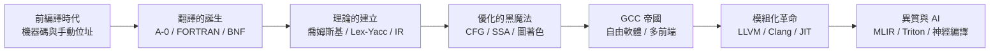

# 前言：矽晶片上的同聲傳譯——編譯器如何將人類思想化為微觀電流

> 「編譯器是把人類意圖翻譯成矽之意志的同聲傳譯官。」

## 一、文明史上最成功的翻譯工程

當你在 Python 裡寫下 `for x in data: total += x`，這行字如何在 0.0000003 秒後變成 CPU 中 16 個暫存器之間的加減位移？答案是一條長達七十年的翻譯流水線：詞法分析切開字元流、語法分析築起抽象語法樹、語意分析檢查型態契約、中間表示扁平化邏輯、SSA 展開資料流、圖著色分配暫存器、最後一道指令排程把百萬電晶體的物理規則納入考量。**編譯器是人類資訊文明中最精密、也最隱形的翻譯工程**——它翻譯的規模以每天數十億次編譯計，而絕大多數使用者根本不知道它的存在。

這本書講的是這條流水線的誕生史。故事的核心人物有一個共同點：他們都相信**人類不該被迫用機器的語言思考**。1952 年，葛麗絲·霍普在滿室懷疑中讓機器替人類翻譯數學；1957 年，約翰·巴科斯用 FORTRAN 的優化器證明高階語言不必比組語慢；1960 年，一紙 ALGOL 報告把 BNF 寫進歷史；1987 年，理查·斯托曼用 GCC 把編譯器變成公共財；2003 年，克里斯·拉特納把編譯器變成函式庫；2019 年，MLIR 把 IR 變成生態。

## 二、編譯器的三段式解剖

本書的技術主軸沿著編譯器的三大階段展開，每一階段都有獨立的革命史：

- **前端**（第 3-4 章）：喬姆斯基的文法階層意外成為解析的數學、Lex/Yacc 把前端開發自動化、符號表與型態系統承載語意、AST 與三位址碼完成從樹到線性的扁平化；
- **中端**（第 5 章）：控制流圖與 SSA 是優化的形式基礎，死碼消除與循環展開是經典招式，圖著色暫存器配置是 NP 困難問題的優雅近似；
- **後端與基礎設施**（第 6-9 章）：GCC 的四十年帝國與其單體代價、LLVM 的模組化革命、JIT 讓動態語言飛起來、MLIR 回應異質晶片的碎片化。

## 三、歷史與工程的雙螺旋

編譯器史最迷人的地方在於**純理論與工程實務的雙螺旋**：喬姆斯基研究自然語言時從未想過編譯器，他的文法階層卻成了 Lex/Yacc 的數學地基；Knuth 的 LR(k) 論文是純理論，卻讓 Yacc 成為可能；Curry-Howard 對應（型態即命題、程式即證明）從邏輯哲學走進了每個編譯器的型態檢查器。反過來，工程需求也塑造理論——SSA 誕生於 IBM 的實務團隊，卻反過來統一了優化理論的語言。本書在講技術時，會不斷回望這些思想的來路與去路。

## 四、閱讀路線

全書五篇十章，嚴格按年代推進：前編譯時代（1950s）→ 理論建立（1960s-80s）→ 優化與 GCC 帝國（1980s-90s）→ LLVM 革命與 JIT（2000s-10s）→ 異質計算與 AI 編譯器（2020s-）。所有故事皆為真實史實：霍普的 A-0 確實存在、FORTRAN 團隊確實是「18 人年」的豪賭、egcs 分叉確實發生、AlphaDev 的代碼確實進了 LLVM 主線。當代（2024-25）的進展我們標明時點，不做超出證據的預言。

讓我們回到 1950 年代初的賓夕法尼亞大學與 UNIVAC 工廠，看一位海軍女上校如何讓滿室懷疑的數學家相信：**機器可以懂英文**。
