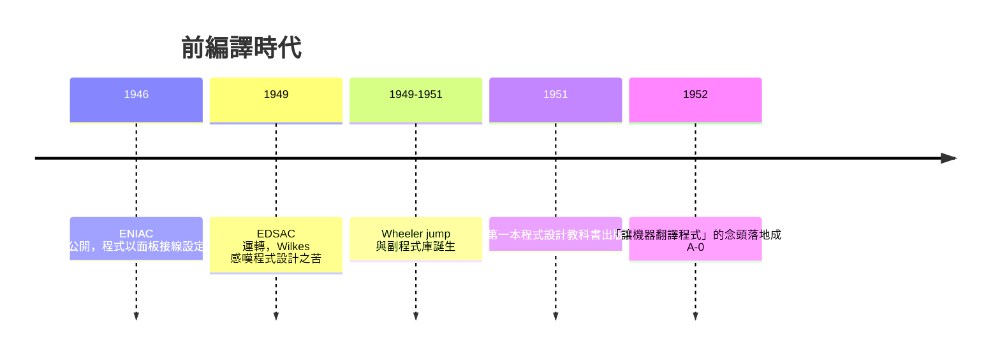

# 節標題：機器碼與手動換算——前編譯時代的噩夢

## 一切從零與一開始

一九四九年的某個深夜，劍橋大學數學實驗室的 EDSAC 正在緩慢運轉。這台機器是莫里斯・威爾克斯（Maurice Wilkes）從美國賓州大學的摩爾學院研討會帶回靈感後、在戰後物資匱乏的英國親手打造出來的。當 EDSAC 第一次成功執行程式、印出平方表時，威爾克斯回憶道：「機器上燈光閃爍的那一刻，我終於確信電子計算機將成為解決數學問題的實用工具。」然而下一秒鐘，他就意識到一個殘酷的現實——「程式設計的整個過程，將比我們想像的麻煩得多。」

這句話成了前編譯時代最精準的預言。在那個年代，程式設計師面對的是赤裸裸的機器：指令以二進制或八進制書寫，每一條指令都是一個編號、幾個位址與操作碼的組合。你必須親自翻閱機器的指令表，把「載入累加器」寫成 `60`，「條件跳轉」寫成 `40`，再把每一條指令和每一個資料項目安排到記憶體的絕對位置上。想呼叫一個開平方的常式？你必須記住它存放的位址，把這個數字手工填進每一處呼叫指令裡。

## 位址地獄

真正的噩夢在於「插入」這件事。假設你寫完了一支三百條指令的程式，忽然發現第 47 條指令之後少寫了一個除法運算。你插入兩條新指令，於是從第 48 條起，所有指令的位址統統往後移了兩格——而程式中所有引用這些位址的跳轉指令、資料存取指令，都必須逐一人工修改。改漏一處，程式就在某個不可預期的時刻崩潰或算出荒謬的結果。當年一根電纜線、一副打孔卡，都是除錯的線索；而大部分的錯誤，其實是程式員自己在位址換算時犯下的算術失誤。

這不是罕見的插曲，而是日常。程式設計師的桌上攤滿了草稿紙，上面畫滿記憶體配置圖與位址對照表，像會計帳簿一樣逐格核對。有人開玩笑說，那個年代的程式設計師一半的時間在寫程式，另一半的時間在做加減法。

## 副程式庫：模組化的先聲

威爾克斯不是坐視苦難的人。他與年輕的助手大衛・惠勒（David Wheeler）——後來劍橋第一位電腦科學博士——在一九四九到五一年間，為 EDSAC 發展出史上第一套副程式庫（subroutine library）。他們把開平方、三角函數、浮點運算等常用功能寫成標準化的副程式，集中存放在紙帶上，需要時併入主程式。為了解決副程式返回位址的問題，惠勒發明了著名的「Wheeler jump」：副程式被呼叫時，先把返回位址存進自身開頭的跳轉指令中，執行完畢後跳回呼叫者。這個技巧在今天看來樸素得近乎天真，卻是函式呼叫與堆疊思想的遠祖。

一九五一年，威爾克斯、惠勒與吉爾（Stanley Gill）合著《電子數位計算機程式的編製》（*The Preparation of Programs for an Electronic Digital Computer*），把副程式庫的經驗系統化出版——這是史上第一本程式設計教科書。副程式庫解決了「重用」的問題，卻沒有解決「組裝」的問題：把幾十個副程式與主程式拼在一起，仍然要人工分配位址、人工修補相互引用。威爾克斯們已經觸摸到問題的核心，但答案還在半路上。

## 程式設計的社會地位：體力活

更深的困難不在技術，而在文化。在早期計算機實驗室裡，程式設計被視為機器的操作與保養，是「體力活」，是工程師與技術員的雜務。真正的榮耀屬於設計電路的數學家與物理學家。哈佛 Mark I 的贊助者甚至認為，讓受過高等教育的數學家去寫機器碼是一種浪費；而當數學家真的動手寫程式時，許多人又以輕蔑的態度對待這種「低下」的勞動。馮紐曼式的天才崇拜籠罩著這個領域：寫出精巧的技巧性程式碼被當作智力競賽，簡潔易懂反而被視為平庸。

在這種氛圍下，第一位系統地為程式設計爭取專業尊嚴的人，是哈佛 Mark I 的首批程式員葛麗絲・霍普（Grace Hopper）。而揭示這份工作的真實成本、間接為它「喊價」的，是機時的政治經濟學。

## 機時的政治經濟學

ENIAC 和哈佛 Mark I 都是軍方重金打造的项目。ENIAC 由美國陸軍彈道研究實驗室出資，原本為了計算炮彈彈道表；哈佛 Mark I 則有海軍的背景。這些機器造價數十萬甚至上百萬美元（一九四〇年代的幣值！），占用整個房間，電力消耗驚人，真空管經常燒毀。機器的每一小時都對應著真金白銀——軍方合約、大學預算與企業投資的角力就發生在排程表上。

誰能用機器、用多久，於是成了制度問題。程式員往往只有有限的「除錯時間」，主要工作必須在紙上完成，然後在分配到的寶貴機時裡一次送入機器。一次位址換算的錯誤，可能浪費一整週苦等而來的機時。這種稀缺性塑造了早期的程式設計文化：程式要一次跑對，技巧要精雕細琢。同時它也埋下了變革的種子——既然機時如此昂貴，那麼「讓機器替人做位址分配、指令翻譯這種機械性工作」，在經濟上就是理所當然的。

## 孕育中的念頭

到了一九五〇年代初，好幾個人幾乎同時想到同一件事：既然副程式是標準化的、呼叫方式是機械化的，為什麼要人來做這些拼裝工作？程式員只要用某種符號方式描述「我要呼叫哪個常式、引數是什麼」，剩下的展開、連結、定址，全部交給機器自己完成。這就是「讓機器自己翻譯程式」的念頭——編譯器的胚胎。

格拉斯哥的 John Mauchly 團隊、劍橋的威爾克斯、以及遠在費城 Eckert-Mauchly 公司裡一位海軍預備役女軍官，都朝這個方向望去。歷史選擇了後者先把念頭變成可運行的機器——她的名字叫葛麗絲・霍普，而她把那個翻譯程式命名為 compiler。

