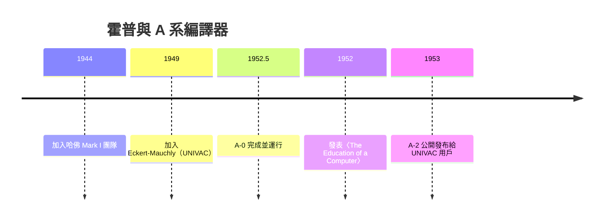

# 節標題：葛麗絲・霍普與 A-0——第一個編譯器

## 從數學教授到海軍中尉

葛麗絲・莫瑞・霍普（Grace Murray Hopper）的人生在四十一歲那年轉了個大彎。她是瓦薩學院（Vassar College）的數學副教授，擁有耶魯大學數學博士學位——在那個女性學者鳳毛麟角的年代，這已經是罕見的成就。珍珠港事變後，她決心報國申請從軍，卻因為體重過輕（不足海軍規定的最低標準）與年齡而被拒。她不肯罷休，靠著特許於一九四三年加入海軍預備隊（WAVES），以中尉階結業，一九四四年被派往哈佛大學，為霍華德・艾肯（Howard Aiken）的哈佛 Mark I 工作。

艾肯起初對這位嬌小的女軍官並不熱情，但霍普很快用實力證明了自己。她成了 Mark I 的首席程式員，寫出了第一支自動產生三角函數表的程式。在哈佛，她學會了做別人認為不可能的事——後來她常說：「沒有人跟我說過什麼是『不可能』，所以我做了。」Mark I 是一台靠繼電器與機械軸運轉的巨獸，程式設計意味著在紙帶上打孔、在絕對位址間穿梭。霍普親身嚐盡了前一章描述的位址地獄，這段經歷成為她日後所有發明的原點。

## 費城：Eckert-Mauchly 與商業電腦的賭局

戰後，霍普面臨抉擇：回瓦薩當教授，還是留在這個新奇的世界？一九四九年，她辭去教職，加入普雷斯珀・艾克特（J. Presper Eckert）與約翰・莫奇利（John Mauchly）創辦的 Eckert-Mauchly Computer Corporation——那對建造 ENIAC 的搭檔正在費城打造全世界第一部商用電腦 UNIVAC。

這個商業環境至關重要。Eckert-Mauchly 不像大學實驗室為科學計算造機器，他們的目標客戶是人口普查局、保險公司、大企業——這些客戶要的是處理檔案、報表與薪資資料，而且他們不可能養一批天才程式員在位址地獄裡掙扎。霍普後來回憶，是商業現實逼出了她的洞見：客戶的數學水平參差不齊，「與其教每個人都學會寫二進制，不如讓機器學會聽懂人話」。一九五〇年公司因資金周轉不靈被 Remington Rand 收購，霍普留任 UNIVAC 團隊，繼續她的探索。

## A-0：compiler 一詞的誕生

一九五一到五二年間，霍普和她的團隊（包括年輕的程序員）著手實現那個關鍵的想法。他們把 UNIVAC 上常用的數學常式——浮點加減乘除、三角函數、開方等——寫成一套標準化的子程式庫。然後，程式員不再直接寫機器碼，而是寫出一串符號化的「呼叫碼＋引數」：每條紀錄指定要用哪個常式、輸入放在哪、結果存到哪。剩下的事情交給一個翻譯程式：它讀進這串呼叫碼，從程式庫中把對應的副程式一一取出、展開、分配位址、修補內部跳轉，最後產出可以直接執行的完整機器碼程式。

霍普為這個翻譯程式取名 A-0（Arithmetic Language version 0），而她稱之為「compiler」。這個詞原本的意思只是「編纂者」——把零散資料彙集成表的人或程式；從霍普手中開始，它獲得了今天我們熟知的意義：把高階語言翻譯成機器碼的程式。一九五二年五月，A-0 完成並在 UNIVAC 上成功運行。同年她在匹茲堡的 ACM 會議上發表論文〈The Education of a Computer〉，宣告了這個新物種的誕生。

值得注意的是，A-0 嚴格說來更接近今日的「常式連結載入器＋巨集展開器」——它翻譯的是對程式庫的呼叫序列，還不是任意算式的語言。但模組化、符號描述、機器自動組裝這三大要素已經齊備，編譯器的骨架自此確立。

## A-1 與 A-2：最早的編譯器發布

霍普沒有停下腳步。A-1、A-2 相繼問世，其中 A-2 在一九五三年完成後公開發布給 UNIVAC 的用戶社群，附帶原始碼、請用戶回報錯誤與貢獻改進——這堪稱史上最早的編譯器「發布」與社群協作實踐之一，開放原始碼的幽靈在此已隱約可見。A-2 被眾多 UNIVAC 用戶採用，證明了這條路的可行性，也培養出第一批理解「翻譯程式」價值的工程師。

## 讓機器做機器擅長的事

霍普的洞見可以濃縮成一句話：**讓機器做機器擅長的機械性工作，讓人做人有創造力的工作。** 位址分配、常式展開、符號展開，這些是機器永不疲倦、永不犯錯的強項；人類應該去設計演算法、思考問題本身。她還強調「程式碼重用」——把經過驗證的常式存進程式庫，比每次重寫更可靠也更省錢。這些觀念在今日軟體工程中已是常識，在一九五〇年代卻是異端。

支撐這一切的，還有她特殊的身分處境。霍普始終保有海軍預備役身分（她最終以海軍少將軍階除役，是美國海軍史上最高齡的現役軍官之一），軍方的資源、人脈與對實用性的重視，成為她推動編譯器的制度後盾；而 Remington Rand 的商業競爭壓力，則迫使團隊必須讓 UNIVAC「好用」——好用到連不會寫二進制的人都願意買。軍事的務實與市場的壓力，在這位女將軍身上匯流，澆灌出第一個編譯器。

下一章的戰役更艱難：A-0 只需說服程式員，而霍普接下來要做的，是讓全世界相信——電腦可以聽懂英文。
