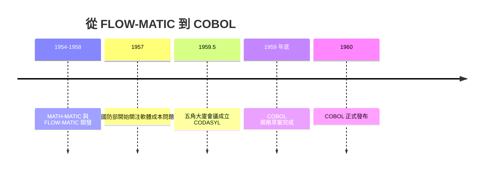

# 節標題：「電腦可以懂英文」——說服懷疑者的戰爭

## 面對整個時代的懷疑

A-0 證明了機器能翻譯「呼叫碼」，但霍普的野心遠不止此。她想要的是一種程式語言：程式員直接寫下接近人類語言的指令，機器自己翻譯。這個想法在一九五〇年代初面臨的不只是技術質疑，而是近乎神學式的反對。

反對者陣營豪華得驚人。約翰・馮紐曼——這個時代最負盛名的數學家、EDVAC 報告的作者——認為讓人類使用類似自然語言的方式和機器溝通是天方夜譚：數學符號之所以精密，正因為它與日常語言隔絕；程式設計師應該學會機器的語言，而不是反過來。IBM 高層也普遍認為，客戶買的是機器，學機器碼天經地義，研發翻譯程式徒增成本。學術圈的主流論調是：高階翻譯必然產生低效的機器碼，而機時如此昂貴，低效就是罪惡。霍普後來總結那個時代的氛圍：「他們說，只有人類才會翻譯，機器不可能做翻譯這種需要智慧的事。」

## FLOW-MATIC：會說英文的機器

霍普的反擊是做出成品。一九五四年起，她的團隊先開發 MATH-MATIC（AT-3），把 A 系的數學常式呼叫升級為更完整的符號數學語言；但真正的殺手鐧是她看準的商業應用——UNIVAC 的客戶是企業，企業的痛點不是算三角函數，而是處理檔案與報表。於是自一九五五年提出、一九五八年完成的 FLOW-MATIC（B-0），成為第一個用近似英文詞彙描述商業資料處理的語言。

在 FLOW-MATIC 裡，程式員寫的是這樣的句子：比較兩個記錄的欄位、若符合條件則把檔案 A 的記錄寫到輸出檔、否則讀下一筆。檔案、記錄、輸入、輸出這些商業世界的名詞直接成為程式語言的元素。霍普的策略很直接：每一份輸入與輸出檔案都要在程式開頭宣告，像填商業表格一樣。她日後回憶：「我用英文，是因為我已經證明程式員寫這種程式比寫數學符號的快得多、錯得少。」

## 說服的藝術：資料、演示與教育

霍普戰勝懷疑者的方法，是教科書級的技術傳播策略，三管齊下。

**第一，用資料說話。** 她統計比較同一項工作分別用機器碼與高階語言完成的時間與錯誤率：FLOW-MATIC 程式員的生產力數倍於機器碼程式員，除錯時間大幅下降。對精打細算的企業經理人，這比任何理論辯護都有力。

**第二，用演示折服客戶。** 霍普最著名的戲碼，是在 UNIVAC 的潛在客戶面前請對方的人當場寫一小段 FLOW-MATIC 程式，機器立刻翻譯執行。她常說：「最有效的方法是演示。讓他們親眼看見。」企業主管親眼看著英文句子變成機器動作的那一刻，理論上的不可能就瓦解了。

**第三，用教育培養土壤。** 從一九五〇年代中期起，霍普每年夏天在賓州大學與 Remington Rand 舉辦訓練營，培訓程式員與管理者，系統性地灌輸「自動化程式設計」的理念。這些學員日後散布到政府與企業，成為高階語言運動的種子部隊。她還積極在 ACM 等場合發表演講、寫論文，把「面向使用者的語言設計」變成一個可以討論的議題。霍普的教育活動是最被低估的貢獻：COBOL 之所以可能，是因為已經有一整代人被她說服。

## 一九五九：CODASYL 與 COBOL 的臨盆

土壤成熟的速度超出所有人預期。一九五七年，美國國防部驚覺各軍種與承包商的機器碼互不相通，軟體成本失控。一九五九年五月，國防部召集各大電腦廠商與用戶在五角大廈開會，成立 CODASYL 委員會，目標是造出一種通用的商業資料處理語言。會議的共識直接來自霍普的實踐：語言要像英文、要能處理檔案與記錄、要在不同廠牌機器上通用。會上播放了 FLOW-MATIC 的演示影片，霍普本人在場答問。

一九五九年底，CODASYL 的短暫委員會（Short Range Committee）提出規格，COBOL（COmmon Business-Oriented Language）誕生，一九六〇年正式發布。其語法骨架大量吸收 FLOW-MATIC，以至於霍普被公認為「COBOL 的祖母」。此後數十年，COBOL 支撐起全球銀行、保險與政府的資訊系統——世界上運行中的 COBOL 程式碼至今仍以百億行計。一份語言的遺產能活過一甲子，這在任何科技史上都屬罕見。

## 十年的孤獨

霍普晚年最常被引用的一句話，是她對創新傳播速度的感慨：「你最前沿的想法，得等十年才有人接受。」她從一九五二年開始宣講機器翻譯與英文編程，到 COBOL 全面普及、到人們終於理解「程式語言是給人讀的，只是碰巧能在機器上執行」，恰好走過了二十餘年。一九九二年元旦，八十五歲的霍普在佛吉尼亞州阿靈頓的家中辭世，長眠於阿靈頓國家公墓。她沒能等到如今 every programmer 都寫在近似英文的直覺語言裡的那個世界——但那個世界，正是她一磚一瓦說服出來的。

她留下的不只是語言，而是一條設計哲學：程式語言首先是人與人之間的溝通工具，其次才是人與機器的介面。這條哲學日後在 FORTRAN 的科學戰場上，將由另一位戰士用另一種方式證明——而且是證明給馮紐曼的追隨者看。
