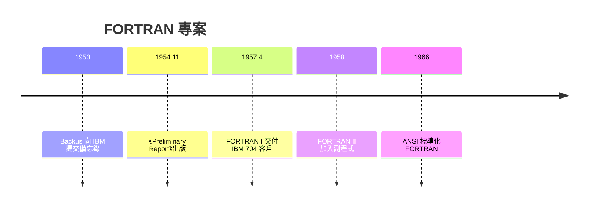

# 節標題：FORTRAN 的 18 人年豪賭——IBM 704

## 一位數學家的務實性格

約翰・巴科斯（John Backus）並不是典型的好學生。他生於一九二四年的費城，在維吉尼亞就讀中學時成績平平、屢屢翹課，進入維吉尼亞大學後因曠課被退學。珍珠港事變後他入伍，在陸軍醫療隊服役期間發現自己喜歡數學，戰後進入哥倫比亞大學攻讀數學，一九四九年取得碩士學位——據他自己說，當初選數學系只因為不用上實驗課。

一九五〇年，他在參觀 IBM 電腦計算中心後加入 IBM，先做 SSEC 的浮點運算硬體，逐漸轉向程式設計。巴科斯的性格與學院派截然不同：他討厭繁瑣的細節勞動，重視實效，敢於直言。正是這種性格，讓他對機器碼程式設計的痛苦有切膚之感。一九五三年，他向 IBM 管理層提交備忘錄，提議開發一個「自動程式設計」系統——這就是 FORTRAN 的起點。

## 商業動機：節省機時就是賣點

巴科斯的提案能在 IBM 立項，靠的不是理想主義，而是精明的商業算術。一九五〇年代，IBM 的 701、704 系列科學計算機每台售價動輒數十萬至百萬美元，客戶買機器是為了算數，但程式設計成本層層疊加：訓練程式員、寫機器碼、除錯、搶機時。客戶抱怨不斷——機器很貴，卻有大半時間閒置在等人寫好程式。

巴科斯的論證直指要害：如果程式員用一種近似數學記號的語言寫程式，開發速度可以快上數倍；但前提是編譯出來的機器碼必須夠快，否則省下的程式開發時間會被增加的執行時間吃回去。當時學界（包括馮紐曼陣營）普遍認為自動翻譯必然低效，自動程式設計系統的實踐（如 Harvard 的 Autumn 系統、各種 assembly 產生器）也確實效能不彰。巴科斯偏要賭一把：他的目標不是「能用就好」，而是**編譯出的機器碼要媲美甚至超越手寫組合語言**。一九五四年十一月，IBM 出版《Preliminary Report—Specifications for the IBM Mathematical FORmula TRANslating System》，向世界宣告了這個承諾——這份報告把交付日期定得很近，結果證明是嚴重低估，專案延期了一年多。

## IBM 704：戰場與利器

專案的硬體平台是 IBM 704——第一台大量採用磁芯記憶體與硬體浮點運算的商用計算機。704 的架構深深塑造了 FORTRAN：它有三個索引暫存器（index registers），可以用一條指令完成「載入—運算—存回」的複合操作，這給了編譯器優化的空間；它的浮點指令直接對應 FORTRAN 的實數運算。巴科斯團隊後來承認，FORTRAN 的設計與 704 的機器結構是一體兩面——語言中的每一個結構，幾乎都能對映到 704 的高效指令序列。

## 十八人年的團隊

FORTRAN 團隊從未超過十人，投入總量史稱約十八人年，在大型計畫動輒數百人年的今天聽來像笑話，但這支小隊的素質驚人。核心成員包括：系统程式老手伊爾文・齊勒（Irving Ziller）、哈蘭・赫里克（Harlan Herrick）——他寫出了第一支 FORTRAN 程式並發明 DO 迴圈的語義、謝爾登・貝斯特（Sheldon Best）、納爾遜・鄧克爾（Nelson Dunckel）、理查・戈德堡（Richard Goldberg）、羅伯特・尼爾森（Robert Nelson）；還有入職時對編譯器一無所知的洛伊絲・海布特（Lois Haibt），她被交辦分析表達式的執行頻率以指導優化，後來成為團隊中堅。巴科斯的管理風格獨樹一幟：他讓工程師各自擁有明確的模組、用「飛行計畫」（flow charts）溝通、鼓勵辯論但要求用論證而非職位說話。團隊成員日後回憶，那幾年他們每週工作超過八十小時，白天寫程式，晚上在機器上測試，巴科斯本人則因壓力一度住院。

## 一九五七：交付與勝利

一九五七年四月，第一版 FORTRAN 編譯器（FORTRAN I）交付給 704 客戶。起初用戶仍心存疑慮——傳單上 IBM 還謹慎地附了「自動程式設計的風險」說明。但結果很快說話：用 FORTRAN 寫的程式，編譯出的機器碼效率逼近手寫碼，而開發時間縮短到原來的幾分之一。到一九五八年，半數以上的 704 客戶在用它；同年 FORTRAN II 發布，加入副程式與函式，支援分開編譯，解決了大型程式的協作問題。從此 FORTRAN 以燎原之勢成為科學計算的通用語——數值天氣預報、核物理、航天軌道計算，無一不用。

## 制度性遺產

FORTRAN 的勝利改變的不只是寫程式的方式，而是整個產業的結構：軟體從硬體的附屬品，開始變成獨立的生產要素；「程式語言」從個別機器的方言，變成跨機器的標準。一九六六年，ANSI 將 FORTRAN 標準化，成為第一個正式標準化的程式語言。七十年後的今天，超級電腦上的高效能計算（HPC）核心——氣候模式、CFD、格點 QCD——仍然大量使用 FORTRAN，因為編譯器對陣列與迴圈的優化至今無可取代。當年那場十八人年的豪賭，賠率一直延續到今天。

