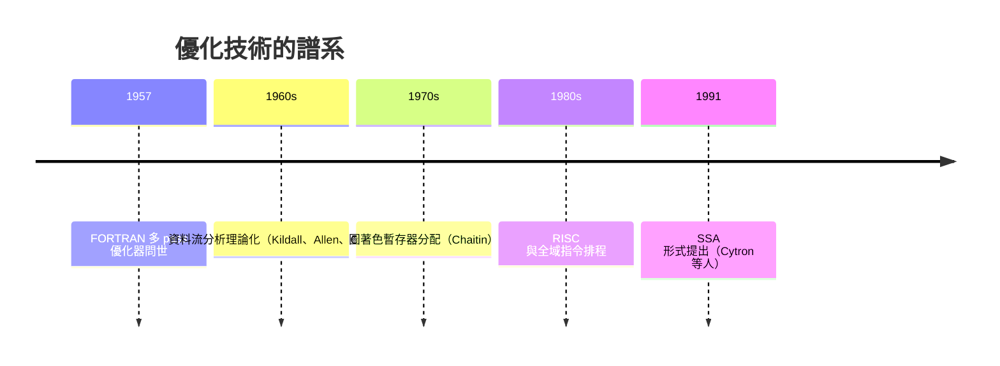

# 節標題：第一次代碼優化——比手寫組語更快

## 為什麼優化是生死問題

如果 FORTRAN 編譯出的程式比手寫的慢兩倍，FORTRAN 就死了。這是巴科斯團隊從第一天就明白的鐵律。當時的計算環境決定了遊戲規則：IBM 704 的機時昂貴，客戶買機器是為了日夜不停地算數值問題——氣象、流體力學、核反應——這類程式的執行時間以小時計、以天計。手寫組語的高手能榨出機器的每一滴效能，而如果編譯器做不到同等水準，客戶沒有理由改用新語言。

更糟的是理論環境的不利。馮紐曼學派與學界主流認定：機器翻譯必然損失效率，就像兩次口譯必然失真。巴科斯後來回顧，他們甚至認為「自動程式設計」這個詞本身都會引起懷疑。於是團隊做了當時看來最瘋狂的決定：把專案的大部分人力投入在**編譯器產出碼的品質**上，而不是語言的便利性上。FORTRAN 的語法設計——陣列、DO 迴圈、算術運算式——有一半的考量是「這樣寫，編譯器才優化得了」。

## 五十個分析器的軍火庫

巴科斯團隊在編譯器中構建了當時最龐大的優化體系。第一版 FORTRAN 編譯器包含多個 pass 的架構，其中用於優化的分析器多達數十個：常數折疊（把 $2 \times 3$ 直接算成 6 而非生成乘法指令）、公共子表達式消除（同一運算式在多處出現只算一次）、巢狀 DO 迴圈中的歸納變數分析與強度削減（把昂貴的乘法換成廉價的位址遞增）、以及最關鍵的——利用 IBM 704 三個索引暫存器做暫存器分配與運算式重排，把常用值留在索引暫存器裡，避免反覆存取記憶體。

洛伊絲・海布特（Lois Haibt）負責的部分格外有趣：她寫了一個統計分析器，模擬程式的控制流，估計每一個基本區塊的執行頻率，然後把經常執行的程式碼放在記憶體中更靠近的位置以縮短跳轉距離、把優化資源集中到熱點上。這是史上最早的「效能剖析導向優化」思想之一。整個優化子系統的規模與精巧度，遠超過當時所有「自動程式設計」系統的總和。

## 一九五七：偏見的崩塌

成果在交付後立刻顯現。客戶用 FORTRAN 重寫原本的組語程式，編譯出的機器碼執行速度常常與手寫碼相當，某些情況下甚至更快。這不是魔法，而是兩個因素：其一，編譯器不會疲倦、不會忘記優化，人類程式員在龐大程式中難免漏掉某個可省的指令，機器不會；其二，編譯器能做全域分析，看到人類在局部看不到的模式。

「高階語言必然低效」的偏見就此崩塌。學界與業界開始相信：語言的層次與機器的效率可以兼得，關鍵在編譯器。這個信念開啟了高階語言全面勝利的時代——LISP、COBOL、ALGOL 接踵而至，沒有人再認真主張人人都該寫機器碼。程式設計師的生產力自此與機器的效率脫鉤，這是軟體產業得以起飛的根本前提。

## 優化成為一門科學

FORTRAN 的優化器不僅是一個工程成就，更催生了一門學問。一九六〇與七〇年代，Kildall 對資料流分析的理論化、Cocke 與 Schwartz 的全域優化框架、Allen 與 Cocke 的 interval 分析，把 FORTRAN 團隊的實踐昇華為系統理論。這條線直接通往現代編譯器的核心技術：基於資料流方程的常數傳播與死碼刪除、Chaitin 的圖著色暫存器分配、以及二十一世紀成為主流的靜態單賦值形式（SSA）——Cytron 等人在一九九一年提出 SSA 時，目標就是更乾淨地表達 FORTRAN 式的稀疏條件常數傳播。今天 LLVM、GCC 中的每一趟優化，血統都可以上溯到一九五七年那台 IBM 704 上運行的程式。

## 洞見背後的性格

回頭看，FORTRAN 優化器的成功還隱含一個關於人物性格的故事。巴科斯團隊裡多是二三十歲的年輕人，他們沒有學術包袱，敢於把「不可能」當成待辦事項；他們相信工程實驗勝過權威斷言，在機器上反覆量測、反覆改進。巴科斯本人後來總結這段經驗時說，他們的成功關鍵是「抱著強烈個人責任感的小團隊，以及敢於追求雄心勃勃目標的勇氣」。這種「先證明可行，再聽反對意見」的作風，與霍普用演示說服客戶的策略如出一轍——那一代的先驅者共同書寫了一條規律：在範式轉移的關頭，資料與成品比理論辯論更有說服力。

從此，編譯器不再只是翻譯員，而是繼承了數學家角色的一部分：它是第一個懂得替程式做推理的程式。它看見 $a \times 2$ 就想到位移，看見兩次相同的除法就省去一次，看見迴圈中的不變量就把它提到迴圈外。這種「讓機器為程式做數學」的思想，是整本《編譯器的故事》最深刻的主線，而我們才剛剛翻開它的第一章。
