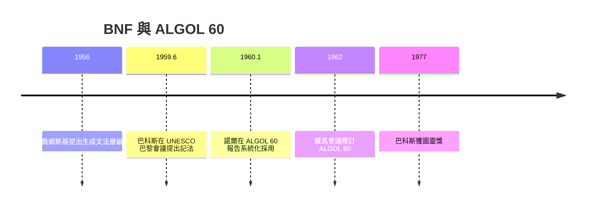

# 節標題：巴科斯—諾爾範式 BNF——形式語言基石

## 巴黎：一九五九年的那場會議

一九五九年六月，UNESCO 在巴黎召開「資訊處理語言國家會議」，會議的一個議程是討論一項剛誕生的國際語言提案——ALGOL 58。會上，約翰・巴科斯宣讀了一篇論文，提出一種形式記法，用來精確描述 ALGOL 58 的語法：每個語法成分定義為若干「產生式」的選擇，左邊是待定義的非終端符號，右邊是符號序列，用豎線分隔多個選項，用尖括號標記語法類別，用遞迴定義表達任意長度的結構。

這篇論文當時反應平平，但真正讀懂的人裡有一位丹麥計算科學家——彼得・諾爾（Peter Naur）。諾爾當時是 ALGOL 語言委員會的編輯，他立刻看出這套記法的價值遠超論文本身的內容。一九六〇年一月，ALGOL 60 委員會在巴黎召開著名的六十小時會議，諾爾在起草最終報告時，系統地採用了巴科斯的記法來定義整個語言——並做了細緻改進，包括引進 `::=`、約定元符號的意義。這份《Report on the Algorithmic Language ALGOL 60》因此成為史上第一個用形式文法完整定義的程式語言，而那套記法也因諾爾的推廣與系統化，被命名為 Backus-Naur Form（巴科斯—諾爾範式，BNF）。諾爾日後謙虛地說這記法應叫「巴科斯範式」，但歷史記住了兩個人的名字。

## 思想的源頭：Post 與喬姆斯基

BNF 並非憑空而降。它的思想譜系可上溯到邏輯學家埃米爾・波斯特（Emil Post）一九二〇至四〇年代對產生式系統（Post canonical systems）的研究——任意符號串可由有限的改寫規則生成；更直接的靈感來自語言學革命：諾姆・喬姆斯基（Noam Chomsky）一九五六年前後提出生成文法層級，把形式語言分為正則、上下文無關、上下文有關與遞迴可枚舉四類。程式語言的語法大多落在上下文無關文法的範圍，BNF 正是上下文無關文法的一種實用寫法。巴科斯後來承認，他提出記法時並不知悉喬姆斯基的工作——兩條線索在巴黎會師，數學、語言學與工程在此刻合流，這正是編譯器故事最動人的母題：不同學科的平行發現，在需求的催化下匯成主流。

## BNF 的制度意義：無歧義的語言規格

BNF 的深遠影響在於制度層面。在它之前，程式語言的定義靠散文描述與範例程式，歧義叢生，廠商各自詮釋；有了 BNF，語言可以**無歧義地**定義，標準化才有了數學基礎。ALGOL 60 報告本身也留下著名教訓：它的文法無歧義，但報告的散文部分仍有爭議之處——例如遞迴呼叫是否允許、參數傳遞的換名（call by name）語義，後者甚至催生了「困惑者的困惑」（call by name 的著名難題）與惰性求值的理論。形式文法管語法，語義仍需更深的工具——這條界線的發現，本身就是科學進展。

## 編譯器前端的數學基礎

BNF 同時是編譯器理論的地基。一旦語言以文法定義，語法分析（parsing）就變成純數學問題：給定文法與輸入串，構造導出樹。一九六〇年代，Knuth 提出 LR 分析的理論（LR(k) 文法），DeRemer 使其工程化；遞迴下降解析器則因 ALGOL 60 的語法特性（後來的「懸空 else」歧義）而發展出實用技巧。此後半世紀，幾乎每一種主流語言——從 Pascal、C 到 Java、Rust——的規格書都用 BNF 或其變體（EBNF）書寫，解析器產生器（yacc、ANTLR）直接以文法為輸入。程式語言委員會的標準化鬥爭（ISO、ANSI、ECMA），武器庫裡的第一件兵器永遠是那份文法。

## 歐洲與美國的制度對比

ALGOL 60 也是觀察科技制度史的絕佳標本。它由歐洲與美國學者共同設計：歐陸（以 Bauer、Rutishauser、Dijkstra 為首的 GAMM）追求數學的優雅與語言的純粹；美國的 ACM 與 IBM（Perlis、Samelson 等人）則更看重實用。委員會政治錯綜複雜——IBM 中途撤回支持、大力推銷自家的 FORTRAN，使得 ALGOL 在美國商業市場幾乎全軍覆沒，卻在歐洲學界與蘇聯集團大放異彩。這種「學術成功、商業失敗」的錯位，恰恰鑄就了 ALGOL 60 的歷史地位：它是結構化程式設計的溫床（begin-end 區塊、作用域、遞迴），孕育了 Dijkstra 的結構化程式設計學說、Wirth 的 Pascal、以及影響 C 語言血統的 B 語言。FORTRAN 贏了市場，ALGOL 贏了思想——軟體工程的兩大源流自此分岔。

## 一九七七：巴科斯的反思

一九七七年，巴科斯因「FORTRAN 編譯器、BNF 及 ALGOL 的貢獻」獲得圖靈獎。他的得獎演講題目驚人：〈Can Programming Be Liberated from the von Neumann Style?〉——程式設計能否從馮紐曼風格中解放？演講中他痛陳傳統命令式語言的缺陷：它們把程式捆綁在「逐字改寫狀態」的思維上，使得程式難以推理、難以組合、難以證明正確。他呼籲轉向函數式程式設計與代數性質驅動的語言——恰是他年輕時親手推動的範式的反面。一個人用二十五年時間推翻自己建立的帝國，這種智識誠實，為《編譯器的故事》寫下最富人性的註腳：編譯器的故事，從來不只是機器翻譯機器的故事，而是人類不斷重新定義「程式是什麼」的思想史。
