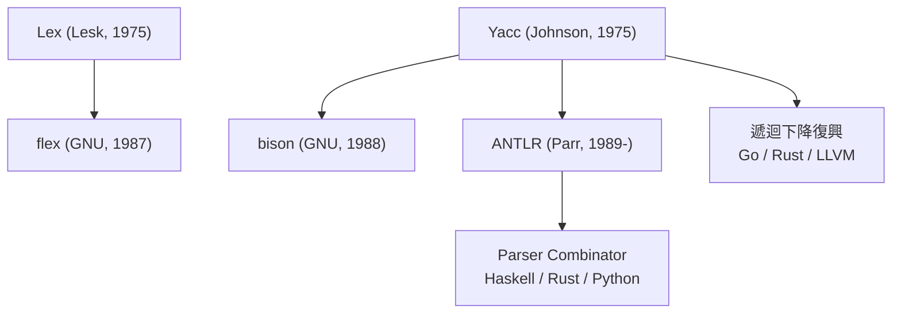

# Lex 與 Yacc：貝爾實驗室的自動化革命

1975 年前後，貝爾實驗室的計算機科學研究中心（1127 大樓）正處於創造力的巔峰：湯普森與里奇已造出 UNIX 與 C 語言。就在同一棟樓裡，兩位研究員各自做了一件看似不起眼、卻影響此後半世紀軟體工程的事——把編譯器理論裝進命令列工具裡。

Mike Lesk 寫出了 Lex，Stephen C. Johnson 寫出了 Yacc。

## Lex：正則表達式變成程式碼

Lex 是詞法分析器產生器。使用者寫一份規格檔：每一行是一條正則表達式加上一段 C 語言的動作碼，例如「匹配到 `[0-9]+` 就產生一個整數 token」。Lex 讀入規格，自動生成一張確定性有限自動機的表格，連同驅動程式，編譯成純 C 的詞法分析器。

這背後是整整二十年的理論積累：克林尼的正則事件、湯普森的 NFA 建構、Huffman 與 Moore 的自動機最小化。Lesk 的貢獻不是發明理論，而是把理論封裝到「寫下規則、其餘免談」的介面之後。值得一提的是，湯普森在更早的 1968 年就用同樣的理論寫了 grep；Lex 則是把同樣的引擎推廣成可組裝的零件。

## Yacc：BNF 變成解析器

Yacc（Yet Another Compiler-Compiler）處理的是難得多的一半。使用者以 BNF 語法規則加上語意動作描述語言，Yacc 自動生成一個 LALR(1) 解析器。這個「LALR」正是 1971 年 Frank DeRemer 對 Knuth LR(k) 理論的實用化壓縮：解析能力略遜於完整 LR(1)，但狀態表小了幾個數量級，恰好在 1970 年代的機器記憶體裡放得下。

Yacc 的設計處處顯示 Johnson 的務實智慧。它有個著名的「移進–歸約衝突」預設策略：衝突時預設移進、歸約時偏好清單前面的規則，並且只在開啟除錯旗標時才逐一報告。這個「先給答案、再談學問」的態度讓普通工程師不研讀 Knuth 的論文也能上手——很多人確實是靠著 Yacc 的錯誤訊息才第一次理解什麼是文法歧義。Johnson 自己對 Yacc 最得意的應用之一是可移植 C 編譯器 PCC，而諷刺的是，連 Yacc 自己的規格語法後來都用 Yacc 解析。

## 小工具的組合學

Lex 與 Yacc 的配對，是 UNIX 哲學的完美展示：lex 的輸出餵給 yacc，各司其職，透過管道與檔案組合成完整的編譯器前端。湯普森與里奇打造的環境——C 編譯器、shell、管線——既是 Lex/Yacc 的誕生條件，也因它們而更強大。UNIX 第七版的 man 手冊裡，lex 與 yacc 從此與 grep、make 並列，成為系統標配。

它們的應用遠超過「編譯器」一詞的狹義：SQL 的早期實作、awk 的解析器（Aho、Weinberger、Kernighan，Aho 正是龍書的作者）、無數設定檔格式、方程式計算器 bc、以及後世各家資料庫與直譯器。凡是需要「讀懂一種語言」的地方，就有人先寫一份 yacc 語法。這也是 Unix 文化的一個重要面向——語言不再是少數大神的手工藝，而是工程師日常的組合零件。

## 後世譜系

商業授權的 AT&T 原版在 1980 年代催生了自由軟體陣營的重寫：Vern Paxson 的 flex 取代 Lex，加入更快的表格與生成純 C 的選項；GNU 的 bison（由 Robert Corbett 開發、Richard Stallman 完善）取「yacc 的犛牛親戚」之意，成為 GNU 編譯器家族的標準配備。它們幾乎逐位元組地相容原版規格——這是「規格驅動」工具的一大美德：規格不變，工具可以換血。

1990 年代，舊金山大學的 Terence Parr 發起 ANTLR。他早先用 Yacc 系工具寫解析器屢受 LALR 衝突之苦，轉而押注另一條路：LL 型的遞迴下降。ANTLR 經歷數代重寫（從 Pascal、C++ 到 Java），到 ANTLR v4 已能在語法檔中直接寫左遞迴規則、自動生成具備優良錯誤回復能力的解析器，並可輸出十餘種目標語言的程式碼。Twitter、Salesforce、Hive SQL 都靠它解析訊息與查詢。與此平行，函式語言社群發展出 parser combinator——把解析器寫成可組合的函式，讓「語法即程式」成為一種風格。兩條路殊途同歸：解析器的編寫門檻一再降低。

## 規格驅動的工程

「編譯器編譯器」的思想，本質上是把程式設計中的一個根本模式——領域特定語言（DSL）——應用到編譯器開發自身：語法規格就是 DSL，Lex/Yacc 就是它的直譯器。這個思想讓編譯器開發從少數人壟斷的深奧手工藝，變成有規格、有自動驗證、可由普通工程師執行的工程。此後任何新語言的設計者，第一天就可以用一份 BNF 草案造出能跑的原型，靠實驗而不是靠想像來打磨語法。

編譯器的「認知前端」至此自動化了。但能解析出 AST 還遠遠不夠——`x + y` 中的 x 和 y 是整數還是字串、宣告於何處、可否存取，這些「意義」層面的工作，屬於下一階段：語意分析。
