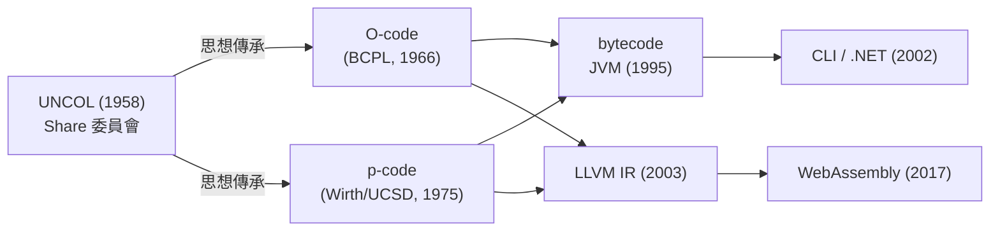

# 中間表示 IR：解耦前後端的橋樑

1960 年前後，電腦世界正面臨一個令人絕望的算術。機器五花八門——IBM 704、709、650，Burroughs 205，UNIVAC——每一台的指令集都不同；語言也越來越多——FORTRAN、ALGOL、COBOL、Lisp。若要讓 $N$ 種語言都能跑在 $M$ 種機器上，就得寫 $N \times M$ 個編譯器。IBM 為 FORTRAN 一種語言一台機器就投入了數十人年，這個乘法顯然撐不下去。

## UNCOL：最早的夢想

1958 年，IBM 用戶組織 SHARE 的一個委員會提出了一份提案：UNCOL（Universal Computer Oriented Language）。構想是定義一種通用的中間語言，每種語言只需一個「前端」把它翻成 UNCOL，每種機器只需一個「後端」把 UNCOL 翻成機器碼——總共 $N + M$ 個組件，而非 $N \times M$ 個。用數學語言說，這是把矩陣分解成一列加一行：

$$N \times M \quad \Longrightarrow \quad N + M$$

這是「寫一次、到處跑」最早的嚴肅版本，比 Java 的口號早了近四十年。然而 UNCOL 失敗了。原因並不神祕：定義一種對所有語言、所有機器都恰到好處的通用表示，本身就是要同時預知未來所有語言與機器的特性。抽象層次錯了，資訊在兩次翻譯中流失，優化無從下手；而且各家廠商也沒有動機去支援一個削弱自身機器特色的標準。UNCOL 作為產品死了，作為思想卻活得極久——後世每一個中間表示，都是對「這個抽象層次該畫在哪裡」這道題目的新解答。

## 多種解答的實驗時代

**Burroughs B5000**（1961）選了一個激進答案：乾脆讓硬體直接執行接近 ALGOL 的表示。它的機器碼採用波蘭記法（字尾堆疊式），配合硬體堆疊架構，讓 ALGOL 編譯器的「後端」幾乎不存在。這條「語言導向硬體」路線在 1960-70 年代曇花一現——Symbolics 的 Lisp 機器、Java 晶片都是其迴響——最終輸給了通用微處理器的經濟規模，但它證明了 IR 的邊界可以劃得很靠近硬體。

**BCPL 的 O-code**（Martin Richards, 1960 年代中）走了另一端：編譯器先從 BCPL 生成一種簡單的中間碼 O-code，再把 O-code 翻成目標機器碼。因為前後兩半都極小，BCPL 編譯器在短短幾個月內就被移植到數種機器上。Richards 的學生 Ken Thompson 正是把這套「小型語言 + 中間碼移植法」的精神帶進了 UNIX 世界（B 語言即 BCPL 的簡化）。

**p-code** 則是第一個大獲成功的案例。1970 年代中，蘇黎世聯邦理工學院的 Niklaus Wirth 團隊與加州大學聖地牙哥分校（UCSD）的 Kenneth Bowles 合作，把 Pascal 編譯器改成生成「P-machine」的虛擬機碼——p-code。Pascal-P 發行版附帶 p-code 直譯器原始碼，任何機器只要把這幾百行程式移植過去，整個 Pascal 編譯器與標準程式庫就自動可用。移植到上百種機器的壯舉，靠的正是這個策略。1978 年，UCSD Pascal 被蘋果選為 Apple II 上的主要開發環境（Apple 軟體銀行套裝），p-code 於是隨著百萬台 Apple II 進入千家萬戶——一個學術界的可移植性實驗，就這樣成了最早的商業級虛擬機碼生態。1991 年的 Visual Basic 以 p-code 為直譯模式，名稱直接致敬。

## 抽象的槓桿

p-code 之後，譜系加速分化又匯流：Smalltalk-80 的 bytecode、供組合器的 Forth、1995 年 Java 的 JVM bytecode（借鑒了 Pascal 與 Smalltalk 的堆疊機設計，加上驗證器與安全模型）、2002 年微軟 .NET 的 CIL、2003 年 Chris Lattner 的 LLVM IR、2017 年瀏覽器裡的 WebAssembly。這條線上每一代都往前多學到一件事：JVM 學會了把安全驗證放進 bytecode 語意，.NET 學會了把泛型放進表示層，LLVM 則把 IR 做成顯式 SSA 形式、配上完整的庫化基礎設施——那是第七章的故事。

回頭看，IR 的核心價值早已超出「省編譯器」的算術：

1. **解耦**：前端只對語言負責，後端只對機器負責，中間是一份穩定契約。GCC 用 GIMPLE/RTL 分離了上百種前後端組合。
2. **優化落點**：資料流分析、常數傳播、死碼消除等優化做在 IR 上一次即全體機器受惠，與硬體無關。
3. **生態位**：IR 成為新語言的快速起點（Rust、Swift、Julia 皆直落 LLVM IR）、新硬體的快速起點（GPU、晶片設計皆可吃 LLVM 後端），兩邊的創新速度都因此倍增。

從 UNCOL 的烏托邦到 LLVM 的帝國，「中間表示」證明了一個工程學的深理：選對抽象層次，比寫對任何一段程式碼都更重要。UNCOL 錯在把抽象劃得太高太死；成功的 IR 都把抽象劃在「保留足夠低階資訊以利優化」與「足夠遠離任何特定機器」之間那道細縫裡。

IR 這座橋的橋面上，行駛著兩種主要車輛：樹狀的 AST 式表示與線性的三位址碼。它們如何互相轉換、各擅勝場，就是下一節的主題。
