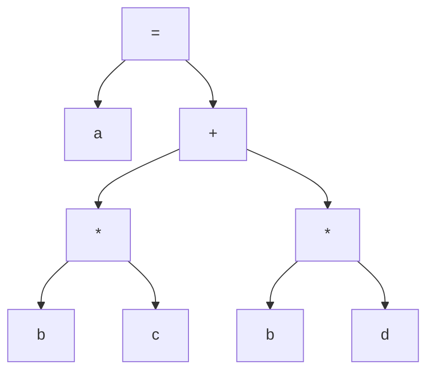
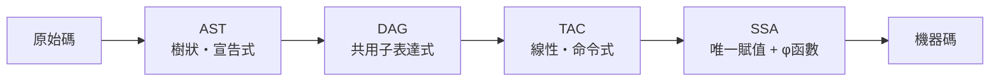

# AST 與三位址碼：樹狀邏輯的扁平化

語意分析之後，編譯器裡躺著一棵意義完整的 AST。但真正的機器是一條線性的指令序列：取、算、存，一次一步。從樹到線，這一步「扁平化」是編譯器內部最核心的一次表示轉換——它不只是翻譯，更決定了之後所有優化能在什麼視角下進行。

## AST：邏輯的骨架

抽象語法樹剝去了原始碼的表面形式（括號、分號、關鍵字拼寫），只留下運算的巢狀結構。它是「宣告式」的視角：`a = b * c + b * d` 的意義就是「兩個乘積相加」，巢狀一目瞭然。

各家編譯器對 AST 的設計哲學不同。GCC 的內部表示 tree 早年與語言前端的型態系統深度糾纏，C、C++、Fortran 各有前端節點，演化出龐大的繼承體系；蘋果的 Chris Lattner 在設計 Clang 時則反其道而行：Clang AST 採用值語意（value semantics）的緊湊節點、與來源位置（source location）緊密綁定，讓重構工具與 IDE 能精確地「從樹回到原文」。這個設計差異直接決定了工具生態——Clang 的 AST 成為 clang-format、clang-tidy、以及無數重構工具的地基，因為它把「程式碼的結構」與「程式碼的文本」之間的映射做成了公民權利。現代編譯器（如 Rust 的 rustc、Swift）更把 AST、HIR、MIR 分成多層，逐層降低抽象，各層服務不同的分析。

## 三位址碼：機器的影子

三位址碼（Three-Address Code, TAC）則是「命令式」的視角。每條指令至多一個運算符、至多三個位址（兩個來源、一個目的）：

```text
x = y op z
```

這個形式刻意貼近真實機器（x86、RISC-V 的指令普遍在兩三個運算元之內），使得最終的指令選擇幾乎是逐一映射。TAC 的發明通常歸功於 1960 年代 IBM 的 FORTRAN H 編譯器與 Backus 團隊的實踐傳統，而其理論化則出現在 1970 年代的教科書——Aho 與 Ullman 的《The Theory of Parsing, Translation, and Compiling》(1972-73) 正式把它立為標準的中間形式。

## 一行敘述的兩副面孔

以 `a = b * c + b * d` 為例。它的 AST 是：



扁平化成 TAC，需要為每個子運算引入暫存器：

```text
t1 = b * c
t2 = b * d
t3 = t1 + t2
a  = t3
```

樹裡藏著的秘密，在線性化之後暴露了出來：`b` 出現了兩次，`t1` 與 `t2` 是同一個式子 `b * c` 與 `b * d` 的「表親」。這正是**公共子表達式**（common subexpression）。如果在生成 TAC 之前先把樹轉成 **DAG**（有向無環圖）——讓相同子運算共用同一個節點，`b * c` 與 `b * d` 在 DAG 中各是一個乘法節點但共享 `b` 葉子，而更進一步的值編號（value numbering）技術甚至能發現跨敘述的重複——優化器就能把它們合併：

```text
t1 = b * c
t2 = b * d
t3 = t1 + t2
a  = t3
```

DAG 表示法由 Cocke 與其他 IBM 研究者在 1960 年代引入基本塊分析，成為局部優化的標準資料結構：在 DAG 上做拓撲排序，直接產生優化後的線性碼。這正是扁平化的意義——樹適合表達「邏輯是什麼」，線性碼與 DAG 適合回答「怎麼算得省」。資料流分析（哪些變數在哪裡活著）、指令排程（哪條指令先發射）、暫存器分配（誰住進有限的暫存器），全部都需要線性的、順序明確的表示才有抓手。

## SSA：TAC 的革命性進化

TAC 有個古老的煩惱：變數 `b` 在程式裡可能被賦值十次，「`b` 的值」在不同程式點指涉不同的定義，資料流分析被迫在模糊中做保守估計。1980 年代末，IBM 的 Cytron 與其同事在芝加哥伊利諾大學的 Ron Cytron、Jeanne Ferrante、Barry Rosen、Kenneth Zadeck 以及 Rice 大學的 Keith Cooper 等人手中，發展出**靜態單賦值**（Static Single Assignment, SSA）形式：每個變數只被賦值一次，路徑交會處插入 $\phi$ 函數合併不同來路的值。上述程式在 SSA 世界裡會是 `b1 = ...; b2 = ...; b3 = φ(b1, b2)` 這樣的形態——每個值都有了唯一的名字，use-def 關係退化成一次指標追逐，優化演算法從此從對數、線性直落到接近常數時間。

值得一提的是，樹與線並非取代關係而是分工關係。現代編譯器往往在整條管線中反覆切換表示：前端生成 AST 做語意檢查，下降（lowering）成 TAC/SSA 做機器無關優化，指令選擇時又用樹狀的模式匹配（如 Burg、tblgen 的選擇器）挑出最合適的機器指令。每一層表示都是為特定問題量身訂做的透鏡——編譯器工程的藝術，正在於知道該透過哪一面鏡子看程式。

SSA 的思想譜系可上溯至 1970 年代的「單賦值」資料流語言，但把它變成可工程化的編譯器中間形式，是 Cytron 等人 1991 年論文〈Efficiently Computing Static Single Assignment Form and the Control Dependence Graph〉的功勞。此後 GCC 的 GIMPLE、LLVM 的 IR、Java HotSpot、V8、Rust 的 MIR，全數採用 SSA。那是第五章的主題；此處只需記住：SSA 是 TAC 這條線性傳統的進化，而不是背離——它保留線性，只是讓每一份值都有了自己的名字。



從樹到線，從線到 SSA，編譯器的內部旅程，其實是一部「表示法」的演化史。每一次表示的更換，都解鎖了一整代優化技術——接下來，我們就深入這場 SSA 革命。
