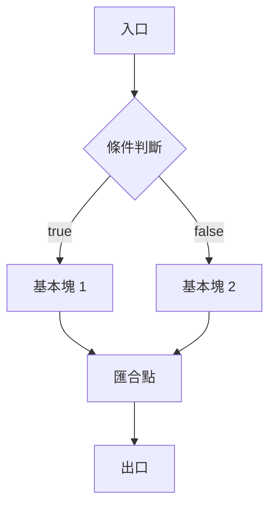

# CFG 與 SSA：優化的形式基礎

1970 年代之前，編譯器優化更像是一門手藝而非科學：工程師針對特定程式片段施展零散的技巧，優化是否正確、是否達到極限，全憑經驗判斷。改變這一切的關鍵人物，是 IBM 的法蘭西絲．艾倫（Frances Allen）。

## 資料流分析：讓優化變成科學

艾倫 1957 年加入 IBM，原本是教 FORTRAN 的老師，被調去協助編譯器團隊檢查程式正確性，卻從此走上編譯器研究之路。在那個女性工程師寥寥無幾的年代，她一步步成為 IBM 的高級研究員，並在 2006 年成為史上第一位女性圖靈獎得主。

她與同事 John Cocke 合作提出的核心洞察是：任何程式的控制流程都可以畫成一張圖——控制流圖（CFG）。圖中的節點是「基本塊」（basic block），即一段只能從開頭進入、從結尾離開、中間沒有分支的直線程式碼；邊則代表可能的跳轉。有了 CFG，優化問題就被形式化了：在圖上定義「資料流方程」，用迭代法求出每個程式點上變數的性質。

```text
if (x > 0)
    y = 1;
else
    y = 2;
z = y + 1;   // 到這裡時 y 必為 1 或 2
```

艾倫的資料流分析框架回答的正是這類問題：「執行到某一行時，某個變數的值一定是什麼？哪些值可能傳到這裡？」她進一步開創了跨程序分析（interprocedural analysis），把分析範圍從單一函式擴展到整個程式，這在計算資源昂貴的 1970 年代是極具遠見的工作。圖論演算法中的支配樹（dominator tree）也在此期間被引入編譯器：若每條從入口到某節點的路徑都經過節點 A，則 A 支配該節點——這個概念後來成為 SSA 演算法的數學基石。



## SSA：每個變數只誕生一次

到了 1980 年代末，IBM 托馬斯．華生研究中心的團隊——Ron Cytron、Jeanne Ferrante、Barry Rosen、Mark Wegman 與 Kenneth Zadeck——在 1989 年發表、1991 年定稿的論文〈An Efficient Method of Computing Static Single Assignment Form〉中，提出了一種劃時代的中間表示：靜態單賦值形式（SSA）。

SSA 的規則簡單得近乎優雅：每個變數在程式中只被賦值一次。一旦變數需要重新賦值，就改用一個「新名字」。例如：

```c
x = 1;
if (c)
    x = 2;
y = x;
```

轉成 SSA 後變成：

```text
x1 = 1
if (c) x2 = 2 else (跳過)
x3 = Φ(x1, x2)   // Φ 函數：依來路選擇 x1 或 x2
y1 = x3
```

那個神祕的 Φ（phi）函數是 SSA 的精髓：當控制流從不同分支匯合時，Φ 根據實際執行路徑選出正確的版本。更關鍵的是，Cytron 等人證明了可以用支配樹高效計算 Φ 函數的插入位置（支配邊界，dominance frontier），整個轉換接近線性時間——SSA 從數學概念變成了工程上可行的技術。

## 為什麼 SSA 是革命

在 SSA 之前，資料流分析要對每個變數、每個程式點建立集合，然後在 CFG 上反覆迭代直到收斂，代價高昂。在 SSA 之後，每個變數只有一個定義點，「這個值從哪裡來」的問題直接由 def-use 鏈回答——資料流資訊被編碼進了變數命名本身。常數傳播、死碼消除、公共子表達式消除等經典優化在 SSA 上都變得更簡單、更精確。

這場革命在工業界落地的速度不快，但極為徹底。GCC 花了十幾年的內部辯論，終於在 2005 年的 4.0 版以 GIMPLE 中間表示全面轉向 SSA；LLVM 則從 2000 年代初誕生起就直接以 SSA 為 IR，完全跳過了舊世界的包袱。今天幾乎所有主流編譯器與 JIT 都以 SSA 為核心。

## 與函式式思想的暗合

有趣的是，SSA 與函式式程式設計在數學上是同構的：每個變數只賦值一次，意味著變數不可變（immutable），程式成為一張資料依賴圖。1978 年 John Backus 在圖靈獎演說中鼓吹函式式風格時，命令式陣營曾覺得那是不切實際的數學幻想；十年後，編譯器工程師卻為了優化的效率，自願把命令式程式改寫成單賦值形式。思想的河流在此交會：讓編譯器好分析的表示方式，與讓人類好推理的表示方式，原來是同一種。

艾倫在圖靈獎演說中回顧這段歷史時強調，編譯器優化的進步來自抽象：先把程式變成圖，再把圖上的性質變成方程。CFG 與 SSA 正是這條路線的兩座里程碑——前者讓優化有了地圖，後者讓地圖上的每條路都標上了出處。
