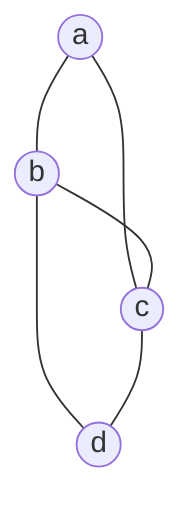

# 暫存器配置與圖著色演算法

編譯器優化的大廈，最後要收在一個殘酷的物理現實上：CPU 的暫存器少得可憐。x86-64 只有 16 個通用暫存器（扣掉堆疊指標等專用者更少），而一個中等函式裡「同時活著」的變數動輒數十個。誰能留在最快的暫存器裡，誰被踢進慢上百倍的記憶體——這就是暫存器配置（register allocation）問題，它幾乎直接決定一個編譯器產出程式碼的品質上限。

## 把配置變成著色：Chaitin 的洞察

1981–82 年，IBM 的 Gregory Chaitin 發表了一系列論文，提出一個至今仍在使用的形式化框架。他的第一步是定義干涉圖（interference graph）：圖中每個節點是一個變數的活躍區間，若兩個變數的存活時間重疊（同時需要佔據儲存位置），就在它們之間連一條邊。於是問題神奇地轉化為圖論中的圖著色：給圖中每個節點塗一種顏色，相鄰節點不同色，而顏色數不能超過 $k$——$k$ 就是可用暫存器的數量。

三個暫存器即可著色上圖：a、d 同色，b、c 各一色。但若圖中出現完全子圖 $K_5$，就需要五種顏色——五個變數同時搶暫存器，必有失敗者。

這個轉化美妙之處在於它揭示了問題的本質：Chaitin 同時證明圖著色是 NP 困難的，所以完美的暫存器配置在計算複雜度上就不可能輕鬆獲得。他提出的啟發式至今仍是教科書內容：反覆從干涉圖中移除「鄰居少於 $k$ 個」的節點（這些節點肯定能著色），壓成一個棧；若卡在所有節點的鄰居都 $\geq k$，就選一個「犧牲者」估計其 spill 成本（使用次數少、位於冷路徑上的優先），把它溢出到記憶體，並在程式中插入載入與儲存指令，然後重來。整個流程是「簡化—溢出—選色」的循環，工程上極為高效。

Chaitin 這項工作還有一個有趣的背景：他是一位數學家，以演算法資訊理論（Kolmogorov 複雜度的演算法版本）聞名。他把圖著色帶進編譯器，可說是純數學對工程的一次完美空降。

## 線性掃描：JIT 時代的務實主義

圖著色配置器雖好，編譯一個函式要建圖、反覆化簡，成本不低。對一次編譯、終身執行的靜態編譯器，這成本划算；但對 JIT（即時編譯器）而言，編譯發生在程式執行的路徑上，編譯本身的每一毫秒都在拖累使用者。1999 年，Massimo Poletto 與 Vivek Sarkar 發表了線性掃描（linear scan）演算法：把所有變數的活躍區間按起點排序，掃一遍，遇到暫存器不夠就逐出「生命週期結束得最晚」的區間。整個演算法沒有圖、沒有迭代，只有一趟掃描，快上一個數量級，代價是碼品略遜於圖著色。

這個「品質稍差但快得多」的取捨，恰好長在 JIT 的需求上。JavaScript 的 V8 引擎、LuaJIT、早期的 Android JIT 都採用線性掃描或其變體。演算法的價值不由理論優雅度決定，而由使用場景決定——這是暫存器配置史給軟體工程上的一課。

## 溢出的真實代價

暫存器配置的品質不是抽象指標。每一次 spill 都是一對額外的 load/store 指令；在現代 CPU 上，快取命中的載入要 4–5 個週期，快取未中則上百週期。一個函式若被逼出十幾個 spill，效能腰斬是常事。這也解釋了為什麼暫存器壓力（register pressure）成為編譯器內部設計的關鍵約束：內聯會增加暫存器壓力，循環展開也是，優化之間會互相拉扯，編譯器必須全局權衡。

## 從古典到現代

三十年來，暫存器配置持續演化。LLVM 在 2001 年起使用線性掃描的改良版，2011 年由 Jakob Stoklund Olesen 重寫為 greedy allocator——一種基於 SSA 特性的貪心著色：SSA 中每個變數單一定義，生命週期是樹狀區間，可在掃描時即場分配並在必要時「分裂」（live range splitting）活躍區間，把變數的後半生留在暫存器、前半生放在記憶體，大幅減少整段 spill。它兼取兩派之長：接近圖著色的品質，接近線性掃描的速度。

回顧這段歷史：Chaitin 把工程問題翻譯成數學問題，Poletto 與 Sarkar 又在硬體與 JIT 的經濟壓力下把它翻譯回務實的工程解。理論與實務之間的鐘擺，最後停在一個混合體上——而混合體之所以可能，正是因為兩代人都把問題的形式化基礎打牢了。
