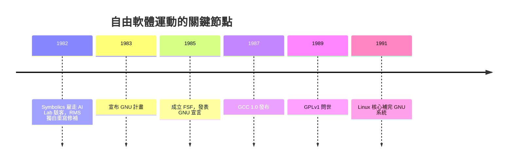

# RMS 與 GCC：自由軟體的編譯器

1970 年代的 MIT 人工智慧實驗室，是駭客文化的黃金時代。那裡的工程師相信程式碼應該共享——遇到問題，敲開鄰居的門、讀他的原始碼、改進它，是天經地義的事。Richard Stallman（RMS）是這個文化的產物，也將成為它最激進的守護者。

## 催化劑：Symbolics 事件

1982 年，實驗室的駭客們紛紛被創業公司 Symbolics 雇走。Symbolics 與 LMI 是兩家從 MIT Lisp machine 技術衍生出的公司，卻走向了封閉：Symbolics 對其作業系統原始碼嚴格保密，並不斷雇走實驗室的人才。最後，AI 實驗室裡幾乎只剩下 RMS 一個駭客。

他的反應是一場孤獨的游擊戰：Symbolics 每次發布新版作業系統，RMS 就拿著 LMI 機器上仍是 MIT 版本的舊原始碼，把 Symbolics 的所有改進與修補逐一重寫出來，放回 MIT 的版本中，公開給大家使用。他刻意不抄原始碼，而是實現同樣的功能，以規避版權。這場持續一年多的競賽，讓 RMS 每週工作七十二小時，也讓他想清楚了一件事：問題不在某家公司，而在於軟體被當成了私有財產，使用者之間的合作被法律禁止了。

## GNU 與 FSF：一場作業系統的遠征

1983 年 9 月，RMS 在 Usenet 上宣布 GNU 計畫——一個完全自由、相容 Unix 的作業系統（GNU 是「GNU's Not Unix」的遞迴縮寫）。1985 年他成立自由軟體基金會（FSF），並發表〈GNU 宣言〉，把軟體自由從工程偏好提升為道德主張：「free as in freedom, not free as in beer」——自由軟體講的是自由，不是免費。

但一個作業系統要從哪裡開始蓋？RMS 的答案是編譯器。這是極為清醒的工程判斷：作業系統的一切——核心、工具、應用——都必須被編譯器轉成機器碼；沒有自由的編譯器，你只能用別人的私有編譯器，整個系統的自由就有一個永遠補不上的洞。而且編譯器天然需要大量移植（每種 CPU 一套後端），正是社群協作最能發揮的領域。

1987 年，GNU C Compiler（GCC 1.0）正式發布。它迅速以極佳的優化能力聞名，很快在各種 Unix 工作站上成為主流 C 編譯器——甚至往往比廠商自家的私有編譯器更強。1991 年 Linux 核心出現後，GCC + Linux 核心拼出了完整的自由作業系統，GNU 遠征的第一階段目標意外地由 Linus Torvalds 的核心補完。

## 性格與哲學

RMS 的性格是理解這段歷史繞不開的因素：固執、極端、邏輯徹底到不近人情。他不吃早餐以外的正餐只為省麻煩，他長年不用信用卡、拒絕門禁卡，把隱私原則貫徹到生活的每個縫隙。這種性格造就了自由軟體運動的道德純度，也埋下了他與實務派開發者多年摩擦的種子。但不可否認：若非這種近乎宗教的堅持，「軟體應該自由」在 1983 年就只是邊緣的抱怨，而不是一場持續四十年的社會運動。

## 開發模式：為了自由而集中

GCC 早期的開發模式與今天大相逕庭：所有 patch 都要經過 RMS 或少數核心維護者審查；貢獻者必須簽署版權讓渡（copyright assignment），把著作權移交給 FSF。這在今天的開源世界看來不可思議，但 RMS 的理由一以貫之：只有 FSF 完整持有版權，才能在法庭上有效執行 GPL（通用公共授權）——自由不是靠祈禱維持的，要靠法律武器，而法律武器需要乾淨的產權。

這個制度深刻塑造了 GCC 的命運：它保證了 GCC 永遠不會被私有分叉收購，卻也讓貢獻流程緩慢、中心化，為日後的 egcs 分叉埋下伏筆。歷史的弔詭之處在於：RMS 為了保衛自由而建立的集中制度，最終成了實務開發者想逃離的高牆——但若沒有那堵牆，GCC 能否挺過商業軟體公司最猛烈的圍剿年代，本身也是一個問號。

GCC 的誕生證明了一件事：一個人的道德執念，配上正確的工程切入點（編譯器），可以撬動整個軟體產業的產權結構。接下來的四十年，這支軍隊將從單一 C 編譯器長成橫掃所有硬體的巨無霸。
