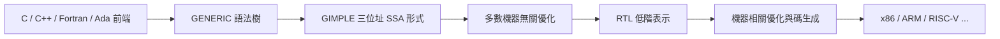

# GCC 的擴張：多前端多後端巨無霸

1987 年的 GCC 只是一個 C 編譯器。四十年後，它支援十餘種程式語言前端、數十種 CPU 後端，從手錶裡的微控制器到超級電腦上的 ARM 叢集，都在用它編譯。這個巨無霸的成長史，正是自由軟體從道德運動變成產業基礎設施的歷史。

## 多語言前端：從 G++ 到 GNAT

C++ 是第一個大目標。1987 年前後，Peter Lenkov 最早開始嘗試在 GCC 上加 C++ 支援，而真正把它變成可用產品的是 Michael Tiemann——他後來成為 Red Hat 的 CTO。Tiemann 對 C++ 有深刻的技術判斷：他把虛擬函式、例外處理、模板等語言特性直接編譯成高效機器碼，證明了「C++ 不必慢」。G++ 的成功讓 GCC 打入當時正在爆發的物件導向程式設計浪潮，也證明了 GCC 架構可以承載比 C 更複雜的語言。

其他前端陸續到來：

- **Fortran**：先有 1990 年代的 g77，2000 年代由支援 Fortran 90/95 的 gfortran 取代——科學計算社群因此在自由軟體上獲得了完整工具鏈。
- **Ada**：1992 年前後，紐約大學的團隊在美國空軍資助下開發 GNAT（GNU NYU Ada Translator）；之後被 Ada Core Technologies（ACT）商業化經營，同時保持自由軟體授權——這是「公司賣支援、不賣授權」模式的早期範例。
- **Objective-C**：讓 NeXTSTEP（後來的 macOS 基礎）得以在 GCC 上構建，間接把自由編譯器帶進了蘋果生態。
- **Java**：gcj 將 Java 原生編譯，是 1990 年代末自由軟體陣營對 Sun 佔有策略的回應。

## 多後端：橫掃所有晶片

GCC 的後端版圖擴張，映射著整個電腦工業的變遷：最早的 vax 與 m68k，到 Sun SPARC、MIPS、x86，再到 PowerPC、ARM，直至近年的 RISC-V。每加一個後端，GCC 就多統治一個硬體生態。對晶片廠商而言，支援 GCC 幾乎成為新品上市的必要儀式——沒有 GCC 後端，你的晶片就沒有開發者；有了它，全世界的自由軟體一夜之間「免費」移植到你的硬體上。這是自由軟體最成功的商業外溢：FSF 出於道德建立的工具，成了晶片產業的公共財。

## 中間表示的演化：GENERIC → GIMPLE → RTL

支撐多前端多後端的，是 GCC 的分層架構：

前端先把語言解析成 GENERIC 樹；再降到 GIMPLE——一種受限的三位址碼（每條語句至多三個運算元），2005 年起以 SSA 形式存在，承擔絕大多數優化；最後降到 RTL，做指令選擇、排程等機器相關工作。前端不必知道後端細節，後端不必理解語言語義——理論上。

## 商業生態：嵌入式產業的經濟動力

GCC 最大的商用推力來自嵌入式產業。1990 年代末，嵌入式 Linux 興起，路由器、機上盒、手機裡的系統都需要交叉編譯工具鏈，而 GCC 是唯一成熟的自由選項。於是出現了一批以 GCC 為業的公司：Red Hat 雇用 Tiemann 等核心開發者；CodeSourcery（後被 Mentor Graphics 收購）專門做 GCC 與工具鏈的客製與支援，深度參與 ARM 後端的開發。他們的模式是：上游改進 GCC（回饋社群），下游向客戶收顧問與維護費。嵌入式產業的規模經濟，養活了一支常年的 GCC 專職工程師部隊——自由軟體第一次擁有了不靠學界熱情的持續開發能量。

## 四十年統治

到 2000 年代，GCC 的地位已難撼動：嵌入式 Linux 幾乎全部以 GCC 為工具鏈；超級電腦上的科學程式由 gfortran 與 GCC 編譯；Android NDK 早期也以 GCC 為預設編譯器。它成為了那種最深刻的基础设施——大多數使用者不知道它的存在，卻每天都運行它編譯出的程式碼。

但巨無霸有其代價。多語言、多後端、多種中間表示堆疊在幾百萬行 C 代碼上，內部耦合日漸嚴重；版權讓渡與 RMS 的集中審批讓外部貢獻者步步艱難。到 1990 年代末，這座大廈的裂縫已大到從外面看得見——下一章，我們來看分叉如何發生，以及一個從一開始就選擇了另一條路的後繼者。
