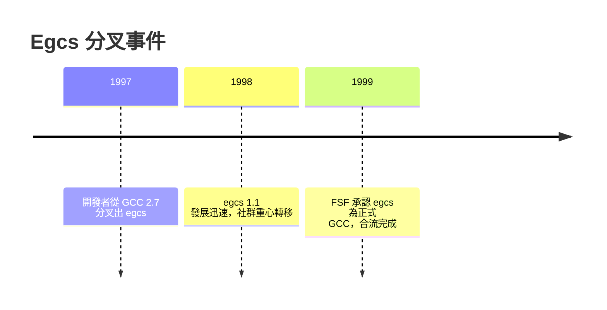

# 單體架構的代價：GCC 的耦合與爭議

一個軟體專案成為標準之後，最危險的事就發生了：它開始依靠地位而非品質維持自己。1990 年代末的 GCC，正處在這種狀態——而它為此付出了分叉的代價。

## 集中治理的摩擦

RMS 為了 GPL 的法律防衛力建立了兩項制度：版權讓渡（貢獻者須把版權移交 FSF）與權威審批（patch 由少數 maintainer、最終由 RMS 裁定）。制度本身有其邏輯，但執行方式讓實務開發者痛苦：審查週期長、裁決標準不透明、外部貢獻者常感覺自己是在「請求」而非「參與」。1990 年代末，隨著 GCC 用戶爆發性成長，貢獻者的耐心到了極限。爭議的核心問題是：自由軟體專案該由道德權威治理，還是由工程共識治理？

## 更深的病根：單體式架構

治理問題只是表面，技術債是更深的病根。早期 GCC 為了快速支援多種語言與機器，讓內部資料結構直接暴露在模組之間：前端直接改寫 GIMPLE/RTL 的節點，優化 pass 之間互相依賴內部細節，沒有穩定的 IR 函式庫介面。想「把 GCC 當函式庫用」——例如嵌入到 IDE 做即時語法檢查，或寫一個獨立工具借用它的優化器——幾乎不可能：你得把整個編譯器連同它的全部假設一起吞下去。代碼在檔案之間層層互相 include，改一處牽動全域，導致開發速度越來越慢、重構越來越難。

這不是 GCC 獨有的病，而是單體架構的通病：快速成長期，耦合是捷徑；成熟期，耦合是枷鎖。

## Egcs：分叉再合流

1997 年，長期受挫的開發者群（包括 Cygnus Solutions 的工程師，如 Ian Lance Taylor、Michael Meissner 等人主導）決定動手：他們從 GCC 2.7 分叉出 egcs（Experimental GNU Compiler System）。egcs 採取了與 GCC 正統截然不同的原則：開放的 patch 審查流程、透明的決策委員會、大膽接受實驗性重構。發展速度立刻超越本尊——許多新優化與新硬體支援都先出現在 egcs。

戲劇性的結局在 1999 年：FSF 承認了既成事實，正式宣布以 egcs 為基礎繼續開發，egcs 更名為 GCC，開發主導權和平轉移。這是開源史上著名的「分叉再合流」：分叉沒有撕裂社群，反而用市場機制完成了一次治理改革。FSF 保留了版權讓渡制度（至今仍是 GCC 的規則），但日常治理已轉為分散式的 maintainer 共識。教訓很清楚：在自由軟體世界，治理權最終屬於做出最多有效工作的人。

## LLVM 的鏡像：另一種設計哲學

就在 egcs 分叉前後，伊利諾大學的 Chris Lattner 開始構思另一個編譯器，2000 年左右成型，2003 年論文發表：LLVM。它從第一行代碼就做出與 GCC 相反的選擇——模組化函式庫、穩定的 C++ API、清晰的 IR、每個 pass 獨立可連結。想寫一個新的語言前端？寫一個函式庫客戶端即可。想單獨用它的 JIT？不必引入整個編譯器。LLVM 的成功很大程度上是「從 GCC 的痛苦中學到了一切」——GCC 的架構債，成了 LLVM 的設計規格書。（這段故事，第 7 章將完整展開。）

## GCC 陣營的回應

GCC 陣營並非坐視。技術上，後續版本持續推進模組化：GIMPLE 全面 SSA 化（GCC 4.0, 2005）、pass 管理重構、逐步清理內部介面。政治上，2007 年 FSF 發布 GPLv3，加入了著名的反 TiVo 化條款——若硬體廠商用 GPLv3 軟體但不允許使用者更換其上的軟體（如同 TiVo 鎖死機器），就違反授權。這是 RMS 哲學的又一次延伸：自由必須覆蓋到硬體消費的終端，不能讓嵌入式裝置變成自由的孤島。Linux 陣營為此拒絕 GPLv3，自由軟體運動自此分裂為兩大陣營——這是後話。

## 單體的教訓

GCC 的故事留下一個超出了編譯器的教訓：**模組化不只是工程美學，而是生態的政治選擇。**一個耦合的單體，把權力集中在能看懂全部內部的人手裡，外部參與者只能繞著走；一個清晰的函式庫介面，則把能力分配給每一個外部開發者，讓生態可以水平生長。GCC 用 egcs 分叉買到了這個教訓的一半，另一半要等 LLVM 用十年的爆發式成長來證明：架構決定政治，政治決定生態，生態最終決定誰統治下一個時代。
