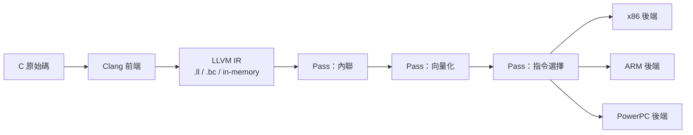

# 07.2　LLVM IR 與 Clang：模組化管道

## 函式庫，而非黑箱

LLVM 帶給編譯器世界的第一場革命，不是某個更快的優化演算法，而是一個架構觀念的翻轉：**編譯器應該是一組函式庫，而不是一個黑箱工具**。

GCC 的模式是典型的單體工具：你餵給它原始碼，它吐出執行檔，中間過程全部封在內部。想寫一個工具借用 GCC 的前端解析結果？理論上可以（GCC 後來提供插件機制），但它的內部 API 逐版變動、沒有穩定性承諾，加上 GPL 著佐權（copyleft）——你的工具若連結 GCC 程式碼，可能整個都必須以 GPL 釋出。對商業公司而言，這等於把 GCC 關在玻璃箱外。

Lattner 把這件事倒過來做。LLVM 從設計第一天就把自己定位為「編譯器基礎設施」：前、後端之間以 LLVM IR 解耦，任何工具都能以穩定的 C++ API 直接操作 IR。這個決策的深遠影響，要到前端的出現才完全展現。

## Clang：從前端的空白補起

2000 年代中期，LLVM 有了優秀的後端與中端，卻缺一個能用的 C/C++ 前端——當時唯一可用的是 GCC 前端，而連結它又會掉回 GPL 的陷阱。於是 Lattner 於 2007 年主導啟動 Clang（C Language 前端，諧音取 "clang" 的鏗鏘之意），目標是打造一個以 LLVM 函式庫風格寫成的 C/C++/Objective-C 前端。

Clang 的工程文化體現了 Lattner 的個人品味，也反映了 LLVM 社群長期以來對「使用者經驗」的重視：

- **診斷訊息極佳**：GCC 的錯誤訊息以晦澀聞名；Clang 則會指出確切位置、用底線與箭頭標示，甚至猜測「你是不是想寫……」並給出修復建議（fix-it hints）。這看似小事，卻徹底改變了數百萬開發者的日常體感，也逼著 GCC 後來追趕其錯誤訊息品質。
- **編譯速度快**：Clang 的記憶體管理與資料結構設計以速度為目標，大型專案的完整建置時間顯著縮短。
- **模組化的 pass 管理**：優化管道由一個個 pass 依序組成，每個 pass 宣告自己需要哪些分析結果，管理器負責排程與快取——撰寫新 pass 從「侵入式改核心」變成「附加一個檔案」。
- **函式庫化的解析器**：Clang 把詞法、語法、語意分析全部做成可重用函式庫，於是靜態分析器（scan-build、後來的 clang-tidy）、程式碼補全引擎、重構工具都能共用同一套前端，而不必各自重新解析程式碼。

## LLVM IR：管道的通用語言

在 Clang 與後端之間，LLVM IR 是合約本身。它有三種等價形式：人類可讀的 `.ll` 文字格式、可發布的 `.bc` 位元碼，以及記憶體中的 C++ 物件表示。其技術核心包括：

- **SSA 形式**：每個值只賦值一次，控制流匯合處用 phi 節點，讓資料流分析直接可做。
- **型別化**：每個值攜帶型別，連指標都有指向型別，使 IR 檢查與優化推論更嚴謹。
- **無限虛擬暫存器**：不必為了省暫存器而扭曲 IR，目標相依的暫存器分配被隔離在後端。
- **顯式的顯式控制流圖**：函式即 CFG，基本區塊即節點，優化演算法有乾淨的操作對象。

同一個 IR，往下可以接任何後端，往上可以接任何前端。這個「解耦」在工程上並非全新觀念（GCC 也有中間表示），但 LLVM 把它做成了**對外穩定的合約**，這才是關鍵差異。

## 工業界的骨牌效應

寬鬆授權加上穩定函式庫，讓「把編譯器技術嵌進自己的產品」首次變得便宜而合法：

- **蘋果 Xcode**：蘋果自 2005 年起內部大量投入 LLVM，2011 年的 Xcode 4 正式以 Clang 為預設 C/C++/Objective-C 編譯器，LLVM 並為 OpenCL 與圖形著色器提供 JIT。iOS 生態的整條工具鏈就此站在 LLVM 上。
- **FreeBSD**：2012 年 FreeBSD 10 起，基系統全面從 GCC 遷移至 Clang/LLVM——核心動機正是擺脫 GPLv3。一個以自由軟體純度自豪的社群，最終選擇了以寬鬆授權寫成的工具，這個弔詭本身就是時代的註腳。
- **Android NDK**：Google 於 2010 年代逐步把 NDK 的預設工具鏈從 GCC 換成 Clang，2016 年後 GCC 支援正式停止。
- **Mozilla 與 Chrome**：Mozilla 以 Clang 建置 Firefox 並用其靜態分析找出大量潛在錯誤；Chromium 也在 2010 年代轉向 Clang。當兩大瀏覽器與兩大行動平台同時倒向 LLVM，臨界質量便不可逆轉。

## 範式轉移：從工具到平台

2005 年之前，「編譯器」一詞召喚的是一個工具；2015 年之後，它召喚的是一個**平台與生態系**。靜態分析、模糊測試（libFuzzer）、sanitizer 家族、JIT 引擎、混淆器、硬體廠商的客製後端——全部寄生在同一套 IR 與 pass 基礎設施上。GCC 面對這波攻勢，也被迫改善：錯誤訊息升級、釋出插件機制、加速開發節奏。競爭把兩者都變好了。

從思想史的角度看，LLVM 的勝利是「基礎設施思維」的勝利：Lattner 與 Adve 在論文裡寫下的「lifelong analysis」，實際上預言了軟體工程從「一次編譯」走向「持續理解程式」的未來。編譯器不再是建置流程的終點站，而是整個開發工具鏈共用的心臟。而把這顆心臟接上最大血管的，是下一章的主角——蘋果。
