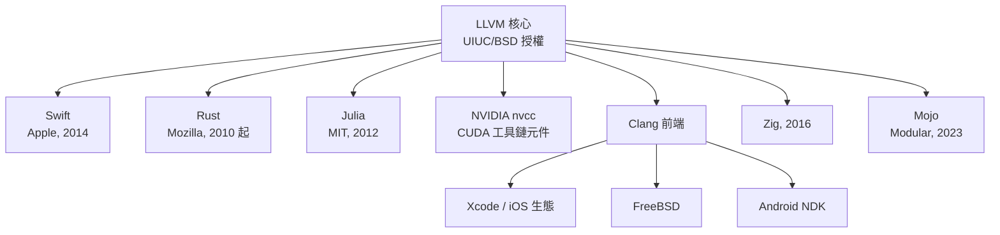

# 07.3　蘋果重金注資：Swift、Rust、NVCC 的共同底座

## 一通改變歷史的電話

2005 年，Chris Lattner 博士畢業前夕，指導教授 Vikram Adve 做了一件事：把這個學生與他手上的 LLVM 推銷給蘋果。蘋果當時正面臨一個尖銳的制度性難題——它的整條開發工具鏈依賴 GCC，而 GCC 正處於 GPLv3 的陣痛期。蘋果曾資助 GCC 的開發並僱用維護者，但 FSF 的新授權方向（反 tivoization 條款尤其針對嵌入式裝置）與蘋果的商業模式正面衝突：iOS 裝置不允許使用者自行替換系統軟體，蘋果不可能接受 GPL 的授權邏輯。GCC 4.2 之後，蘋果實質上被鎖死在舊版本上，無法升級。

對蘋果而言，LLVM 的 UIUC/BSD 授權不只是「比較方便」，而是戰略逃生門。2005 年，Lattner 進入蘋果擔任實習後轉正職，LLVM 團隊從他一個人開始成長為一個正式部門。

## 三個戰場：JIT、工具鏈、硬體

蘋果對 LLVM 的投入是全方面的。第一個重大任務是 **OpenCL**：2008 年蘋果發表的 GPU 通用運算框架，需要把 kernel 即時編譯到各種 GPU 上，LLVM 的 IR 與 JIT 基礎設施成為天然選擇，OpenCL 的設計甚至直接以 LLVM IR 的子集為基礎。第二個任務是**工具鏈替換**：Clang 逐版取代 GCC，2011 年 Xcode 4 正式定為預設。第三個任務是**硬體協同設計**：蘋果於 2013 年推出自家 64 位元 ARM 晶片 A7，LLVM 的 ARM64（AArch64）後端獲得重金投資與深度打磨，蘋果晶片效能的躍進背後有編譯器的一份功勞。

## Swift：把語言蓋在自己的地基上

Lattner 在蘋果的代表作是 **Swift**。2010 年他利用晚上與週末起步這個專案，理念是打造一個比 Objective-C 更安全、更現代、又與 LLVM 基礎設施深度整合的語言。2014 年 WWDC 上 Swift 首次公開，隔年開源。Swift 編譯器的前端（SwiftIL 與型別推論）雖然獨立實作，但最終落地在 LLVM IR 與其優化/後端管線上——換言之，蘋果能夠以「一年級生」的效率造出全新語言，正是因為最難的中端與後端已經是現成的、可重用的。

這件事的象徵意義極大：**編譯器基礎設施成為語言創新的加速器**。設計新語言的門檻，從「先花十年寫個編譯器」降為「把前端接上 LLVM」。

## 生態外溢：一個時代的預設答案

LLVM 的成功很快超越了蘋果的邊界，成為 2010 年代新語言與新工具的預設後端：

- **Rust**：Mozilla 自 2010 年起的系統語言實驗，選擇 LLVM 作為後端，借用其優化與多平台支援，得以專注在所有權型別系統這個真正的創新點上。
- **Julia**：2012 年 MIT 團隊的科學計算語言，靠 LLVM JIT 把動態型別程式碼編到接近 C 的速度。
- **NVIDIA nvcc**：CUDA 的編譯驅動程式中內含 LLVM 元件，用於 host 端與部分 device 端的編譯工作——連最不缺研發資源的晶片巨頭，也選擇不重造輪子。
- **Zig** 與 **Mojo**：2016 年 Andrew Kelley 的 Zig 直接以「提供 LLVM 包裝」為架構；2023 年 Lattner 自己創立的 Modular 推出 AI 導向的 Mojo 語言，延續他「把 MLIR/LLVM 打造成 AI 時代基礎設施」的路線。

## Lattner 的職業軌跡

Lattner 的履歷本身就是 LLVM 擴張史：Apple（2005–2017，LLVM→Clang→Swift→MLIR）→ **Tesla Autopilot**（2017，打造用於自駕推論的編譯基礎設施）→ **Google**（2017–2020，投入 TPU 與 MLIR，試圖為機器學習建立多層次的中間表示）→ **SiFive**（2020–2022，RISC-V 軟體生態）→ **Modular**（2022 年創業至今）。他在每個組織做的事驚人地一致：為某種「程式怎麼變成機器碼」的新需求，搭建可重用的編譯器基礎設施。

## 一個人與一套基礎設施

從制度面看，LLVM 的故事是一則關於**授權如何塑造權力結構**的寓言：GPL 想以法律手段強迫軟體自由流動，卻意外地把商業巨頭推向另一條路；BSD 式授權表面「放任」，實際上讓 LLVM 成為所有陣營——蘋果、Google、AMD、Intel、NVIDIA、Sony——唯一都敢依賴的中立地帶。編譯器這個原本冷僻的學術領域，因此獲得了前所未有的資金與人才密度。

2000 年在 UIUC，Lattner 只是想解決「研究者寫個 pass 太難」的問題。二十五年後，你口袋裡的手機、遊戲主機、資料中心裡的每一塊晶片，幾乎都有一段程式曾經路過他的 IR。基礎設施的時代意義正在於此：它沉默、無名，卻決定了整個世代能蓋出什麼。
