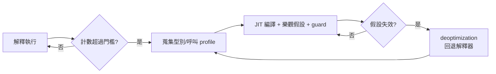

# 08.2　JIT 編譯原理：熱點檢測與動態生成

## 混合模式：聰明的賭徒

JIT（Just-In-Time）編譯的核心思想，是承認一個來自實測的經驗事實：**程式的執行時間高度集中在少數程式碼上**——少數方法、少數迴圈吃掉絕大多數 CPU 週期。既然如此，何必花力氣編譯全部程式碼？正確的策略是：先用解釋器跑（啟動快、無編譯延遲），同時計數觀察，發現「熱點」後才投入編譯器，把熱點編成原生碼。這就是**混合模式執行**：解釋器與編譯器並存，各司其職。

## 熱點檢測與 HotSpot 的身世

熱點檢測的實作通常是兩種計數器的組合：**方法調用計數**（一個方法被呼叫多少次）與**迴圈邊界計數**（迴圈跑過多少次迭代，即所謂 OSR——on-stack replacement，讓正在執行中的熱迴圈也能中途切換到編譯後的版本）。當計數超過門檻，VM 就把該方法排入編譯佇列。

1999 年商用化的 Sun **HotSpot JVM**，名字就直接來自這個技術：它不平均用力，只打擊熱點。HotSpot 的身世是一段收購史：90 年代後期，Sun 意識到自家 JVM 效能落後，收購了 Longview Technologies——其團隊源自 Animorphic，由 Lars Bak 等人領導，背景正是 **Self 語言與 Smalltalk 的 JIT 研究**。Self 的實驗（型別回饋、inline caching、去優化）在 HotSpot 中開花結果，並日後隨 Lars Bak 流轉到 V8。學術原型的血脈，經由少數幾位工程師的手，一路塑造了網際網路時代最重要的執行環境。

## 自適應優化與去優化：逃生口的智慧

動態語言的變數型別在執行期才確定，編譯器怎麼可能產生高效率的原生碼？JIT 的答案是**自適應優化**：

1. 解釋執行時蒐集**型別 profile**：這個加法操作的運算元，實際上 99% 是整數；這個虛擬呼叫的接收者，實際上只有一種型別。
2. 編譯熱點時，基於 profile 做出**樂觀假設**：就編譯成整數加法、直接內聯那個唯一目標。
3. 在編譯碼中插入 **guard（防護檢查）**：假設成立則全速狂奔。
4. 假設失效時觸發 **deoptimization（去優化）**：拋棄編譯碼、回退到解釋器，重新蒐集 profile，日後再重編譯。

去優化是整個體系的靈魂：它把「靜態編譯必須保守」的束縛解開了——錯了可以退回來。這是動態語言 JIT 的核心技巧，其思想根源在 Self 語言的研究（1980s 末至 1990s 初，斯坦福與 Sun）。

## Inlining 與型別特化

**內聯**在 JIT 世界中的威力被放大到極致。靜態編譯器也能內聯，但虛擬呼叫是障礙；JIT 透過 profile 知道「這個呼叫點 99% 是同一個方法」，就能大膽內聯，隨後死碼消除、常數傳播等優化得以跨方法展開——**把整個呼叫圖視為一個優化單元**。配合**型別特化**（把「可能是 int 的 Object」特化為裸的 int，加上 guard），動態程式碼可以達到靜態編譯的水準。

## 機器層面的現實：可寫不可執行

JIT 要在執行期產生機器碼並執行，觸及作業系統的安全制度：記憶體頁若同時可寫（W）又可執行（X），就是緩衝區攻擊的溫床。現代 JIT 遵守 **W^X** 原則——透過 `mmap`/`mprotect` 把程式碼頁在「可寫」與「可執行」之間切換，或使用雙映射技巧。作業系統與硬體（如 ARM 的指標驗證）也反過來塑造了 JIT 的實作方式。這是制度與技術互相驅動的小小縮影：安全政策並不阻擋 JIT，而是逼它長得更嚴謹。

## JIT 的現代擴張

JIT 早已超越 Java：JavaScript 引擎（V8 的 TurboFan、JavaScriptCore 的多重 JIT 階梯）靠它撐起整個網頁生態；.NET 自 RyuJIT 起重寫了 64 位元後端；資料庫（如 HyPer）把 SQL 查詢 JIT 成機器碼，讓 OLAP 查詢逼近手寫 C；**PyPy** 發明 **meta-tracing**——用 RPython 寫一個解釋器，框架自動為它生成 JIT，把「造 JIT」的成本降一個數量級；Oracle 的 **Truffle/Graal** 更進一步主張「universal JIT」：任何語言只要以 Truffle 的 AST 節點寫成解釋器，就能獲得頂級效能。當年 Deutsch 與 Schiffman 在 PS 中點燃的火種，如今燒遍了語言、資料庫與中介層的每個角落。

JIT 的思想總結成一句話：**在執行期，用觀察代替假設，用逃生口代替保守**。它證明了效能不是靜態型別的專利，而是一種可以靠「正確地賭」贏得的勝利。
