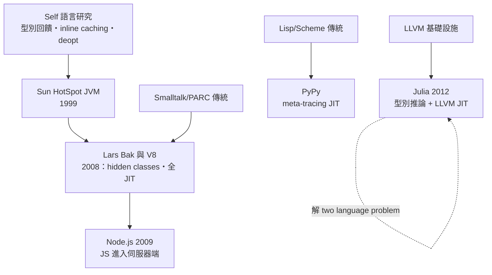

# 08.3　V8、PyPy 與 Julia：動態語言的速度革命

## V8：讓 JavaScript 擺脫「玩具語言」的罵名

2008 年，Google 為了讓 Chrome 承載即將爆發的網頁應用，從 Sun 挖來了 **Lars Bak**——這位丹麥工程師的履歷正是 JIT 的活化石：參與過 Self 語言的研究、打造過 HotSpot 的前身、在 CLDC HotSpot 上做過嵌入式 JVM。Bak 領導團隊在丹麥奧胡斯建構 **V8**，做出了幾個反主流的決策。

第一，**V8 沒有解釋器**——第一版直接把所有 JavaScript 編譯成原生碼，以換取極致的啟動與執行速度。第二，**hidden classes**：JavaScript 的物件是雜湊表式的動態屬性袋，屬性查找極慢；V8 在執行期給每個物件貼上由建構歷程推導的隱藏類別，把動態查找變成固定的偏移量存取——動態語言的物件，穿上了靜態結構的骨架。第三，**inline caching**，直接繼承自 Smalltalk 與 Self 的 **Polymorphic Inline Cache** 傳統：在呼叫點快取「上次是什麼型別、方法在哪」，下次先比對快取。

V8 的成績震驚業界：JavaScript 從「慢得只能做表單驗證」一躍成為有「編譯型速度」的語言。此後 V8 管線不斷演化：Crankshaft（2010）引入優化編譯器，TurboFan（2015–2017）改用 **sea-of-nodes** IR，後來又補回 Ignition 解釋器（省記憶體、加速啟動）、Sparkplug 基線編譯器、Maglev 中層 JIT，形成階梯式的多層管線——繞了一大圈，又回到混合模式的智慧。

V8 的間接後果比直接後果更驚人：2009 年 Ryan Dahl 在 V8 之上寫出 **Node.js**，把 JavaScript 帶到伺服器端。當年 Java 以「write once, run anywhere」挑戰伺服器市場未竟全功，JavaScript 卻以「瀏覽器已經統一了語言」的既成事實，反過來統治了後端——**V8 先證明了 JS 跑得快，Node.js 才可能誕生**。

## PyPy：自動生成 JIT 的野心

**PyPy** 的故事是學術理想主義的十年長跑。2003 年起，Armin Rigo 等歐洲研究者在歐盟資助下啟動一個大膽的計畫：不要為每種動態語言手寫 JIT，而是用一個受限制的 Python 子集（**RPython**）寫「解釋器」，再由工具鏈自動分析解釋器的執行軌跡，生成 **meta-tracing JIT**——追蹤執行時的熱迴圈軌跡、把整條軌跡編譯成原生碼。寫一個解釋器，就白得一個 JIT：這把 JIT 的工程成本壓低了一個數量級。

PyPy 的成效驚人：在純 Python 工作負載上比 CPython（官方實作）快數倍。但它也暴露了動態語言生態的殘酷現實——**GIL**（全域直譯器鎖）限制了多核利用，而 CPython 的 C extension ABI（NumPy 等科學堆積都依賴它）讓 PyPy 難以完全相容。PyPy 證明了技術上的勝利，卻輸給了生態鎖定：**一個語言的效能史，從來不只是編譯器技術史**。

## Julia：解開 two language problem

2012 年，MIT 的 Jeff Bezanson、Stefan Karpinski、Viral Shah 與 Alan Edelman 發表 Julia。他們的問題意識直指科學計算的核心矛盾：科學家為了快速實驗用 Python/R/MATLAB，為了速度又得用 Fortran/C 重寫核心程式碼——**two language problem**，同一套邏輯維護兩份實作，錯誤與痛苦由此滋生。

Julia 的解法是把兩件事同時做滿：語言層面，多重分派（multiple dispatch）與參數化型別讓程式碼保持動態、通用、互動；編譯層面，**強大的型別推論 + LLVM JIT**——每次呼叫方法時，根據實際型別即時推論、特化、編譯成機器碼，數值迴圈的效能直逼 C。Julia 沒有解釋器，沒有「加速模式」與「快速模式」的分裂：一個斐波那契函式，互動呼叫與百萬次迴圈走的是同一條編譯路。這正是 LLVM 作為基礎設施的紅利——MIT 團隊不必寫後端，只需專注於型別推論這個真正的難題。

## 思想總結：效能不是靜態型別的專利

三個案例，三種路徑，同一個結論。V8 用工程天賦證明動態物件可以被「馴化」成高效機器碼，甚至改寫了伺服器端的政治版圖；PyPy 用抽象證明 JIT 本身可以被自動化，儘管敗給了生態的慣性；Julia 用型別系統與 LLVM 證明動態語言可以正面擊敗 Fortran，把科學計算從「雙語言」的宿命中解放。

回望來路：1970 年代 PARC 的 Smalltalk 位元組碼、1984 年 Deutsch 與 Schiffman 的動態翻譯、Self 的型別回饋、HotSpot 的熱點偵測、V8 的 hidden classes、PyPy 的 meta-tracing、Julia 的推論式 JIT——將近半個世紀，一條觀念的主線貫穿始終：**執行期的資訊是寶藏，不是障礙**。靜態編譯器用假設求安全，JIT 用觀察換速度。動態語言的速度革命就此宣告：效能從來不是型別宣告的專利，而是正確的架構、耐心的工程與敢於樂觀的賭注。
