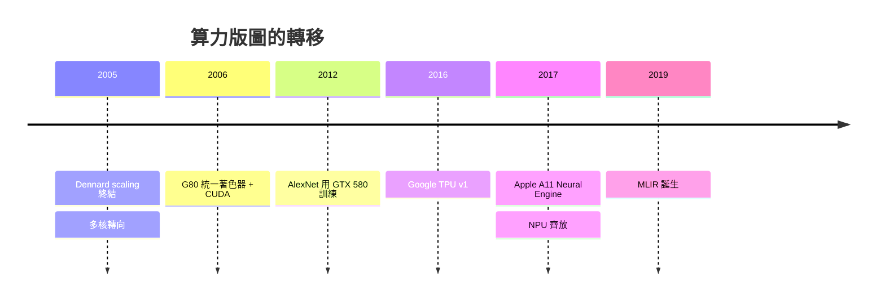

# 節標題：異質晶片浪潮——GPU、TPU、NPU 的衝擊

## 一、天花板：當摩爾定律與 Dennard scaling 同時失效

半個世紀以來，編譯器工程師活在一個甜蜜的假設裡：什麼都不用做，下一代晶片就會讓程式自動變快。這個假設由兩條定律支撐。第一條是摩爾定律——電晶體密度約每十八個月翻倍；第二條較少人知，卻同樣關鍵：Dennard scaling，它保證電晶體縮小的同時功率密度不變，於是你可以不斷提高時脈而不把晶片燒掉。

2005 年前後，這兩條定律先後撞牆。電晶體仍然在縮小，但漏電流與散熱讓時脈停在三四 GHz 的牆前。處理器產業的回應是轉向多核——Intel 在 2005 年放棄了 Tejas 與 Jayhawk 等單執行緒效能巨獸的計畫，宣告「免費午餐結束」。可是多核只是把問題推給軟體：平行編程之難，讓大多數程式根本吃不到多核的紅利。電晶體還在變多，只是越來越多地被用在一件事上——讓特定工作快上十倍、百倍。專用加速器（domain-specific architecture）的時代，就這樣被物理定律逼了出來。

## 二、GPU 的轉身：從像素到張量

第一個成功的加速器其實早就存在：圖形處理器。GPU 為了即時渲染數百萬個像素，天生就是數千個執行緒的 SIMD/SIMT 機器。問題是，想在 GPU 上算繪圖以外的東西，得把資料硬塞進「頂點」與「紋理」的騙局裡——早期的 GPGPU 研究者用 shader 語言寫矩陣乘法，宛如在鋼琴上打字。

改變始於史丹佛的 Ian Buck。他在 2003 年前後開發了 Brook 這門「為 GPU 而生的 C 語言」，讓研究員能用 stream programming 的抽象寫通用計算。2004 年 Buck 加入 NVIDIA，把 Brook 的想法鍛造成正式產品：2006 年，NVIDIA 推出 GeForce 8800（G80）——第一個**統一著色器架構**的 GPU，像素與頂點處理器不再各自為政，而成為一群通用的可程式化核心；同年 NDA 舊事重提的 CUDA 正式發布，Buck 主導的 CUDA C 讓程式設計師用接近 C 的語法直接寫 GPU kernel。硬體提供統一架構，編譯器（nvcc，基於 Edison Design Group 的前端）與數萬個 tuning 過的程式庫（cuBLAS、cuDNN）補上其餘。NVIDIA 真正的護城河，從來不是晶片，而是這套十年累積的軟體棧。

## 三、深度學習引爆算力飢渴

2012 年，多倫多大學的 Alex Krizhevsky、Ilya Sutskever 與 Geoffrey Hinton 用兩張 GTX 580 訓練 AlexNet，在 ImageNet 競賽中把錯誤率一口氣壓低十個百分點。這場勝利通常被敘述為「深度學習的黎明」，但對編譯器史家而言，它同時是「算力決定模型疆界」的宣言：神經網路的能力第一次明確地與 GPU 的 FLOPS 掛鉤。從此，訓練算力需求以指數成長，成為晶片史上最猛烈的單一需求源。

2016 年，Google 揭露了 TPU v1——一顆專為神經網路**推理**設計的 ASIC，核心是 256×256 的脈動陣列（systolic array）執行 INT8 矩陣乘法。在 ISCA 2017 的論文中，Google 揭示其性價比達到同代 CPU/GPU 的數十倍，關鍵正是「敢於捨棄通用性」：沒有 cache 的複雜階層、沒有分支預測、不需要圖形管線。TPU 證明了一件事——當工作負載大到足以攤提 ASIC 成本（Google 的資料中心恰好如此），DSA 就比通用晶片划算。

## 四、NPU 齊放與碎片化的災難

TPU 之後，全世界都學會了這個詞。Apple 從 A11（2017）起在手機 SoC 內建 Neural Engine；華為推出昇騰（Ascend）系列；寒武紀從中科院的「寒武紀一號」走向商用 NPU；Intel 併購 Nervana 與 Habana、AMD 併購 Xilinx；連新創都在畫自己的脈動陣列。十年之間，計算從「一種 CPU」碎裂為「幾百種異質 SoC」。

對硬體設計師，這是文藝復興；對軟體工程師，這是巴別塔。每家晶片有自己的指令集、自己的記憶體階層與一致性行為、自己的程式設計模型。PyTorch 的 `device` 參數背後，是每個廠商各自維護的 backend： CUDA、ROCm、XLA、各家自研的圖編譯器——同一個模型在不同裝置上的最佳化路徑幾乎不可遷移，無數工程團隊日復一日地重複造輪子，把同一個矩陣乘法 kernel 用五種 IR 重寫。CUDA 的準壟斷之所以穩固，正因為它罕見地提供了一個**統一的目標語言**；而挑戰者每一家都得從頭建立自己的整條軟體棧，這個成本比晶片本身更昂貴。

## 五、編譯器是異質時代的作業系統

主機時代的編譯器，把高階語言翻譯到單一 ISA；異質時代的編譯器，必須做的是更接近作業系統的事：把一個抽象的高階計算圖，調度、分割、映射到數十種異質執行單元上，管理記憶體、平行性與通訊。運算圖（graph）是行程，kernel 是執行緒，IR 是系統呼叫介面。誰掌握了這個「異質作業系統」的抽象層，誰就掌握了下一代算力的入口——這就是 MLIR 登場的舞台。

