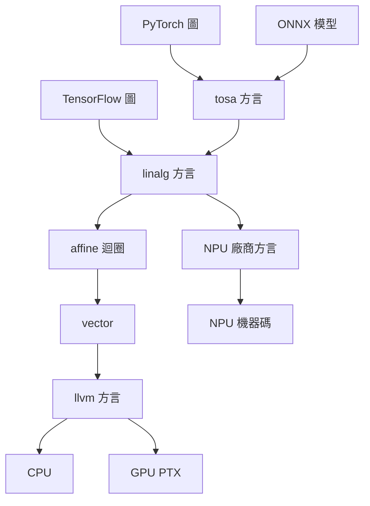

# 節標題：MLIR——Lattner 的終極抽象

## 一、重出江湖的人

2019 年，Chris Lattner 又一次動手打造編譯器基礎設施。上一次是 2000 年代的 LLVM——他把大學的暑期專案做成了之後二十年最成功的編譯器框架，然後去了 Apple 打造 Swift。這一次，他在 Google，面對的是一個比 C/C++ 世界更混亂的戰場：機器學習。

當時的 ML 軟體棧是這樣的：TensorFlow 有自己的 GraphDef，PyTorch 有自己的 autograd 圖，XLA 有自己的 HLO，TensorRT、TVM、各家晶片廠的圖編譯器又各有各的 IR。每一層都是封閉的王國，中間的轉換靠脆弱的序列化格式硬接。Lattner 在 2020 年與 Jacques Pienaar（本名姓 Pienaar，人稱 jpienaar）、Mehdi Amini 等同事發表了論文〈MLIR: A Compiler Infrastructure for the End of Moore's Law〉——標題本身就是宣言：摩爾定律死了，軟體不能再靠「硬體自動變快」過活，我們需要一個新的基礎設施來馴服異質硬體的多樣性。

## 二、核心思想：IR 不該只有一種

LLVM 的偉大在於「一種 IR 統治所有語言」；MLIR 的洞察則是：對異質計算而言，**單一 IR 本身就是錯誤的抽象**。神經網路裡的 `matmul`、影像管線裡的仿射迴圈、DSP 上的定點運算、GPU 的平行語意——硬把它們全降到 LLVM IR，等於把所有訊息都在半路燒掉，讓各後端只能從灰燼裡重新考古。

MLIR 的答案是「多層級、可組合的 IR 系統」。它是 LLVM 基礎設施之上的一層超集：編譯器不再是一條直通的流水線，而是一組可自由組合的**方言（dialect）**——`linalg` 描述結構化的線性代數操作、`tensor` 與 `tosa` 描述張量語意、`affine` 描述多面體模型可分析的迴圈、`vector`、`gpu`、`llvm` 逐步靠近機器。每個方言定義自己的操作、型別與屬性，任意兩者之間可以寫**漸進式 lowering（逐層下降）**的轉換 pass。高階的 `linalg.matmul` 可以先 tile 成 `linalg` 子操作，降到 `affine` 迴圈，再向量化成 `vector` 操作，最後落到 `llvm` 或某個 NPU 自己的方言。每一步都保留該層該有的語意資訊，同時允許該層的專門最佳化。

另一個常被低估的設計決策：MLIR 的基礎設施本身就是可擴充的——新增一個方言不需要改 MLIR 核心。這讓它從「一個編譯器」變成「一個製造編譯器的生態系」。

## 三、採用：從論文到事實標準

MLIR 於 2019 年開源（最早在 Google 內部孕育，作為 LLVM 的一部分發展）。此後數年，它以驚人的速度成為業界的事實標準：Google 的 IREE 用它編譯 ML 模型到各種後端；XLA 逐步與 MLIR 整合；TensorFlow 與後來的生態用它做圖表示與轉換。Lattner 2019 年轉赴 Apple 之後，MLIR 也進入了 Apple 晶片工具鏈的研發視野。Intel、AMD、Arm、華為等大廠先後投入 MLIR 上游開發——在編譯器史上，競爭對手們共同投資同一個基礎設施的場景極其罕見，上一次大約是 LLVM。ONNX 作為模型流通格式，則與 MLIR 形成了「模型格式 × 編譯器基礎設施」的互補。

這個模式其實是 LLVM 劇本的重演：先提供比自家方案好一個量級的抽象，開源，讓競爭者的重複建設變成不理性。Lattner 在 LLVM 證明過一次——「編譯器基礎設施」是可以成為產業公共財、再反過來定義產業格局的。

## 四、Modular 與 Mojo：把抽象商業化

2022 年離開 Google 後，Lattner 與 Tim Davis 於 2023 年創辦 Modular，方向是把 MLIR 的能量商業化：一邊是 MAX 平台，主打「一套 API 跑遍所有 AI 硬體」，直接挑戰 CUDA 的軟體壟斷；另一邊是 **Mojo** 語言——一個以 MLIR 為基礎、宣稱兼具 Python 可用性與系統語言效能的新語言，讓 kernel 作者能寫出可移植到各家晶片的高效能程式碼。2024 到 2025 年間，Modular 公開展示了其平台對多種 GPU 廠商的支援，並持續擴充套件生態（此為當前進展，長期格局仍在演變中）。無論 Modular 最終成敗，MLIR 作為基礎設施已經贏得了它的歷史地位：它是 LLVM 之後第二個重新定義「編譯器該長什麼樣」的範式。

Lattner 的職業生涯有一條清晰的主線：他總是在問「下一層正確的抽象是什麼」。Clang 回答了「前端該如何模組化」，LLVM IR 回答了「語言與機器之間的中間層」，Swift 回答了「主流語言的安全與表達力」，而 MLIR 回答的是這個時代最大的問題——當硬體碎裂成一千塊，軟體如何不再陪葬。
