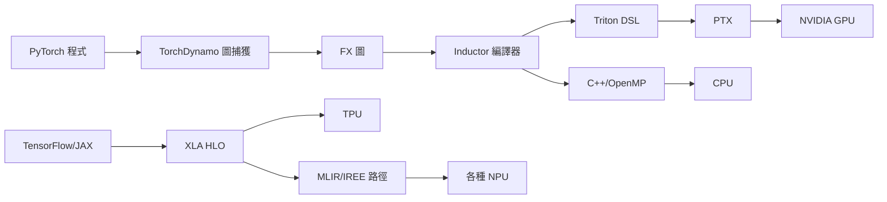

# 節標題：DSL 與專用編譯器——Halide 與 Triton 的勝利

## 一、犧牲通用性，換取編譯器之眼

通用語言有一個宿命的困境：C++ 編譯器面對 `for (i...) a[i] = b[i] * c[i]` 這樣的迴圈，必須靠啟發式去**猜**它能不能向量化、該不該平鋪、資料有沒有相依——因為語言不保證。而域特定語言（DSL）的哲學恰好相反：犧牲表達的通用性，把演算法的**結構**明文寫進語言裡，於是編譯器不再需要猜，它**看得穿**。在異質計算時代，這條路線接連產出了兩個教科書級的勝利。

## 二、Halide：把「算什麼」與「怎麼算」分開

2012 年，MIT 的 Jonathan Ragan-Kelley 與 Google 的 Andrew Adams 等人發表了 Halide（論文於 SIGGRAPH 2012/2013 系列）。它的核心設計只有一句話：**把演算法（algorithm）與排程（schedule）分離**。同一個程式，演算法部分描述每個像素如何由輸入計算而來；排程部分則獨立指定：哪些維度該平鋪（tile）、哪裡向量化、哪裡平行化、中間結果放暫存器還是 shared memory、要不要以逐級下降的方式融合（sliding window）……

這個分離的威力在於組合爆炸被馴服了：演算法寫一次，排程可以針對 CPU、GPU、DSP 各寫一份，互不污染。傳統 C++ 影像管線中，「演算法改一行，效能調三個月」的詛咒被破解。Halide 很快成為工業事實標準：Google 相機的 HDR+ 夜景模式、Instagram 與 Snapchat 的即時濾鏡、Adobe 的影像處理、以及大多數 Android 手機相機管線的底層，都有 Halide 的影子。你今天拍的每一張照片，幾乎都經過 Halide 編譯器的手。

## 三、Triton：Python 寫 GPU kernel

第二個勝利來自 AI 側。2019 年，OpenAI 的 Philippe Tillet 發表 Triton：一門以 Python 為基礎的 DSL，讓研究員用百來行程式碼寫出 GPU kernel，編譯器自動處理平鋪、向量化與記憶體排程，最後生成 PTX。對比之下，等價的 CUDA C kernel 需要手寫 shared memory 管理、bank conflict 規避等數百行黑魔法，而且換一張 GPU 就要重調。

Triton 於 2021 年開源後迎來了歷史性的轉折：2023 年，PyTorch 2.0 發布 `torch.compile`，其核心後端 Inductor **直接以 Triton 作為 kernel 生成目標**。這意味著史上使用者最多的深度學習框架，其自動化效能路徑不再依賴手寫 CUDA——PyTorch 程式碼被 TorchDynamo 捕獲成圖，由 Inductor 生成 Triton kernel，再編譯到任何有 Triton 後端的 GPU 上。CUDA 亮出了真正的挑戰者。

## 四、圖捕獲與編譯：XLA 與 torch.compile 的管線

這張譜系圖呈現了 AI 編譯器的整合現況：Google 的 XLA 從 TensorFlow 時代就證明了「把整個計算圖編譯掉」的價值（JAX 讓它成為研究主流）；PyTorch 以 Dynamo+Inductor 迎頭趕上；MLIR/IREE 則作為中立的基礎設施承載跨廠商的長尾。DSL 不再是學術玩具——它們已成為 AI 算力棧的中樞神經。

## 五、思想的啟示

Halide 與 Triton 的共同教訓是：**編譯器的勝負不在於翻譯得多快，而在於抽象層選得多對**。Halide 選了「演算法/排程分離」，Triton 選了「block-level 的張量程式設計」——這些抽象讓編譯器擁有了通用語言中永不存在的資訊。這也預告了下一章的主題：當抽象選對了，剩下的問題（該 tile 多大？該 unroll 幾次？排程該怎麼選？）本質上是巨大的搜尋空間——而搜尋，恰好是機器學習最擅長的事。啟發式統治編譯器三十年後，退位的時刻到了。
