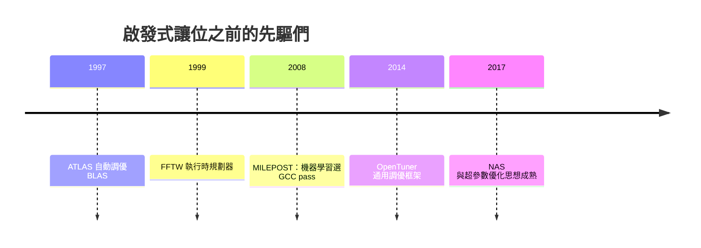

# 節標題：啟發式的瓶頸——相位順序的 NP 困難

## 一、藏在每個編譯器裡的賭徒

打開任何一個現代編譯器的原始碼，你都會找到成千上萬行這樣的程式碼：`if (cost_model_estimate > threshold) ...`。門檻怎麼定的？多半是某位工程師在某一年、針對某幾款機器、用某幾個基準程式調出來的。編譯器優化的本質，半世紀以來一直是**啟發式**——有根據的猜測。而猜測的脆弱，源於一個根本的理論困境：相位順序問題（phase ordering problem）。

## 二、順序決定一切的數學

編譯器優化不是一個問題，而是幾十個相互糾纏的子問題：常數傳播、死碼消除、迴圈不變量外提、內聯、指令排程、暫存器分配……它們彼此影響：先做常數傳播再刪死碼，可能消掉整個分支；反過來做，分支還在，常數傳播就失去了刪碼的機會。同一組 pass，順序不同，產出的機器碼品質可能天差地遠。

理論上的壞消息更加徹底。給定 $n$ 個優化 pass，僅僅排列順序就有 $n!$ 種組合；再考慮每個 pass 可以執行多次（不動點迭代）、每個 pass 帶有自己的參數（迴圈展開因子 $k$、內聯的函式大小閾值、向量化寬度……），搜尋空間瞬間超過任何窮舉所能觸及的範圍。相關的判定問題——例如選擇哪組 pass 序列能達到最優——已被證明是 NP 困難的。換言之，**最優編譯在計算複雜性的意義上不可得**；所有現實中的編譯器，都只是這個不可及的最優解的某種廉價近似。而更殘酷的是：什麼是「最優」本身還取決於目標機器——為 x86 調好的啟發式，換到 ARM 或某款 NPU 上可能系統性地做出錯誤決策。

## 三、黑魔法的累積

實務界對這個困境的回應，是三十年間一層層疊加的啟發式。GCC 與 LLVM 各自累積了數百個 pass，每個 pass 內有數十個手調參數；工程師們根據 SPEC 基準的回歸測試修修補補，修好一個基準、弄壞另一個，然後再加一個特例。久而久之，這些啟發式成了誰也不敢動的黑魔法——改動的風險高於收益，「為什麼這個門檻是 7？」的答案往往是「2013 年有人調過」。編譯器研究者常用一個詞形容這種狀態：爬山者困在多重山脊之間的谷地裡，而且地圖每換一款新晶片就重畫一次。

## 四、auto-tuning：讓機器自己找答案

在 ML 時代到來之前，已經有人提出：既然是搜尋問題，就該用搜尋解決。這條 auto-tuning 傳統可以追溯到更早：ATLAS（Automatically Tuned Linear Algebra Software，1990 年代末）在安裝時針對使用者的機器實地搜尋 BLAS kernel 的最佳實作參數，其後繼者 LAPACK 生態與 FFTW「規劃器」（planner，執行時搜尋最快的 FFT 排程）都是機器感知調優的經典。2000 年代末，IBM 與合作者推動的 MILEPOST GCC 專案（Louis-Noël Pouchet 等人深度參與）嘗試以機器學習預測 GCC 的優化組合——這是「學習型編譯器」的先聲。2014 年 MIT 的 Jason Ansel 等人發布 OpenTuner，提供一個通用的多臂吃角子老虎機框架，讓各種程式（含編譯器 pass 選擇）都能方便地做啟發式搜尋。

## 五、ML 側的思想回流

吊詭的是，把「搜尋高維配置空間」做到爐火純青的，不是編譯器社群，而是機器學習社群自己：超參數優化（貝葉斯優化、Hyperband）、以及 2017 年前後的神經架構搜索（NAS）——用 RL 或進化演算法在巨大的架構空間中搜出網路結構——本質上與「為編譯器搜出一組優化決策」是同一個數學問題：離散、巨大、評估昂貴的黑箱優化。ML 世界的結論很明確：在這類問題上，學習式搜尋碾壓人類手調。

於是歷史的接力棒交了回來：編譯器界三十年解不開的相位順序與調參困境，正好是 RL 最擅長的問題形態。晶片越來越異質、啟發式越來越失效、搜尋工具越來越強——三股力量在 2020 年代初匯流，AI 進入編譯器的時代開始了。
