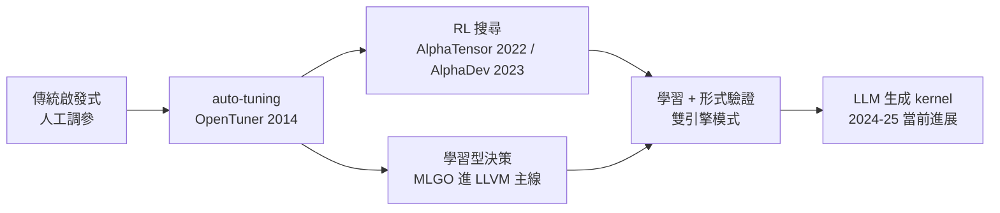

# 強化學習與大模型優化編譯器

## 一、啟發式的黃昏

五十年來，編譯器的優化決策——要不要內聯這個函式、循環展開幾次、哪個變數該留下——幾乎全靠**人寫的啟發式**（heuristic）：某個由資深工程師根據基準測試調出來的閾值。這些啟發式有兩個致命弱點：其一，它們是為特定硬體調出來的，換一個晶片微架構就開始失準；其二，隨著 pass 數量增長，相位順序的組合空間以 $n!$ 般膨脹，人腦已不可能窮舉。2010 年代末，兩股力量同時成熟：機器學習算力變得便宜，而編譯器界終於承認自己的啟發式已經「調不動了」。於是 AI 開始進入編譯器的聖殿。

## 二、AlphaTensor：數學心臟的突破

矩陣乘法是整個 AI 時代的心臟——Transformer 的每一步都建立在一連串的 GEMM（通用矩陣乘法）上。1969 年 Volker Strassen 證明 $n \times n$ 矩陣乘法可以少於標準 $2n^3$ 次標量乘法（Strassen 演算法用 7 次乘法處理 $2\times2$），此後五十年，尋找更快的分解是純數學的聖杯。

2022 年，DeepMind 的 AlphaTensor（發表於 Nature）用**強化學習**把矩陣乘法分解建模為單人遊戲：狀態是三維張量、動作是張量組合、目標是最小化乘法次數。結果：在 $4\times4$ 模 2 算術的矩陣乘法上，它找到了 47 次乘法的分解——打破了 Strassen 以來 49 次的紀錄。這是 AI 首次在基礎演算法層面超越人類五十年的積累。雖然模 2 的結果距離實用的浮點 GEMM 仍有距離，但它證明了：**指令級的演算法發現，可以外包給學習系統**。

## 三、AlphaDev：AI 的代碼進入 LLVM 主線

2023 年，DeepMind 的 AlphaDev 更進一步：它不研究數學分解，而是直接在**彙編層級**尋找更快的演算法。任務設定：從 LLVM IR 出發，用組合指令組合出排序（sorting network）與雜湊函式，目標是最短指令數。AlphaDev 找到的短排序網路比人類手工優化的版本少幾條指令——微小的節省，乘上每天數十億次的函式呼叫，就是可觀的全球節約。

關鍵的後續：這些 AI 發現的序列**真的被併入了 LLVM 的 libc++ 主線**。這是 AI 生成（或者說「AI 搜尋出」）的底層代碼第一次進入人類最重要的基礎函式庫之一。工程上的注意點同樣重要：每個候選序列都經過等價性驗證與測試——AI 負責搜尋，形式檢驗負責守門。這個「學習 + 驗證」的雙引擎模式，成為此後所有 AI 編譯器工作的範本。

## 四、MLGO：學習的啟發式進入日常

前面兩個是「一次性發現」，Google 的 **MLGO**（2022 年起開發、2023 年開源）則是把強化學習變成編譯器**常駐的大腦**。它選擇了 LLVM 中兩個最倚賴啟發式的決策點：

1. **inlining-for-size**：內聯函式會增大體積，哪個該內聯是經典的取捨難題；
2. **暫存器配置中的 eviction**（呼應第 5.3 節的圖著色與 spill 決策）。

MLGO 把編譯過程建成馬可夫決策過程：編譯器在每個決策點詢問策略網路「該怎麼做」，用訓練時的回饋（最終體積/性能）更新策略。訓練出的模型已整合進 LLVM 主線——編譯器從此可以在生產環境中「帶著學習來的直覺」運行。這標誌著一個制度性轉折：**啟發式不再只是工程師的直覺，也可以是訓練出來的策略網路**。

## 五、學習式排程與更廣的版圖

Halide 社群的 **autoscheduler**（2019，MIT/Adobe/Google 合作）展示了另一條路：不學 pass 順序，而是**學排程**。Halide 把演算法與排程分離（第 9.3 節），這個設計讓排程空間可以自動搜尋：以成本模型預測候選排程的效能，在龐大的平鎖（tiling）、向量化、平行化組合中找到接近人工調優的結果——而人工調優一個影像管線可能需要專家數週。

更廣的版圖還包括：學習型 cost model 用於向量編譯與 GPU kernel 選擇（TVM 的 AutoTVM/Ansor 譜系，呼應第 9 章）；超參數優化方法從 ML 社群回流（OpenTuner，MIT 2014）；以及 2024 年之後 LLM 直接生成 kernel 的實驗——讓大模型根據算子描述寫出候選 CUDA/Triton kernel，再用性能回饋迭代。編譯器研究的會議（PLDI、CGO、MLSys）如今充斥著 ML 相關論文，這在十年前不可想像。

## 六、清醒的邊界

必須誠實面對 AI 優化的三個限制。**訓練成本**：RL 方法需要海量模擬或實測回饋，AlphaDev 級別的專案只有大廠玩得起。**泛化性**：在一種硬體上訓練的策略，換架構後可能失效——啟發式的老問題以新形式回歸。**可驗證性**：優化可以「看起來更快」，但正確性必須被證明或測試到滴水不漏；編譯器錯誤的代價是整個軟體生態的可信度（回憶第 5 章：SSA 之所以被信賴，正因為它的數學形式可驗證）。

因此未來的圖景不是「AI 取代編譯器工程師」，而是**分工重構**：人類定義不變式、寫驗證器、設計 IR；AI 在被驗證器約束的空間裡搜尋最優解。這與 Copilot 之於工程師的關係（第 10 章，《軟體工程的故事》）如出一轍——審查者的位置，永遠留給能承擔責任的人。

