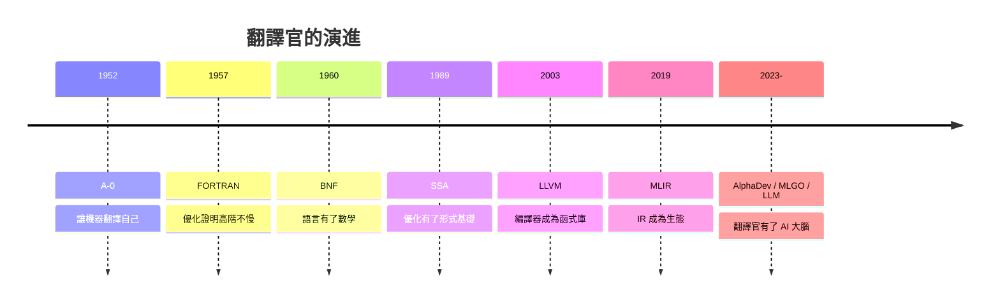

# 自然語言到硬體指令：神經編譯的未來

## 一、編譯定義的鬆動

七十年來，編譯器的定義很穩定：**確定性的翻譯**——同一份輸入，永遠產出同一份輸出，語義等價有數學保證。LLM 的出現讓這個定義鬆動了：當工程師用自然語言說「把這個函式改成向量化版本」，模型生成一段「看起來正確」的代碼——這是**機率性的翻譯**。輸出可能對、可能錯、可能今天對明天錯（模型升級後）。

這個鬆動帶來一個根本問題：誰為正確性負責？傳統答案很清楚——編譯器的語義保證由形式規則背書，錯了算編譯器的 bug。但神經生成的代碼沒有這種保證，於是**驗證的角色空前重要**：形式驗證（如 CompCert——Xavier Leroy 團隊 2005-2008 年用 Coq 證明的 C 編譯器，編譯器史上第一個經過機器檢驗語義正確性的 C 編譯器）、差分測試、以及「人類審查 + 簽名」的責任鏈，全部成為神經編譯時代不可或缺的守門人。諷刺又合理：機率性的生成，反而讓確定性的驗證更值錢。

## 二、LLM 進入編譯器工坊的真實進展

2024-25 年（本書寫作時點），LLM 對編譯器工程的實際滲透沿三條路線展開。**第一條：輔助開發**——研究與工業實踐顯示，LLM 能寫出簡單的 LLVM pass 草稿、為指令選擇生成測試、協助移植後端時填寫樣板代碼；編譯器工程師的日常（改 IR 結構、加新指令的模式匹配）大量是「模式化的苦工」，正是生成模型的甜區。**第二條：錯誤搜尋**——對編譯器本身做模糊測試與差分測試時，用 LLM 生成更具語法多樣性的測試程式，提高觸發深層 bug 的機率。**第三條：kernel 生成**——如第 10.2 節所述，用 LLM 產生候選 GPU kernel 再以性能回饋迭代，這條路線與 Triton 生態結合最快。

同樣真實的是邊界。編譯器的**全域不變式**（暫存器配置的正確性、SSA 的支配關係、異常表的完備性）跨越數萬行代碼與數十個 pass，遠超當前模型的長程一致性能力。生產級編譯器的每個 commit 都可能讓整個生態系的代碼錯誤執行——這種「一錯全毀」的信任結構，短期內仍必須由人類工程師與形式化工具共同承擔。

## 三、Modular 與 Mojo：Lattner 的第三幕

Chris Lattner 的職業軌跡本身就是編譯器史的縮影：UIUC 發明 LLVM（第 7 章）→ Apple 建造 Swift（第 7.3 節）→ Google 主導 MLIR（第 9.2 節）→ 2023 年與前 Google/Apple 同事創辦 **Modular**，推出 **Mojo** 語言與 MAX 平台。Mojo 的野心一言以蔽之：**讓 Python 生態被編譯**——它是 Python 的超集（語法相容），卻加上靜態型別、所有權式的記憶體管理與 MLIR 驅動的異質編譯，目標是讓「研究員寫的 Python」與「工程師調的 kernel」在**同一個語言**裡完成，消滅第 8.3 節 Julia 團隊痛陳的「兩種語言問題」（two-language problem）。

這條路線的深意值得注意：LLVM 解決了「語言→CPU」的翻譯，MLIR 解決了「張量→異質硬體」的翻譯，Mojo 則想解決「**生態**→算力」的翻譯。三次創業式接力，其實是同一個信念的三次升級：**抽象層級每上移一次，就有一大批被規格化的勞動可以被編譯掉**。Modular 的成敗尚在未定之天（2024-25 年仍在早期商業化階段），但它代表的問題——AI 時代還需要新的編譯器基礎設施嗎——已經把整個行業重新拉回 Lattner 寫 LLVM 論文的 2000 年。

## 四、硬體-軟體共同設計的未來

神經編譯的下一步，與硬體的演化咬合在一起。三股趨勢正在會流：**開放 ISA**——RISC-V 的模組化指令集讓自訂擴充（向量、AI 擴充）遍地開花，每個擴充都需要編譯器支援，編譯器生態成為 ISA 戰爭的決勝戰場；**統一記憶體**——CXL（Compute Express Link）讓 CPU/GPU/NPU 共享位址空間（呼應《系統程式的故事》第 10 章），資料搬移的決策從程式員手中轉移到編譯器與執行時；**可重構硬體**——FPGA 與 coarse-grained reconfigurable arrays 讓「編譯」的終點不再是指令流，而是**電路配置**——high-level synthesis（HLS）本質上是把 C/Python 編譯成邏輯閘。

這些趨勢共同指向一個結論：編譯器的管線正在從「前端→IR→機器碼」的線性流水線，變成「**語意空間 → 多層 IR → 多種物理形態**」的網狀結構——可能輸出 CPU 指令、GPU kernel、FPGA 位元流，或三者混合。MLIR 的 dialect 機制正是為這種未來預留的插座。

## 五、哲學收束：橋樑的永恆

1952 年，Grace Hopper 對著懷疑的人群說：機器可以替人類做翻譯。1957 年，Backus 用優化證明高階語言不會慢。1960 年，BNF 讓語言有了數學。1989 年，SSA 讓優化有了形式基礎。2003 年，LLVM 把編譯器變成函式庫。2019 年，MLIR 把 IR 變成生態。每一代人都以為翻譯的問題已經解決，下一代人都發現新的抽象層級需要新的橋樑。

Backus 在 1977 年的圖靈獎演講〈Can Programming Be Liberated from the von Neumann Style?〉中問：程式設計能否擺脫「一次一個字地把位元搬來搬去」的枷鎖？半世紀後，這個問題被一再重新提出——以函式式的純度、以 ML 的型別理論、以 GPU 的資料流、以 AI 的意圖驅動。問題從未被徹底回答，但每次重新提出，都逼出一套新的翻譯基礎設施。

這就是編譯器作為「人類控制複雜度的永恆橋樑」的意義：**橋的形態隨兩岸的遷移而改變，但橋的功能——讓一種思維的成果在另一種世界裡執行——永恆不變**。從霍普的 A-0 到今天的神經編譯，翻譯官的語言在變、工具在變，而「忠實地傳達意圖」的誓言從未更改。下一座橋的圖紙，此刻也許正躺在某個研究生（就像 2000 年的 Chris Lattner）的電腦裡。

