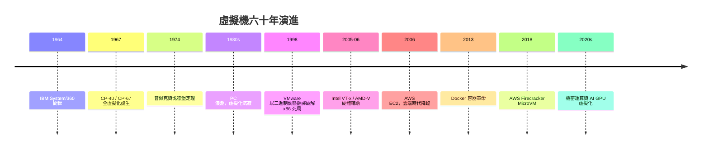

# 前言：幻覺的最高境界——虛擬機如何用程式碼在矽晶片上創造無數個平行世界

## 一個石破天驚的問題

1974 年，兩位 IBM 研究員傑拉爾德·普佩克（Gerald J. Popek）與羅伯特·戈德堡（Robert P. Goldberg）在論文中提出了一個看似簡單、實則深刻的問題：

> **一台電腦，能不能在軟體裡「再造」出好幾台一模一樣的電腦，而且 guest 程式完全察覺不到自己活在幻覺之中？**

這個問題的答案，就是**虛擬機（Virtual Machine, VM）**。

## 什麼是虛擬機？

根據普佩克與戈德堡的經典定義，虛擬機是「**真實機器的一個高效、隔離的複製品（an efficient, isolated duplicate of a real machine）**」。這句話包含三個關鍵要素：

```text
1. 等效性（Equivalence）：在 VM 裡跑的程式，行為必須和跑在真實機器上完全一致
2. 資源控制（Resource Control）：VMM（虛擬機監視器）必須完全掌控實體資源
3. 效率（Efficiency）：絕大多數指令必須由硬體直接執行，不能事事都靠軟體模擬
```

而負責製造這場幻覺的魔術師，叫做 **Hypervisor**（也稱 VMM，Virtual Machine Monitor）。它的工作是：讓多個作業系統同時相信——

- 「我擁有這顆 CPU 的全部」
- 「我擁有從位址 0 開始的全部記憶體」
- 「我擁有這些磁碟、網卡、鍵盤與螢幕」

**全部都是精心編排的謊言。**

## 為什麼虛擬機如此重要？

### 1. 經濟面：從「一台機器一個用途」到「一台機器無限用途」

1960 年代的 IBM 主機要價數百萬美元，但平均使用率不到 20%。虛擬機讓一台機器同時服務數十個使用者與數十種工作負載。五十年後，同樣的邏輯催生了雲端運算：AWS EC2 本質上就是「把虛擬機切成小塊、按小時計費」的商品化革命。

### 2. 工程面：隔離是可靠性的基石

沒有隔離的系統，一個程式的錯誤會污染整台機器。虛擬機提供硬體級的故障邊界（fault boundary）——一個 guest 崩潰，其他 guest 毫髮無傷。這個思想後來演化出容器、MicroVM、Serverless，甚至瀏覽器裡的 WebAssembly。

### 3. 制度面：虛擬化改變了組織的權力結構

在實體機時代，IT 部門每申請一台伺服器都要走漫長的採購流程；虛擬化之後，開發者可以在幾分鐘內「創造」一台機器。**機器從資產變成了可拋棄的軟體物件**，這徹底改寫了企業 IT 的制度與文化。

## 本書的旅程



這段歷史中最迷人的部分，是**理論與現實的反覆拉鋸**：

- 理論告訴我們 x86 因為那幾個「不可虛擬化指令」而無法高效虛擬化 → 現實中 VMware 用二進制動態翻譯硬生生繞過它；
- 硬體廠商曾宣稱虛擬化無足輕重 → 十年後 Intel 與 AMD 卻被迫在矽晶片裡親手打造 Root Mode；
- 當所有人都以為 VM 是終點 → 容器與 MicroVM 又用更輕的方式重新發明隔離。

## 閱讀本書需要的預備知識

你不需要是作業系統專家，但以下三個概念會反覆出現：

| 概念 | 白話解釋 |
|------|----------|
| **特權等級（Ring 0–3）** | CPU 把指令分成「誰都可以跑」與「只有核心能跑」兩種，Ring 0 是最高權限 |
| **陷阱（Trap）** | guest 執行了特權指令時，CPU 把控制權交回 VMM 的機制——這是虛擬化的命脈 |
| **分頁（Paging）** | 把虛擬位址翻譯成實體位址的機制，記憶體虛擬化戰場的主戰場 |

---

> 接下來，讓我們回到 1960 年代那間充滿冷氣噪聲的 IBM 機房，
> 看看人類如何第一次學會：**在一台機器裡，創造一整個世界。**
