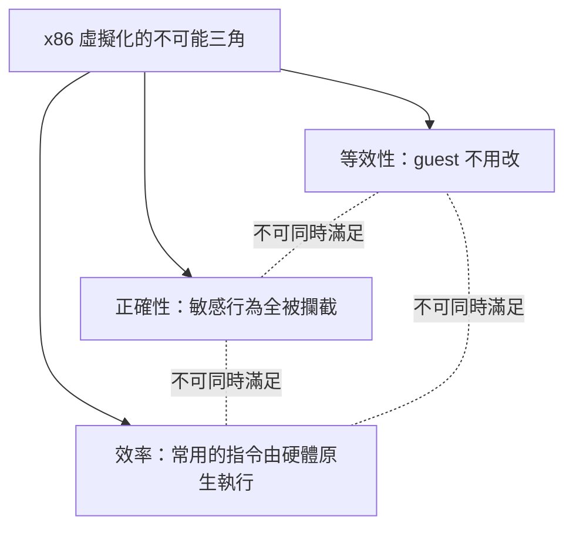

# 3.2 靜默失敗的噩夢：當 guest 試圖修改硬體狀態卻沒有報錯時

## 兩種失敗，天壤之別

工程師不怕失敗，怕的是**沒有訊號的失敗**。在虛擬化的脈絡下，x86 的致命缺陷要分成兩種來看：

```text
【會尖叫的失敗】Trap 可見的失敗
  guest 執行特權指令 → CPU 觸發 #GP（一般保護錯誤）→ VMM 攔截
  → 至少 VMM「知道」guest 想做什麼，可以模擬或回報。
  （系統可控，工程上可解決）

【靜默失敗】Silent Failure
  guest 執行敏感指令 → CPU 不觸發任何錯誤
  → 但行為與「在真正 Ring 0 上執行」不同（或洩露真實狀態）
  → VMM 根本不知道發生了什麼。
  （幻覺穿幫，且無法偵測）
```

## 一個具體的崩潰場景

讓我們看 Linux guest 核心啟動時會發生什麼。假設我們用「環壓縮（Ring Deprivileging）」法：guest 核心跑在 Ring 1，VMM 跑在 Ring 0。

```text
Linux 核心啟動序列（節選）：
  cli              ; 關閉中斷，準備修改關鍵資料結構
  …
  lgdt [新的GDT]   ; 載入自己的全域描述表
  …
  mov eax, CR0     ; 讀取控制暫存器
  or  eax, PG      ; 設定分頁位元…
```

在真實機器上，這些指令依序執行、天下太平。在 Ring 1 的虛擬環境下：

1. `cli` → 依 IOPL 設定，可能觸發陷阱（可處理），也可能**靜默無效**；
2. `popf` → **IF 旗標被靜默忽略**——guest 以為自己關了中斷，實際上中斷仍然每秒數百次打斷它；
3. 某些讀系統暫存器的指令 → 直接讀到**真實的** GDT/IDT 基址——guest 看見了幻覺舞台後面的鋼架。

結果：核心啟動到一半資料結構錯亂、中斷處理紊亂、隨機當機——**而且沒有任何錯誤訊息指向虛擬化**。除錯工程師面對的是「有時好有時壞」的靈異現象。

## 為什麼「偵測」也救不了？

理論上 VMM 可以「掃描 guest 程式碼、找出這些指令、逐一處理」——但這正是噩夢的第二層：

1. **無法靜態窮舉**：x86 指令流是有狀態的——同一串位元組，取指起點不同就是不同指令（前綴、ModRM、SIB 位元組的組合爆炸）。靜態掃描保證漏判。
2. **自修改程式碼**：guest 可以在執行中改寫自己的程式碼，昨天的掃描結果今天就作廢。
3. **動態載入**：作業系統隨時載入新驅動、新模組，敏感指令可能出現在任何時刻、任何位址。

## 效率的深淵：解釋器地獄

如果放棄「找出指令」而採用最笨的方案——**逐條解釋執行（interpretation）**每一條 guest 指令——倒是正確了，但：

```text
每一條 guest 指令 = 幾十條到幾百條 VMM 的 C 語言指令
整體效能 ≈ 原生速度的 1/10 至 1/100
```

1980 年代的 SoftPC 之類模擬器就是這樣：能跑，但慢到讓人懷疑人生。**鐵律三（效率）宣告死刑。**

## 三難困境

把所有約束放在一起，x86 虛擬化的困境可以畫成一個不可能三角：



- **要正確** → 逐條解釋 → 慢到不可用（犧牲效率）；
- **要效率** → 讓指令直接跑 → 敏感指令靜默失敗（犧牲正確性）；
- **要兩者** → 修改 guest OS 原始碼 → 但 DOS/Windows 拒絕合作（犧牲等效性/相容性）。

## 學術界的共同結論

到 1990 年代中期，作業系統教科書與虛擬化文獻的共識已經定型：

> **x86 是「不可虛擬化」的架構。想在 PC 上做虛擬化，只有兩條路：慢如蝸牛的模擬，或者（不可能拿到的）修改封閉原始碼的許可。**

這個結論寫進了論文、教材與業界常識。連 Intel 自己的文件都暗示：x86 的保護模型不是為虛擬化設計的。

> **歷史關聯**：常識之所以為常識，是因為所有人都站在同一個框架裡思考——「攔截」與「翻譯」只能二選一。下一章的主角將證明：框架本身才是錯的。
