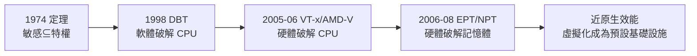

# 5.3 記憶體虛擬化的終極加速：從影子頁表到硬體級 EPT / NPT

## 記憶體：虛擬化最後的硬骨頭

CPU 虛擬化被 VT-x 解決後，戰場只剩記憶體。問題在於**位址要翻譯兩次**：

```text
guest 的視角：
  guest 虛擬位址 (GVA) --guest頁表--> guest 實體位址 (GPA)
  （guest 以為 GPA 就是真實記憶體）

真實硬體的要求：
  必須翻到 host 實體位址 (HPA) 才能存取 DRAM

完整鏈條：
  GVA --guest 頁表--> GPA --VMM 映射--> HPA
  兩次查表，一次在 guest 手上，一次在 VMM 手上
```

x86 的 MMU 硬體只會做**一次**頁表查找。軟體必須想辦法偽造出「一次搞定」的假象。

## 第一代：影子頁表（Shadow Page Tables）

軟體路線的經典解法——**VMM 餵給硬體一份假的頁表**：

```text
影子頁表的把戲：
  guest 建立自己的頁表（GVA→GPA）      ← 存在但硬體不用
  VMM 拿著 guest 頁表，動手「翻譯合併」：
    GVA→GPA→HPA 合併成 GVA→HPA
    得到一份「影子頁表」               ← 硬體真正使用的
  CR3 暫存器由 VMM 掌控，guest 看到的是自己 CR3 的幻影
```

功能正確，但代價殘酷：

1. **同步開銷**：guest 每次修改自己的頁表（載入新程序、換 CR3），VMM 都要捕捉、更新影子頁表。頁表修改恰恰是作業系統最頻繁的操作之一；
2. **寫保護陷阱**：為了捕捉 guest 對頁表的修改，VMM 常把 guest 頁表設為唯讀，每次寫入都觸發 #PF 陷阱——**每個程序的切換都在製造陷阱風暴**；
3. **記憶體占用**：每個 guest 的每份頁表都要一份影子副本，記憶體膨脹嚴重。

工作負載越重、程序切換越頻繁，影子頁表的開銷越驚人——某些惡劣場景下效能損失可達 **30% 以上**。**記憶體虛擬化成為整條虛擬化流水線上最粗的水管瓶頸。**

## 第二代：硬體級二級位址翻譯

2006 年前後，兩家硬體廠再次出手，把「兩級翻譯」直接做進 MMU：

```text
Intel EPT（Extended Page Tables，Nehalem 世代全面普及，2008 前後）
AMD NPT / RVI（Nested Page Tables / Rapid Virtualization Indexing，2006 Opteron 起）

硬體新增的概念：
  guest 的頁表不再是「假象」，GPA 成為真實存在的硬體位址層
  MMU 硬體自動完成：
    GVA --guest頁表--> GPA --EPT/NPT--> HPA
  兩級查表全部由硬體完成，VMM 不再需要任何「影子」
```

效果立竿見影：

| 項目 | 影子頁表 | EPT / NPT |
|------|---------|-----------|
| 頁表同步 | 軟體陷阱＋重算，昂貴 | **不需要**，硬體自洽 |
| guest 改頁表 | 觸發陷阱風暴 | 直接執行，無感 |
| 額外記憶體 | 每份頁表一份影子 | 無影子，僅 EPT 結構本身 |
| 典型記憶體虛擬化開銷 | 高（惡劣場景 30%+） | 大幅下降（普遍個位數） |

VMM 的程式碼也因此大幅瘦身：KVM 等新的 hypervisor 在有 EPT/NPT 的機器上**乾脆不實作影子頁表**。

## 陰影中的代價：TLB 與 TLB shootdown

硬體二級翻譯並非零成本：

1. **查表深度加倍**：每次位址翻譯要過兩層頁表，miss 時最壞要走 24 次記憶體存取（4 層 guest 頁表 × 4 層 EPT）；
2. **TLB 快取成生命線**：硬體 TLB 快取翻譯結果緩解了這個問題，但 guest 與 host 的頁表都要占 TLB；
3. **新指令救場**：Intel 隨後加入 **VPID**（Virtual Processor Identifiers）與 **PCID**，讓不同虛擬機/位址空間的 TLB 條目可以共存，減少切換時的全量清洗（TLB shootdown）。

硬體、微架構、指令集三層聯手，記憶體虛擬化開銷最終被壓到近原生水準。

## 大局觀：完整拼圖



至此，x86 虛擬化的兩大硬骨頭——CPU 與記憶體——全部由硬體消化。I/O 虛擬化（SR-IOV，見第 10 章）將是下一場戰役，但那是 AI 時代的篇章。

**有了近原生的效能，虛擬機才有資格成為「商品」。** 而商品化的舞台，已經在亞馬遜的資料中心裡搭好——2006 年，AWS EC2 即將上線。

> **歷史關聯**：EPT/NPT 與 1967 年 CP-40 的兩級位址翻譯遙相呼應——同一個概念，軟體做了四十年，最終刻進矽。歷史不是直線前進，而是把正確的想法反覆落實到更低的層次。
