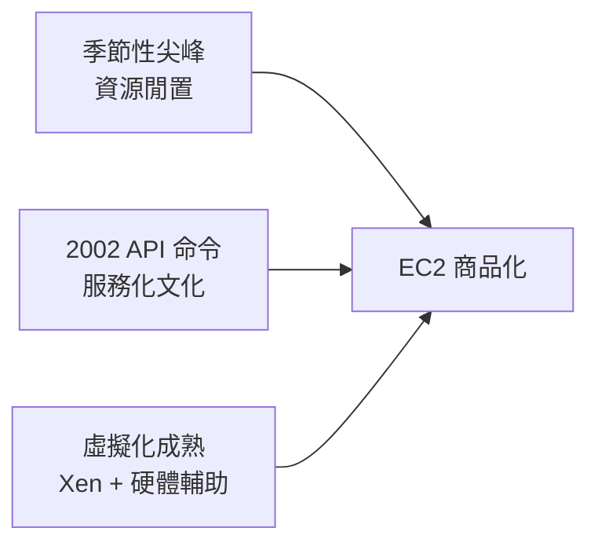

# 6.2 2006 年 AWS EC2 上線：把虛擬機變成像水電一樣隨取隨用的商品

## 一家賣書的公司，賣起了運算力

2006 年 3 月，Amazon 發布 **S3**（儲存服務）；2006 年 8 月 25 日，**EC2（Elastic Compute Cloud）** 公開 beta 上線。一家線上書店，開始向全世界出租虛擬機。

定價與規格今天看來古樸得可愛：

```text
EC2 初期規格（2006）：
  m1.small：1 個 EC2 Compute Unit（≈1.0-1.2 GHz x86）、1.7 GB 記憶體、
            160 GB 磁碟
  價格：每小時 0.10 美元
  作業系統：Linux（Fedora Core 系）
  付費方式：按小時計，用多少付多少，無最低消費、無合約
```

**每小時十分美元，刷卡即用，不用簽約，不用採購伺服器，不用建機房。**

## 為什麼是亞馬遜？

雲端運算的技術要素（虛擬化、分散式儲存、API 化）2006 年前都已存在，但只有亞馬遜把它們組裝成商品。原因藏在亞馬遜自己的組織痛點裡：

1. **季節性尖峰**：黑色星期五與聖誕季的流量是平日的十倍，亞馬遜被迫全年養著為尖峰準備的基礎設施——**其餘十個月，這些機器閒得發慌**。這是 CP-40 問題的亞馬遜版：昂貴資源在發呆；
2. **內部架構的教訓**：2001 年前後，亞馬遜的工程體系被單體式架構與跨團隊依賴折磨。執行長貝佐斯在 2002 年前後發出著名的「API 命令」（常被稱為 API Mandate）：**所有團隊必須透過服務介面溝通，介面必須設計成可對外開放的形態**。這場內部制度革命，讓「把基礎設施做成 API 商品」成為組織本能；
3. **零售基因**：亞馬遜最擅長的就是「把庫存切片、定價、零售」。EC2 不過是把「運算力」當成倉庫裡的商品。



## 技術棧：EC2 的引擎是 Xen

初代 EC2 的 hypervisor 是**開源的 Xen**（而非 VMware）：

- Xen 的半虛擬化在當時對 Linux guest 效能極佳，且**授權免費**——對「按小時 0.1 美元」的零售生意，成本結構就是生死線；
- Amazon 之後投入大量工程資源改造 Xen（後續演化出 Nitro 系統，見第 9 章），證明**雲端巨頭的競爭力在於對虛擬化技術的自有掌控**；
- KVM 也在此後成為部分場景（如 .metal 與 Nitro 路線）的重要選項，開源 hypervisor 成為雲端的地基。

## 觀念革命：「機器」變成了「帳單上的兩行字」

EC2 真正的殺傷力不在技術，而在**觀念**：

```text
舊觀念：伺服器 = 資產
  採購流程、折舊年限、機房位置、報廢手續
  建一個網站後端要準備 6-12 個月

EC2 觀念：伺服器 = 按小時計費的軟體物件
  一條 API 呼叫，10 分鐘後 100 台機器就緒
  用完即棄，帳單月結
  「不可變基礎設施」「基礎設施即程式碼」由是而生
```

三個由此誕生的文化現象：

1. **創業成本的雪崩**：初創公司不再需要天使投資人買伺服器，幾百美元月租即可上線——這是 2010 年代創業潮（Y Combinator 熱潮、獨角獸井噴）的基礎設施前提；
2. **DevOps 誕生**：2009 年前後，「開發與維運合一」的 DevOps 運動，其物質基礎正是「機器可以程式化建立與銷毀」；
3. **企業的上雲猶豫與轉向**：安全性、合規、供應商鎖定的爭論持續十年，最終「不去雲端」反而成為需要論證的異端。

## 競爭者被迫上桌

EC2 證明商業模式後，巨頭們的追趕：微軟 Azure（2010 年公告、正式商業化 2013）、Google Compute Engine（2012 公測、2013 GA），以及更早的 Rackspace 與 2010 年的 OpenStack 開源聯盟。**雲端運算從一家公司的實驗，變成數兆美元產業的地基。**

> **歷史關聯**：EC2 是 CP-40 哲學的終極形態——「讓昂貴資源被充分共享」，只是共享的半徑從一棟大樓擴大到整個地球。而雲端的規模效應，即將把 hypervisor 從商業軟體變成公共基礎設施，引發王座之戰。
