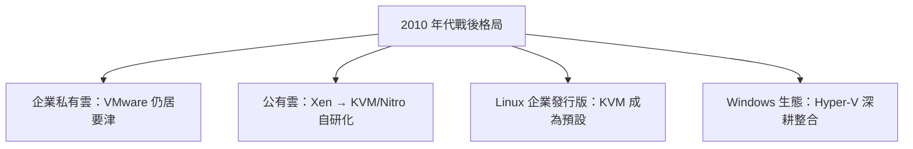

# 6.3 雲端大戰的硝煙：VMware、Xen、KVM 與 Hyper-V 的王座爭奪

## 四強的性格：四種制度土壤的四種哲學

到 2010 年前後，x86 hypervisor 戰場上站著四個性格迥異的玩家。他們的技術路線，其實是各自**制度環境**的產物：

| 玩家 | 誕生 | 技術哲學 | 商業模式 | 制度背景 |
|------|------|----------|----------|----------|
| **VMware ESX** | 1998–2001 | 閉源、全虛擬化、DBT 起家後轉硬體輔助 | 高價企業授權＋訂閱 | 矽谷創投文化的極致 |
| **Xen** | 1998 劍橋大學起 | 半虛擬化先行，後補 HVM | 開源＋Citrix 商業版 | 英國學術研究＋開源社群 |
| **KVM** | 2006 以色列 Avi Kivity | 把 hypervisor 做成 Linux 核心模組 | 開源，紅帽力捧 | Linux 核心社群＋企業開源商業模式 |
| **Hyper-V** | 2008 | 內建於 Windows Server，微核心化 parent partition | 搭售 Windows 授權 | 微軟平台壟斷的防禦性反擊 |

## Xen：學術出身的第一雲端引擎

**伊恩·普拉特（Ian Pratt）** 與 **基爾·弗雷澤（Keir Fraser）** 領導的劍橋大學計算機實驗室團隊，在 1990 年代末的 Xenoserver 專案中孕育出 Xen hypervisor，2003 年首次公開發表。它的成名絕技是**半虛擬化（paravirtualization）**：

```text
Xen 的早期哲學（2003–2006）：
  既然 x86 無法高效全虛擬化（當時無硬體輔助），
  那就修改 guest 核心：
    敏感指令 → 改為顯式呼叫 hypercall 介面
  Linux 是開源的，改起來理直氣壯
  Windows 是封閉的 → Xen 早年根本不支援 Windows
```

2006 年 VT-x/AMD-V 普及後，Xen 加入 **HVM（Hardware Virtual Machine）** 模式支援未修改的 Windows；AWS EC2 選擇 Xen 建雲（成本＋效能＋開源可控），Xen 一度運行著全球最大規模的公有雲。

## KVM：一場「寄生」的勝利

2006 年，以色列程式設計師 **阿維·基維提（Avi Kivity）** 發表 KVM：一個只有幾千行程式碼的 Linux 核心模組，把 Linux 核心本身變成 hypervisor。

```text
KVM 的天才之處：
  不另造一個 hypervisor 生態，而是「寄生」在 Linux 上——
  程序排程、記憶體管理、裝置驅動、安全模組……全部白嫖現成的
  每個虛擬機 = 一個普通的 Linux 程序（QEMU 作為使用者態夥伴）
```

2007 年 KVM 被合併進 Linux 核心主線（2.6.20），這是決定性的一步：**數千名核心開發者的持續供血**。紅帽（Red Hat）在 2008 年收購 Qumranet（KVM 母公司），並於 2010 年代初逐步以 RHEL 的 KVM 取代內建的 Xen——企業開源陣營完成了站隊。

## Hyper-V：帝國的防禦戰

微軟的反擊帶著濃厚的平台戰略色彩：2008 年 **Hyper-V** 隨 Windows Server 2008 出貨，幾乎**免費**搭售。策略明確：

```text
1. 你已經付了 Windows 授權費 → hypervisor 白送
2. 與 Active Directory、System Center、SCVMM 深度整合
3. 用管理生態綁住企業（微軟的看家本領）
```

Hyper-V 從未在「中立客戶」市場撼動 VMware，但在 Windows 為中心的企業中攻下大片堡壘，也成為 Azure 雲端的技術基座之一。

## VMware：守成者的黃金與焦慮

VMware 在 2010 年前後握有 x86 企業市場約七至八成份額，vSphere 套件（vCenter、vMotion、HA、DRS）定義了「軟體定義資料中心（SDDC）」的標準。但三重焦慮揮之不去：

1. **定價反噬**：授權費成為客戶採用開源替代品的最大動機；
2. **雲端繞道**：公有雲用 Xen/KVM 起家，VMware 市場的天花板被雲端直接壓縮；
3. **母公司包袱**：EMC 聯邦的體制直到 2016 年 Dell 併購 EMC 後才鬆動，期間錯過數次雲端轉型的窗口。

## 戰後格局：沒有贏家，只有分層



王座之戰的結局耐人尋味：**沒有任何人「贏」，而是戰場本身消失了**——hypervisor 從「產品」降格為「基礎設施的螺絲釘」。雲端巨頭把它藏進服務背後，企業用容器與 Kubernetes 把它抽象掉（見第 7、8 章）。**當一項技術真正成功時，它會從聚光燈下消失。**

> **歷史關聯**：四大 hypervisor 的混戰驗證了開源與平台經濟的雙重規律：KVM 靠「寄生於 Linux 核心」以最小工程成本獲得最大生態供血；Hyper-V 靠搭售把對手拖進價格戰；VMware 則證明純粹的技術領先無法永遠抵擋制度性的成本優勢。而用戶端更深的變革正在醞釀——既然 hypervisor 已是螺絲釘，那我們能不能乾脆不打包整台機器？
