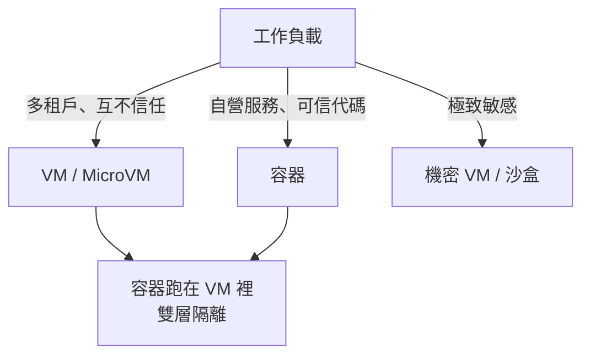

# 7.3 容器與虛擬機的哲學辯論：安全性與開銷的永久權衡

## 辯論的核心：隔離邊界在哪裡？

容器與虛擬機的根本分歧，用一張剖面圖說盡：

```text
【虛擬機】
  應用A | 應用B | 應用C
  ------ guest OS ------   ← 每個 VM 一份完整核心
  ------ hypervisor ------ ← 隔離邊界：硬體級
  ------ host 核心 ------   ← guest 核心的 bug 打不穿 hypervisor

【容器】
  應用A | 應用B | 應用C
  ------ host 核心 ------   ← 隔離邊界：核心內的機制
  系統呼叫直接進入與 host 共用的同一顆核心！
```

**共享核心是容器效率的來源，也是容器安全的原罪。**

## 容器的攻擊面：為什麼安全專家皺眉

### 1. 核心攻擊面全暴露
host 核心的數千萬行程式碼中，**任何一個可被系統呼叫觸發的漏洞**，都是容器逃逸（container escape）的潛在通道。虛擬機 guest 則要先打穿 hypervisor——攻擊面小得多。

### 2. 核心漏洞的「全船沉沒」問題
2016 年的 **Dirty COW**（CVE-2016-5195）核心提權漏洞是經典教材：修補前，宿主機上**所有**容器共享同一個脆弱核心——一個容器被攻破，攻擊者即獲得核心級權限，全機淪陷。VM 世界裡，這個漏洞只會波及單一 guest。

### 3. 歷史上的真實逃逸事件
Docker 早年有多起真實的容器逃逸漏洞（如 2019 年 runc 的 CVE-2019-5736：惡意容器可覆寫 host 上的 runc 執行檔、取得宿主機 root）。每一次都重演同一個劇本：**共享核心 = 共享命運**。

### 4. 預設配置的誘惑
Docker 預設需要 root 權限執行守護行程，且早期預設設定寬鬆（如 `--privileged`、掛載 docker.sock、預設網橋互通）。**易用性與安全性永遠在拔河**，而預設值往往站在易用那邊。

## 反方辯護：容器安全的進化

容器陣營的反駁同樣有力：

1. **攻擊面不等於被攻破**：namespaces（尤其 user namespace 的 root 映射）、seccomp（系統呼叫過濾）、AppArmor/SELinux、capabilities 裁剪、rootless 容器——層層縱深防禦讓核心攻擊面大幅縮小；
2. **VM 也有 hypervisor 漏洞**：2015 年後 VenKAT、XSA 系列、Spectre/Meltdown（2018）等側通道攻擊證明，**硬體邊界也會漏**。跨 VM 的側通道資訊洩露成為新的噩夢（這直接催生了第 9 章的機密運算）；
3. **實務統計**：絕大多數容器安全事故源自**配置錯誤與供應鏈污染**（映像裡帶了毒），而非核心逃逸——治理與流程比邊界更關鍵。

## 現代共識：不是二選一，而是分層混搭

辯論的最終走向是務實的分層：



主流雲端與企業的實踐：**容器一律跑在 VM 裡**（雲端節點本身是 VM），形成「VM 包容器」的雙層結構；對外部使用者的不可信代碼（Serverless、CI 執行器、瀏覽器沙盒），則用 MicroVM 或強化沙盒（第 8 章）。**VM 的角色從「一應用一機器」變成「安全底座」。**

## 經濟學視角：權衡的真面目是「信任等級的定價」

把辯論抽象成經濟學，權衡的本質是**為信任等級定價**：

```text
信任假設              隔離技術      單位成本      適用場景
完全可信（自家代碼）    無/程式庫隔離  ≈ 0          函式、模組
同一團隊的多服務        容器          極低         微服務
同一企業的多團隊        容器＋硬性配額  低          企業內部平台
陌生多租戶             VM/MicroVM    中           雲端 IaaS、Serverless
國家級威脅/高機密       機密運算       高           金融、醫療、政府
```

**每一層防禦都有價格，而工程師的工作是替公司的風險承受度買單。** 這場辯論沒有終局——攻擊技術、硬體能力、與制度信任的每一次演進，都會重新定價。

> **歷史關聯**：這場辯論可視為 1974 年戈德堡「共享、模擬、安全」三分法在雲原生時代的再上演：容器把「共享」推到極致，MicroVM 把「安全」以「共享」的成本實現。而當 Serverless 要求兩者兼得時，歷史迎來了 Firecracker。
