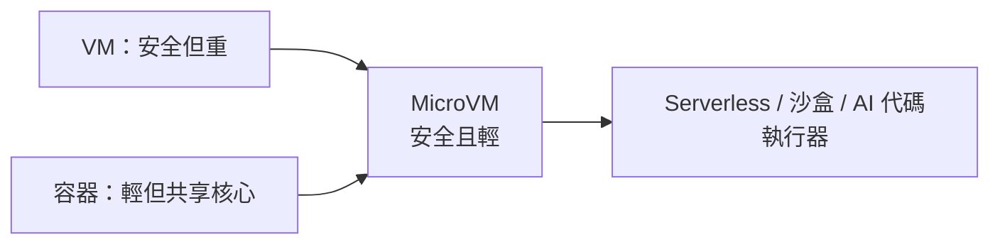

# 8.2 AWS Firecracker 與 Google gVisor：為多租戶隔離而生的超輕量 MicroVM

## Firecracker：一台 125 毫秒的虛擬機

2018 年 11 月（re:Invent 前後），AWS 開源了 **Firecracker**——Lambda 與 Fargate 的底層引擎。它的定位精準：**基於 KVM 的極簡 MicroVM 監視器**，專為「高密度、短生命週期、多租戶」而設計。

```text
Firecracker 的設計取捨：
  ✔ 極簡裝置模型：僅 virtio-net、virtio-block、
                  加上後來的 vsock 與少數週邊
  ✔ 極簡管理介面：一個 Unix socket 上的 REST API，約二十個端點
  ✔ 極小 VMM：單一 Rust 程序，常駐記憶體 < 5 MB
  ✔ 硬體輔助：直接建在 KVM（Linux 核心的虛擬化子系統）之上
  ✘ 刻意不做：熱遷移（VMotion 類）、複雜裝置直通、
             通用桌面級裝置模擬
```

用 Rust 重寫也是深思熟慮：記憶體安全語言從根源削掉一大類 C 語言常見的漏洞——對「承載陌生租戶代碼」的 VMM 而言，VMM 自身的漏洞就是邊界的破洞。

**成效**：單台主機可承載數千個 MicroVM，VM 啟動約 125 毫秒，承載了 Lambda 與 Fargate 的大部分流量。2018 年之後，整個行業跟進：Cloudflare Workers 對比研究、Fastly Compute@Edge、Fly.io（以 Firecracker 為底）、Modal、E2B 等 AI 沙盒服務，以及 Knative/開源 FaaS 陣營的後端選項，MicroVM 成為新的基礎設施類別。

## gVisor：另一條路——「在核心與容器之間插入一個假核心」

Google 的答案走了不同的哲學。**gVisor**（2018 開源，Google App Engine/Cloud Functions 的內部基礎）的思路：**在應用與 Linux 核心之間，插入一個用 Go 寫成的「使用者空間核心」（Sentry）**。

```text
gVisor 架構：
  容器內的應用
    ↓ 發出系統呼叫
  Sentry（使用者態的「假核心」，實作 Linux 系統呼叫介面）
    ↓ 以受限的方式（僅少數被允許的介面）存取真核心
  host Linux 核心

效果：應用看到的「Linux」是 Sentry 模擬的
      惡意系統呼叫永遠碰不到真核心
```

與 Firecracker 的對照是一堂架構哲學課：

| 維度 | Firecracker | gVisor |
|------|-------------|--------|
| 隔離機制 | 硬體虛擬化（KVM） | 使用者態系統呼叫攔截＋核心限制 |
| 效能 | 接近原生（絕大多數指令直通） | 系統呼叫密集型負載有可觀開銷 |
| 兼容性 | 需要自己的 guest 核心 | 標準 Linux 介面，應用無感 |
| 適合 | 完整 VM 語義、高密度 | 容器化工作負載的沙盒強化 |

Google 還有 **Kata Containers** 路線（源自 Intel Clear Containers 與 Hyper.sh 的合併，2019 進入 OpenInfra 基金會）：**用輕量 VM 包住每個容器**，OCI 介面不變、底下換成 VM——「容器的外表，VM 的靈魂」。三大路線（Firecracker、gVisor、Kata）殊途同歸：**把 VM 級隔離做到容器級的輕與快。**

## Nitro 系統：MicroVM 思想的雲端化終點

同一時期，AWS 完成了一场 quieter 的革命：**Nitro 系統**（2017 前後全面鋪開）。思路是把 hypervisor 的職能**逐步下放到專用硬體**：

```text
Nitro 的分層：
  Nitro Cards（專用 ASIC/NIC）：網路、儲存、安全監控
  Nitro Security Chip：硬體鎖定與最小特權監控
  Nitro Hypervisor：基於 KVM 的極薄層，只做 CPU/記憶體分配
                    I/O 幾乎全部交給硬體直通

結果：hypervisor 變薄 → 開銷趨近於零
      EC2 效能逼近裸機（bare metal）
```

Nitro 與 Firecracker 是同一哲學的兩個面向：**hypervisor 越薄越好，能給硬體的都給硬體。** 而 Nitro 的安全監控與記憶體加密能力，也為第 9 章的機密運算埋下伏筆。

## MicroVM 的時代意義



MicroVM 解決了本書開頭提出的原始問題的現代版本：**如何用近乎零的成本，創造一個真正隔離的平行世界？** 答案歷經六十年的演化：先靠硬體指令集（大型機）、再靠軟體翻譯（VMware）、再靠晶片重構（VT-x）、最後靠「把 hypervisor 削到只剩本質」（Firecracker）。

> **歷史關聯**：Firecracker 的每一個「不做」都是對六十年經驗的提煉。而隔離層次還能再往下——不隔離機器、甚至不隔離核心，只隔離「應用的指令集」？WebAssembly 把這場遊戲帶到了最深的一層。
