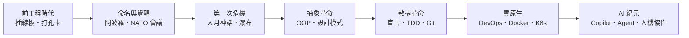

# 前言：無形鋼鐵的建造者——軟體工程如何成為支撐現代文明的隱形骨架

> 「軟體正在吃掉世界。」——馬克・安德森，2011

## 一、看不見的工程

現代文明的每一次心跳都由軟體驅動：你昨晚的轉帳、今早的天氣預報、手機的每一次解鎖、醫院的每一份處方、飛機的每一次起降。可當你伸手觸摸，什麼都摸不到——軟體是**無形的鋼鐵**，沒有重量、沒有形狀，卻承載著人類史上最龐大的工程系統。

但「軟體工程」這門學科並非天賜。它是八十年間、幾代人在**一次次災難與危機**中用血淚換來的：專案失控、預算爆炸、系統崩潰、火箭墜毀。每一次危機都逼出一種新紀律——編譯器、結構化程式設計、版本控制、測試框架、敏捷方法、持續交付、容器化、AI 輔助。這本書講的就是這條紀律的演化史。

## 二、本書的主角：人

工程史容易寫成工具史，但本書的主角始終是**人**：那個想讓機器替她寫低階代碼的葛麗絲・霍普；那個在登月前 1202 警報中賭上職業生涯的瑪格麗特・漢密爾頓；那個說「向延誤的專案加人只會更延誤」的布魯克斯；那個自己都不知道論文會被誤讀成教條的羅伊斯；在雪鳥滑雪勝地簽下四行字反抗官僚的十七個人；被 BitKeeper 斷供逼得十天寫出 Git 的林納斯・托瓦茲；以及 2024 年站在舞台中央、被問「AI 會取代你嗎」的每一位工程師。

他們的共同點從未改變：面對複雜性，他們選擇**建立紀律**，而不是祈禱奇蹟。

## 三、一條主線：複雜性的軍備競賽

如果只能用一個角度縱觀全書，那就是：**人類始終在與複雜性賽跑，而每一次賽跑的轉折點，都是「把某件事交給機器，把判斷留給自己」**。

- 交出「翻譯」（編譯器），贏得生產力；
- 交出「記憶」（版本控制），贏得協作；
- 交出「重複」（測試與 CI），贏得品質；
- 交出「部署」（DevOps 與容器），贏得速度；
- 如今交出「打字」（AI 生成），贏得——什麼？

最後這一問是第十章與第十一章的主題，也是本書寫作的當下理由。歷史提供的答案一貫明確：工具每上移一層抽象，工程師的價值就上移一層判斷。被交出去的從來不是職業，只是職業中「可被規格化的那一部分」。

## 四、閱讀路線

全書五篇、十一章、三十三節，嚴格依時間軸推進：

1. **前工程時代與術語誕生**（1940s–1960s）：打孔卡、霍普的編譯器、漢密爾頓的阿波羅。
2. **第一次軟體危機**（1968–1970s）：NATO 會議、GOTO 有害論、人月神話、瀑布的誤讀。
3. **抽象革命**（1980s–1990s）：Smalltalk、C++/Java、設計模式、重構、UML 狂熱。
4. **敏捷與雲原生**（2001–2010s）：敏捷宣言、Scrum/XP/Kanban、TDD、Git、GitHub、DevOps、Docker、Kubernetes。
5. **AI 紀元**（2020s–至今）：Copilot、提示詞工程、Agent、以及「什麼是機器無法取代的核心」。

所有故事皆有史實依據——有趣的傳說（飛蛾與 Bug、火車上的 JUnit）只講真的版本。資料取自原始論文、當事人自述與可信的歷史研究；對於尚在發生的 AI 革命，本書標明每個數據的來源與限制，不為當下下過早的斷語。

讓我們從一台需要「插線」才能編程的巨獸開始。
